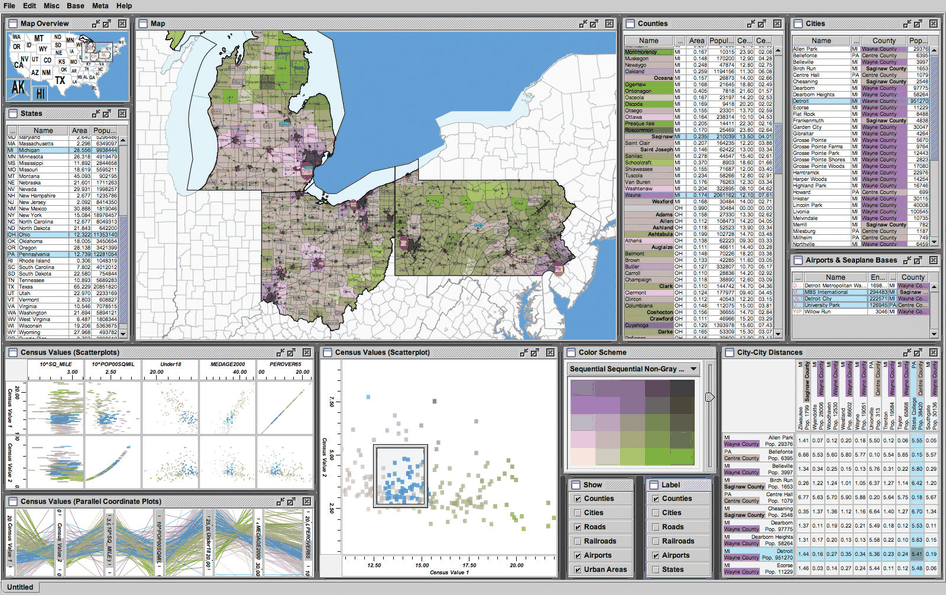

# Improvise

## Idiom box

No idiom box in the book.

The book describes Improvise in a System box rather than an Idiom box; its fields are quoted here [p.303].

<!-- verbatim p.303 -->
> What: Data Geographic and multidimensional table (census data): one key attribute (county), many quantitative attributes (demographic information).
<!-- /verbatim -->

<!-- verbatim p.303 -->
> How: Encode Scatterplot matrix, parallel coordinates, choropleth map with size-coded city points, bird’s-eye map overview, scatterplot, reorderable text lists, text matrix. Bivariate sequential–sequential colormap.
<!-- /verbatim -->

<!-- verbatim p.303 -->
> How: Facet Partition: small-multiple, multiform, overview–detail views; linked highlighting.
<!-- /verbatim -->

The System box gives no Why: Tasks or Scale field [p.303].

## What it is

A census vis built with the Improvise toolkit, which has many forms of coordination between views (Figure 12.7) [p.302]. Each county carries geographic information plus population, density, genders, median age, percentage change since 1990 and proportions of major ethnic groups [p.302].

- **Multiform views.** Geographic, scatterplot, parallel coordinate, tabular and matrix views all share one bivariate sequential–sequential colour encoding, with a legend in the bottom middle [p.302].
- **Small multiples.** A scatterplot matrix in the lower left shows a different pair of attributes in each scatterplot; reorderable list views from partitioning the data by attribute allow direct sorting by, and selection within, an attribute of interest [pp.302-303].
- **Linked highlighting.** All views are linked by highlighting; the blue selected items are close together in some views and spread out in others [p.302].
- **Overview–detail.** A small overview map in the upper left has linked navigation to the large geographic detail view in the top middle [p.303].

## Use when / avoid when

The book gives no explicit use or avoid conditions for Improvise; it presents it as an example of how complex systems combine coordination methods [pp.301-302].

- Complex systems use the coordination methods in combination, so the book uses multiform to mean only that at least one pair of views differs [p.301].
- Multiform views with different spatial layouts can share one colour coding, a shared encoding through the colour channel, as all of Improvise's views share one bivariate colormap [p.292] [p.302].

## Figures

-  **Figure 12.7** [p.302]. The Improvise toolkit [Weaver 04] was used to create this census vis that has many forms of coordination between views. It has many multiform views, some of which use small multiples, and some of which provide additional detail information. From <http://www.cs.ou.edu/∼weaver/improvise/examples/census>.

## Alternatives and disambiguation

- **Exploratory Data Visualizer (EDV)** is a smaller case whose System box lists only multiform views and linked highlighting [p.294].
- **Cerebral** also combines small multiples, multiform views and linked navigation, for network data partitioned by condition [p.299].
- **Bird's-Eye Maps** is the overview–detail map idiom that Improvise's upper-left map applies [pp.295-296] [p.303].

## Related

- [12.3.4 Combinations](../ch12-facet-into-multiple-views/s12-03-juxtapose-coordinate-views/s12-03-04-combinations.md): where Improvise is presented [p.302]
- [10.3.3 Bivariate Colormaps](../ch10-map-color-other-channels/s10-03-colormaps/s10-03-03-bivariate-colormaps.md): the shared colormap [p.302]
- [Bivariate Colormaps](bivariate-colormaps.md): the colormap's card [p.302]
- [Scatterplot Matrix (SPLOM)](scatterplot-matrix-splom.md): its small-multiple scatterplots [p.302]
- [Parallel Coordinates](parallel-coordinates.md): one of its multiform views [p.302]
- [Choropleth Map](choropleth-map.md): its geographic view [p.303]
- [Bird's-Eye Maps](birds-eye-maps.md): its overview map [p.303]

## Implementation hints [NOT FROM BOOK]

### matplotlib

```python
import numpy as np, matplotlib.pyplot as plt
rng = np.random.default_rng(4)
n = 150; age, density, change = rng.normal(40, 8, n), rng.lognormal(3, 1, n), rng.normal(5, 10, n)
sel = (age > 45) & (change > 0)                          # one selection, every view
color = np.where(sel, "tab:blue", "lightgray")
fig, axs = plt.subplots(2, 2, figsize=(8, 7))
axs[0, 0].scatter(age, density, c=color, s=8); axs[0, 0].set_yscale("log")
axs[0, 1].scatter(age, change, c=color, s=8)
axs[1, 0].scatter(density, change, c=color, s=8); axs[1, 0].set_xscale("log")
order = np.argsort(-change)[:15]                         # reorderable list view
axs[1, 1].barh(range(15), change[order], color=color[order]); axs[1, 1].invert_yaxis()
```

### D3

```js
import * as d3 from "d3";
// A tiny coordination hub: every view subscribes; selection and viewport are shared state.
const hub = d3.dispatch("select", "navigate");
hub.on("select.map", ids => d3.selectAll("#map path").classed("sel", d => ids.has(d.id)));
hub.on("select.splom", ids => d3.selectAll("#splom circle").classed("sel", d => ids.has(d.id)));
hub.on("navigate.detail", t => d3.select("#detail g").attr("transform", t));
```
