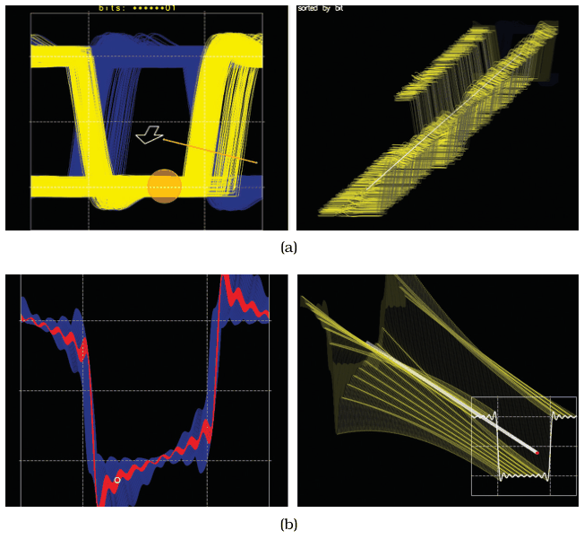

# Layer-Oriented Time-Series Vis

## Idiom box

No idiom box in the book.

The book presents it as the second worked example in Section 6.3.8, a system by Lopez-Hernandez et al. [p.153]. Summarised under the box facets:

- **What: Data.** Oscilloscope time-series data [p.153].
- **Why: Tasks.** The book does not state the task beyond visualising the oscilloscope traces; it presents the system as a case where 3D is used with care and is well justified [p.153].
- **How: Encode.** Starts from the traditional eye diagram, with the signal wrapped around in time as many overlapping traces; users spread the traces apart into layers with the metaphor of opening a drawer [p.153].
- **How: Manipulate.** Layers are orthographically projected and always face the viewer; navigation complexity is controlled by automatically zooming and framing as the user adjusts the drawer's orientation [p.153].

## What it is

<!-- verbatim p.153 -->
> Figure 6.8 shows an example that is similar on the surface to the previous one, but in this case 3D is used with care and the design is well justified [Lopez-Hernandez et al. 10].
<!-- /verbatim -->

<!-- verbatim p.153 -->
> This drawer interface does use 3D, but with many constraints.
<!-- /verbatim -->

The constraints are the point: orthographic projection, layers that always face the viewer, and automatic zooming and framing are designed to avoid the difficulties of unconstrained 3D navigation (Figure 6.8(b)) [p.153].

## Use when / avoid when

- **Use** when overlapping traces in an eye diagram need to be spread apart, letting the user evolve the view from the traditional diagram (Figure 6.8(a)) [p.153].
- **Use** as the book's example of 3D that is justifiable even for abstract data because it is used with many constraints [pp.152-153].
- The book states no conditions for avoiding it [p.153].

## Figures

-  **Figure 6.8** [p.153]. Careful use of 3D. (a) The user can evolve the view from the traditional overlapping eye diagram with the metaphor of opening a drawer. (b) The interaction is carefully designed to avoid the difficulties of unconstrained 3D navigation. From [Lopez-Hernandez et al. 10, Figures 3 and 7].

## Alternatives and disambiguation

- **Cluster–Calendar Time-Series Vis.** Also time series, but it removes 3D in favour of linked 2D views and derived clusters; this idiom keeps 3D and constrains it [pp.152-153].

## Related

- [6.3.8 Justification and Alternatives](../ch06-rules-thumb/s06-03-no-unjustified-3d/s06-03-08-justification-alternatives.md): the example in its context [p.153]
- [Cluster–Calendar Time-Series Vis](cluster-calendar-time-series-vis.md): the preceding example, which replaces 3D [p.153]
- [6.3.3 Occlusion Hides Information](../ch06-rules-thumb/s06-03-no-unjustified-3d/s06-03-03-occlusion-hides-information.md): the navigation costs of 3D that the constraints limit [p.153]
- [Constrained Navigation](constrained-navigation.md): chapter 11's navigation idiom, for comparison with this design's controlled navigation complexity [p.153]

## Implementation hints [NOT FROM BOOK]

### matplotlib

```python
import numpy as np, matplotlib.pyplot as plt
rng = np.random.default_rng(1)
period, n = 100, 12
t = np.arange(period * n)
signal = np.tanh(4 * np.sin(2 * np.pi * t / period)) + rng.normal(0, 0.08, t.size)
traces = signal.reshape(n, period)                     # eye diagram: wrap the signal in time
spread = 0.6                                           # 0 = overlapping eye diagram, 1 = drawer open
fig = plt.figure(figsize=(7, 5))
ax = fig.add_subplot(projection="3d", proj_type="ortho")
for k, tr in enumerate(traces):
    ax.plot(np.arange(period), np.full(period, k * spread), tr, lw=0.8)
ax.view_init(elev=20, azim=-60)
ax.set(xlabel="time in period", ylabel="layer", zlabel="volts")
```

### D3

No 3D in D3 itself. Draw each layer as a `d3.line()` path in its own `g`, and animate the drawer with a `d3.transition()` on `transform` from `translate(0,0)` (overlapping) to `translate(k*dx, -k*dy)` (spread), which keeps every layer facing the viewer as an orthographic offset. Fit the result with a `d3.zoom()` transform computed from the layers' bounding box.
