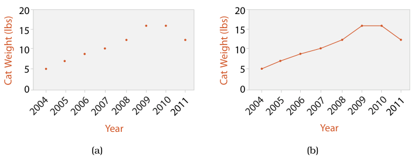
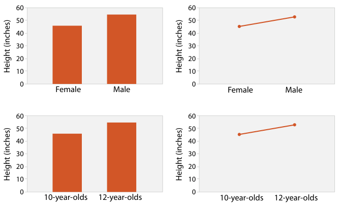
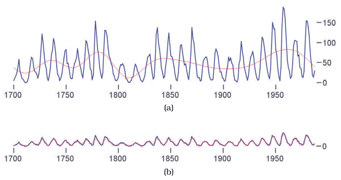

# Line Charts

## Idiom box

<!-- verbatim p.181 -->
> What: Data Table: one quantitative value attribute, one ordered key attribute.
<!-- /verbatim -->

<!-- verbatim p.181 -->
> How: Encode Dot chart with connection marks between dots.
<!-- /verbatim -->

<!-- verbatim p.181 -->
> Why Show trend.
<!-- /verbatim -->

<!-- verbatim p.181 -->
> Scale Key attribute: hundreds of levels.
<!-- /verbatim -->

The Why field has no "Task" label in the book [p.181].

## What it is

Line charts augment dot charts with line connection marks running between the points [p.180]. In Figure 7.8(b), the connecting lines emphasise a cat's steadily increasing weight, followed by loss after a diet in 2010 [p.180]. Line, dot and bar charts all show one value attribute and one key attribute with a rectilinear layout, and are often augmented with a second categorical attribute shown with colour or shape [p.181]. The connection marks emphasise the ordering of items along the key axis by showing the relationship between one item and the next, so line charts imply trends more strongly [p.181].

<!-- verbatim p.181 -->
> Line charts should be used for ordered keys but not categorical keys.
<!-- /verbatim -->

A line chart of categorical data violates the expressiveness principle, because it implies a trend where none can exist, and the implication is strong enough to override common knowledge [p.181]. In Zacks and Tversky's study, line charts of categorical data elicited answers such as "The more male a person is, the taller he/she is" [p.181].

## Use when / avoid when

- **Use** for spotting trends over an ordered key attribute [p.181].
- **Avoid** for categorical keys [p.181]. Bar charts encourage discrete comparisons instead of trend assessments [p.182].
- **Choose the aspect ratio** deliberately: many charting packages default to a square or other fixed size, which often hides dataset structure [p.181]. Angles are judged most accurately near exact diagonals, so banking to 45° picks the aspect ratio that puts the most line segments close to the diagonal [pp.181-182].
- **Multiscale banking to 45°** automatically finds a set of informative aspect ratios: it analyses the line graph in the frequency domain through the derived power spectrum. For the sunspot data, an aspect ratio near 4 shows the low-frequency cycle maxima, and one near 22 shows that cycles mostly rise more steeply than they decay [pp.182-183].

## Figures

-  **Figure 7.8** [p.180]. Line charts versus dot charts. (a) Dot charts use a point mark to show the value for each item. (b) Line charts use point marks connected by lines between them.
-  **Figure 7.9** [p.182]. Bar charts and line charts both encode a single attribute. Bar charts encourage discrete comparisons, while line graphs encourage trend assessments. Line charts should not be used for categorical data, as in the upper right, because their implications are misleading. After [Zacks and Tversky 99, Figure 2].
-  **Figure 7.10** [p.183]. Sunspot cycles. The multiscale banking to 45◦idiom exploits our orientation resolution accuracy at the diagonal. (a) An aspect ratio close to 4 emphasizes low-frequency structure. (b) An aspect ratio close to 22 shows higher-frequency structure: cycle onset is mostly steeper than the decay. From [Heer and Agrawala 06, Figure 5].

## Alternatives and disambiguation

- **Dot charts** drop the connection marks, so they do not imply a trend [pp.180-181].
- **Bar charts** suit categorical keys and discrete comparisons such as "Twelve year olds are taller than ten year olds" [p.181].
- **Streamgraphs** stack many time series as layers instead of drawing each against a common baseline [p.178].

## Related

- [7.5.1 List Alignment: One Key](../ch07-arrange-tables/s07-05-separate-order-align-categorical/s07-05-01-list-alignment-one-key.md): the section that presents dot and line charts and banking to 45° [p.180]
- [7.8 Further Reading](../ch07-arrange-tables/s07-08-further-reading.md): bar versus line chart guidelines and the banking papers [pp.200-201]
- [Dot Charts](dot-charts.md): the unconnected version [p.180]
- [Bar Charts](bar-charts.md): the alternative for categorical keys [p.181]

## Implementation hints [NOT FROM BOOK]

### matplotlib

This banks to 45° with the median-absolute-slope rule: it sets the box aspect so the median segment sits on the diagonal.

```python
import numpy as np
import matplotlib.pyplot as plt

rng = np.random.default_rng(2)
day = np.arange(200)
value = np.cumsum(rng.normal(0.2, 1, day.size))

slopes = np.abs(np.diff(value) / np.diff(day))
aspect = np.ptp(value) / (np.ptp(day) * np.median(slopes))

fig, ax = plt.subplots(figsize=(10, 4))
ax.plot(day, value, marker="o", markersize=2, lw=1)
ax.set_box_aspect(aspect)
ax.set(xlabel="day", ylabel="value")
```

For a categorical key, draw a bar or dot chart instead.

### D3

```js
const x = d3.scaleUtc().domain(d3.extent(data, d => d.date)).range([0, width]);
const y = d3.scaleLinear().domain(d3.extent(data, d => d.value)).nice().range([height, 0]);
const line = d3.line().x(d => x(d.date)).y(d => y(d.value)).defined(d => d.value != null);
svg.append("path").datum(data).attr("fill", "none").attr("stroke", "steelblue").attr("d", line);
```
