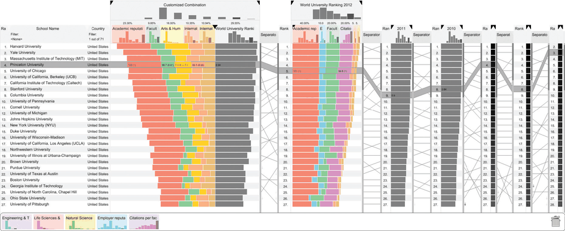
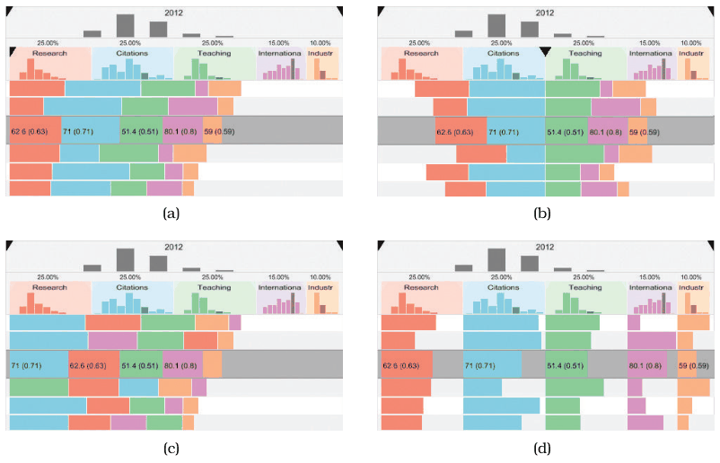

# LineUp

## Idiom box

No idiom box in the book.

The book describes LineUp in a System box rather than an Idiom box; its fields are quoted here [p.273].

<!-- verbatim p.273 -->
> What: Data Table.
<!-- /verbatim -->

<!-- verbatim p.273 -->
> What: Derived Ordered attribute: weighted combination of selected attributes.
<!-- /verbatim -->

<!-- verbatim p.273 -->
> How: Encode Stacked bar charts, slope graphs.
<!-- /verbatim -->

<!-- verbatim p.273 -->
> How: Manipulate Reorder, realign, animated transitions.
<!-- /verbatim -->

<!-- verbatim p.273 -->
> Why: Task Compare rankings, distributions.
<!-- /verbatim -->

## What it is

A system for exploring tables with many attributes through interactive reordering and realigning; besides sorting by any one attribute, the user can sort by complex weighted combinations of several, and it is explicitly designed to compare multiple rankings [p.271].

- **Figure 11.3** compares rankings of top universities: a custom 2012 weighting on the left and the official 2012 ranking in the middle, as coloured stacked bars showing each component attribute's contribution [pp.271-272].
- **Column states.** Two columns are compressed to one summary bar (2011, 2010); three are collapsed to a heatmap with grayscale rather than bar length; uncollapsed columns are scented widgets with distribution histograms on top [p.272].
- **Slope graphs** (bump charts) between columns link the same items: straight lines for unchanged rank, highly sloped crossing lines for large changes [p.272].
- **Alignment (Figure 11.4).** Classical stacked bars; diverging from any attribute as baseline; bars sorted by decreasing size within each row to show which attributes contribute most; each attribute on its own baseline, giving small multiples of horizontal bar charts. Changing alignment triggers an animated transition [pp.272-273].
- **User-derived data.** The user, not the designer, decides what data to derive during the analysis session [p.273].

## Use when / avoid when

- **Use** to compare multiple rankings and distributions of a table's items [p.273].
- **Use** when the user should define the ranking as a weighted combination of attributes on the fly [pp.271-273].
- **Use** reordering on categorical attributes; it does not make sense for ordered attributes, which already have an order [p.271].
- The book gives no scale limits or failure cases for LineUp [pp.271-273].

## Figures

-  **Figure 11.3** [p.271]. The LineUp system for comparing multiattribute rankings with reordering and realignment. From [Gratzl et al. 13, Figure 1].
-  **Figure 11.4** [p.272]. Changing the alignment in Lineup. (a) Classical stacked bars. (b) Diverging stacked bars. (c) Ordered stacked bars. (d) Separately aligned bars: small multiple bar charts. From [Gratzl et al. 13, Figure 4].

## Alternatives and disambiguation

- **Stacked bar charts** are one of LineUp's encodings, with slope graphs; its manipulations are reorder, realign and animated transitions, over a derived weighted-combination attribute [p.273].
- **Separately aligned bars** turn the view into small-multiple bar charts, one per attribute column [p.272].
- **Change over Time** is the general choice; LineUp is one system applying reorder and realign [p.271].

## Related

- [11.3 Change View over Time](../ch11-manipulate-view/s11-03-change-view-over-time.md): LineUp in context [p.271]
- [Stacked Bar Charts](stacked-bar-charts.md): the base encoding [p.273]
- [Animated Transitions](animated-transitions.md): used when alignment changes [p.273]
- [13.3.1 Item Filtering](../ch13-reduce-items-attributes/s13-03-filter/s13-03-01-item-filtering.md): scented widgets, as in the uncollapsed columns [p.272]
- [12.4 Partition into Views](../ch12-facet-into-multiple-views/s12-04-partition-into-views/node.md): small multiples from separate alignment [p.272]
- [7.5 Separate, Order, and Align: Categorical Regions](../ch07-arrange-tables/s07-05-separate-order-align-categorical/node.md): ordering categorical regions [p.271]

## Implementation hints [NOT FROM BOOK]

### matplotlib

Weighted score as stacked horizontal bars, rows sorted by the score; a slope graph between two rankings uses `ax.plot` per item.

```python
import numpy as np, matplotlib.pyplot as plt
names = ["U1", "U2", "U3", "U4", "U5"]
attrs = np.array([[.9, .4, .7], [.6, .9, .5], [.8, .8, .2], [.3, .6, .9], [.5, .2, .6]])
weights = np.array([0.5, 0.3, 0.2])  # user-chosen
contrib = attrs * weights
order = np.argsort(-contrib.sum(1))
fig, ax = plt.subplots()
left = np.zeros(len(names))
for j, label in enumerate(["teaching", "research", "citations"]):
    ax.barh(range(len(names)), contrib[order, j], left=left, label=label)
    left += contrib[order, j]
ax.set_yticks(range(len(names)), [names[i] for i in order]); ax.invert_yaxis(); ax.legend()
```

### D3

```js
const score = d => d3.sum(keys, k => w[k] * d[k]);
const stacked = d3.stack().keys(keys).value((d, k) => w[k] * d[k])(rows);
y.domain(rows.toSorted((a, b) => score(b) - score(a)).map(d => d.id));
// redraw stacked rects with a keyed join and .transition() on y, so re-weighting animates
```
