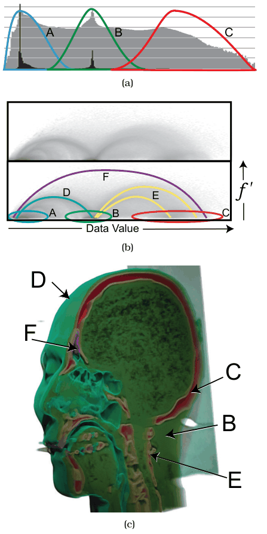

# Multidimensional Transfer Functions

## Idiom box

<!-- verbatim p.212 -->
> What: Data 3D spatial field.
<!-- /verbatim -->

<!-- verbatim p.212 -->
> What: Derived 3D spatial field: gradient of original field.
<!-- /verbatim -->

<!-- verbatim p.212 -->
> What: Derived Table: two key attributes, values binned from min to max for both data and derived data. One derived quantitative value attribute (item count per bin).
<!-- /verbatim -->

<!-- verbatim p.212 -->
> How: Encode 3D view: use given spatial field data, color and opacity from multidimensional transfer function. Joint histogram view: area marks in 2D matrix alignment, grayscale sequential colormap.
<!-- /verbatim -->

The box has no Why: Tasks or Scale field [p.212].

## What it is

The Simian system [Kniss 02, Kniss et al. 05] helps users construct multidimensional transfer functions for direct volume rendering, using a derived space and interactive widgets for specifying regions within it [p.212].

- **Transfer function.** The function that maps changes in the scalar value to opacity and colour; picking it is a crucial direct volume rendering choice [p.212].
- **Derived space.** Horizontal axis: the scalar data value. Vertical axis: the gradient magnitude (the gradient is the first derivative), so regions of high change can be told apart from homogeneous ones [p.212].
- **1D histogram.** The standard 1D transfer function's information, with linear-scale counts in black and log-scale in grey, separates only air, soft tissue and bone [p.212].
- **2D joint histogram.** Like a heatmap of one-pixel area marks, each cell a count in a grayscale colormap; boundaries between materials also form distinguishable structures [p.212].
- **Result.** The 2D transfer function renders a head dataset showing the base materials and the air–tissue, tissue–bone and air–bone boundaries, with a cutting plane exposing internal structure [p.212].

The text cites these panels as Figure 8.7(a)-(c); they are printed as the second Figure 8.6 on p.213 [pp.212-213].

## Use when / avoid when

- **Use** when building a transfer function by hand would take considerable trial and error, because uninteresting regions of the field hold the same range of data values as interesting ones [p.212].
- **Use** when the boundaries between materials matter, not only the materials: the 1D histogram distinguishes only the three basic materials, while the 2D space also separates their boundaries [p.212].

## Figures

-  **Figure 8.6** [p.213]. Simian allows users to construct multidimensional transfer functions for direct volume rendering using a derived space. (a) The standard 1D histogram can show the three basic materials: (A) air, (B) soft tissue, and (C) bone. (b) The full 2D derived space allows material boundaries to be distinguished as well. (c) Volume rendering of head dataset using the resulting 2D transfer function, showing material boundaries of (D) air–tissue, (E) tissue– bone, and (F) air–bone. From [Kniss et al. 05, Figure 9.1].

## Alternatives and disambiguation

- **Flexible Isosurfaces and other isocontour idioms** derive intermediate surface geometry and render it; direct volume rendering instead creates the image from the whole field without deriving surfaces [pp.207-211].
- **Slicing** shows only two dimensions at once as an image, and can be combined with a volume rendering view through a slice-placement widget [p.208].
- **Heatmaps.** The joint histogram view is described as like a heatmap with one-pixel area marks [p.212].

## Related

- [8.4.2 Direct Volume Rendering](../ch08-arrange-spatial-data/s08-04-scalar-fields-one-value/s08-04-02-direct-volume-rendering.md): DVR and the transfer-function problem [p.211]
- [13.4.1 Item Aggregation](../ch13-reduce-items-attributes/s13-04-aggregate/s13-04-01-item-aggregation.md): the histogram idiom [p.212]
- [11.6.2 Cut](../ch11-manipulate-view/s11-06-navigate-reducing-attributes.md#s11.06.02): cutting planes, used to expose the head's internal structure [p.212]
- [Heatmaps](heatmaps.md): the matrix-alignment encoding the joint histogram resembles [p.212]
- [Flexible Isosurfaces](flexible-isosurfaces.md): the surface-deriving alternative for scalar fields [p.211]

## Implementation hints [NOT FROM BOOK]

### matplotlib

```python
import numpy as np, matplotlib.pyplot as plt
from matplotlib.colors import LogNorm
z, y, x = np.mgrid[-1:1:64j, -1:1:64j, -1:1:64j]
r = np.sqrt(x**2 + y**2 + z**2)
vol = np.select([r < 0.4, r < 0.7], [1.0, 0.5], 0.0) + 0.02 * np.random.default_rng(0).normal(size=r.shape)
grad = np.linalg.norm(np.gradient(vol), axis=0)  # derived gradient-magnitude field
fig, ax = plt.subplots()
h = ax.hist2d(vol.ravel(), grad.ravel(), bins=128, cmap="Greys", norm=LogNorm())
ax.set_xlabel("data value"); ax.set_ylabel("gradient magnitude")
fig.colorbar(h[3], ax=ax, label="count per bin")
```

Volume rendering itself needs a 3D library such as VTK, PyVista or napari.

### D3

D3 has no volume renderer. Draw the joint histogram with `d3.bin` per axis or a precomputed 2D count grid, one `rect` per bin, `d3.scaleSequentialLog(d3.interpolateGreys)` for counts, and `d3.brush()` to select the transfer-function region, then pass that region to a WebGL raycaster.
