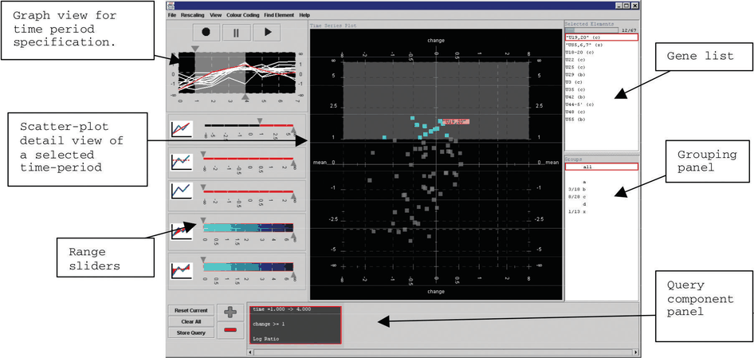

# Multiform Overview–Detail Microarrays

## Idiom box

No idiom box in the book.

The book describes this tool in a System box rather than an Idiom box; its fields are quoted here [p.298].

<!-- verbatim p.298 -->
> What: Data Multidimensional table: one categorical key attribute (gene), one ordered key attribute (time), one quantitative value attribute (microarray measurement of gene activity at time).
<!-- /verbatim -->

<!-- verbatim p.298 -->
> What: Derived Three quantitative value attributes: (value change, percentage of max value, fold change).
<!-- /verbatim -->

<!-- verbatim p.298 -->
> Why: Tasks Locate, identify, and compare; distribution, trend, and similarity.
<!-- /verbatim -->

<!-- verbatim p.298 -->
> Produce.
<!-- /verbatim -->

<!-- verbatim p.298 -->
> How: Encode Line charts, scatterplots, lists.
<!-- /verbatim -->

<!-- verbatim p.298 -->
> How: Facet Partition into multiform views. Coordinate with linked highlighting. Overview+detail filtering of time range.
<!-- /verbatim -->

<!-- verbatim p.298 -->
> Superimpose line charts.
<!-- /verbatim -->

The book prints "Produce." and "Superimpose line charts." as continuation lines under Why: Tasks and How: Facet; the box has no Scale field [p.298].

## What it is

A multiform overview–detail tool for biologists exploring microarray time-series data, coordinating a central scatterplot with a graph view in the upper left (Figure 12.4) [p.296]. Microarrays measure gene expression, the activity level of a gene, to compare it across situations such as times, tissue types, drugs, individuals or known groups [p.296]. The designers analysed the domain and concluded that no single view would suffice [p.296].

**Tasks.** Find genes on or off across the whole period, find genes whose values rose or fell over a time window, find genes with similar time-series patterns, relate these sets to known functional groups, and export the results [p.296]. The first four are consume tasks with the discover and locate goals, three at the identify query level and the last at compare; export is produce; the targets are distributions and trends of one attribute and similarity between attributes [p.297].

**Views.** The graph view shows globally superimposed line charts, one line per gene, time horizontal and value vertical; the user selects a time period with a slider to show in the scatterplot detail view [p.297]. The graph view does not support visual queries about value change or fold change, derived within the chosen window; the scatterplot's horizontal axis can be set to either; each gene is a point coloured by functional group, with the label under the cursor shown dynamically [pp.297-298]. A list view shows the names of all genes in the active window, ordered alphabetically, giving a textual overview and supporting browsing and lookup [p.298].

## Use when / avoid when

- **Use** when no single view suffices for the task set, as the designers concluded here: the overview does not support visual queries about the derived value change and fold change, which the differently encoded scatterplot detail view can show [p.296] [pp.297-298].
- **Use** a text list alongside graphical views when users need an overview of labels or to select an item by a known name; hovering identifies one mark but is a very frustrating way to survey all labels [p.298].
- **Use** a detail-on-demand view for additional information about items selected in a main view, either as a popup near the cursor or a fixed window [p.296].

## Figures

-  **Figure 12.4** [p.297]. Multiform overview–detail vis tool for microarray exploration features a central scatterplot linked with the graph view in the upper left. From [Craig and Kennedy 03, Figure 3].

## Alternatives and disambiguation

- **Bird's-Eye Maps** is overview–detail with shared encoding, differing only in viewpoint and size; this tool's detail view uses a different encoding [pp.295-296].
- **Exploratory Data Visualizer (EDV)** links multiform views by highlighting alone; here one view also filters the time range the other shows [p.294] [p.298].
- **Cerebral** is another microarray system, but partitions data by condition into small-multiple network views [p.299].

## Related

- [12.3.2 Share Data: All, Subset, None](../ch12-facet-into-multiple-views/s12-03-juxtapose-coordinate-views/s12-03-02-share-data-all-subset.md): the overview–detail and multiform discussion around this example [p.296]
- [Superimposed Line Charts](superimposed-line-charts.md): the overview's encoding [p.297]
- [12.5.2 Static Layers](../ch12-facet-into-multiple-views/s12-05-superimpose-layers/s12-05-02-static-layers.md): superimposed line charts covered further [p.297]
- [Scatterplots](scatterplots.md): the detail view's encoding [p.298]
- [3.4.2 Produce](../ch03-why-task-abstraction/s03-04-actions/s03-04-02-produce.md): the produce goal of the export task [p.297]

## Implementation hints [NOT FROM BOOK]

### matplotlib

```python
import numpy as np, matplotlib.pyplot as plt
rng = np.random.default_rng(1)
t = np.arange(12); expr = rng.normal(0, 1, (40, 12)).cumsum(axis=1)
lo, hi = 3, 8                                            # selected time window
change = expr[:, hi] - expr[:, lo]
group = rng.integers(0, 3, 40)
fig, (ov, det) = plt.subplots(1, 2, figsize=(10, 4))
ov.plot(t, expr.T, color="gray", lw=0.6)                 # overview: superimposed lines
ov.axvspan(lo, hi, color="orange", alpha=0.3)
det.scatter(change, expr[:, hi], c=group, cmap="tab10", s=15)
det.set_xlabel("value change in window")
```

### D3

```js
import * as d3 from "d3";
const x = d3.scaleLinear().domain([0, 11]).range([0, 400]);
const brush = d3.brushX().extent([[0, 0], [400, 150]]).on("brush end", ({ selection }) => {
  if (!selection) return;
  const [t0, t1] = selection.map(x.invert).map(Math.round);
  updateScatter(t0, t1);                                 // recompute derived change, redraw detail
});
d3.select("#overview").append("g").call(brush);
function updateScatter(t0, t1) { /* join genes to circles keyed by gene id */ }
```
