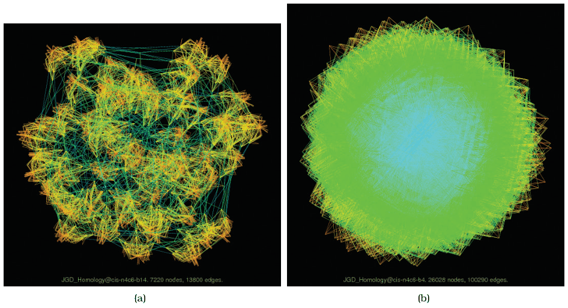

<a id="idiom:sfdp"></a>

# Multilevel Force-Directed Placement (sfdp)

## Idiom box

<!-- verbatim p.233 -->
> What: Data Network.
<!-- /verbatim -->

<!-- verbatim p.233 -->
> What: Derived Cluster hierarchy atop original network.
<!-- /verbatim -->

<!-- verbatim p.233 -->
> What: Encode Point marks for nodes, connection marks for links.
<!-- /verbatim -->

<!-- verbatim p.233 -->
> Why: Tasks Explore topology, locate paths and clusters.
<!-- /verbatim -->

<!-- verbatim p.233 -->
> Scale Nodes: 1000–10,000. Links: 1000–10,000.
> Node/link density: L < 4N.
<!-- /verbatim -->

The box labels its encoding field "What: Encode" where the other boxes in the chapter say "How: Encode" [p.233].

## What it is

A multilevel network idiom: the original network is augmented with a derived cluster hierarchy, forming a compound network. The hierarchy comes from coarsening the network into successively simpler networks that still try to capture its essential structure [p.231]. Laying out the simplest version first and refining through more complex versions improves both the speed and quality of the layout, and does better at avoiding the local-minimum problem [pp.231-232]. In the example, sfdp lays out a network of 7220 nodes and 13,800 edges with edges coloured by length [p.232].

## Use when / avoid when

- **Use** for exploring topology and locating paths and clusters in networks of 1000 to 10,000 nodes and links [p.233].
- **Use** to make cluster structure visible: dense clusters of short edges stand apart from long edges between them [p.232].
- **Limit:** even sfdp hits the hairball problem with sufficiently large networks; at 26,028 nodes and 100,290 edges the layout shows little structure, and overlapping lines cause overwhelming clutter through occlusion [p.232].
- In the sfdp example, the derived hierarchy was used only to accelerate the layout and was not shown directly to the user [p.240].

## Figures

-  **Figure 9.5** [p.232]. Multilevel graph drawing with sfdp [Hu 05]. (a) Cluster structure is visible for a large network of 7220 nodes and 13,800 edges. (b) A huge graph of 26,028 nodes and 100,290 edges is a “hairball” without much visible structure. From [Hu 14].

## Alternatives and disambiguation

- **Force-directed placement** is the single-level version: easier to implement, but readable only up to dozens or hundreds of nodes [p.231].
- **GrouseFlocks** also builds a cluster hierarchy atop a network, but shows multiple possible hierarchies explicitly with containment marks, whereas sfdp hides its one hierarchy [p.240].
- **Adjacency matrix view** scales to about 1000 nodes and one million links and suits dense networks, but supports topology tasks less well [pp.233-234].

## Related

- [9.2 Connection: Link Marks](../ch09-arrange-networks-trees/s09-02-connection-link-marks.md): the multilevel idea and the sfdp example in context [p.232]
- [9.5 Containment: Hierarchy Marks](../ch09-arrange-networks-trees/s09-05-containment-hierarchy-marks.md): compound networks, which multilevel layouts build [p.231]
- [13.4.1 Item Aggregation](../ch13-reduce-items-attributes/s13-04-aggregate/s13-04-01-item-aggregation.md): cluster hierarchies in more detail [p.231]

## Implementation hints [NOT FROM BOOK]

### matplotlib

For the real engine, use Graphviz's `sfdp` through NetworkX: `nx.nx_agraph.graphviz_layout(G, prog="sfdp")` (needs `pygraphviz`). Without Graphviz, this sketch shows the multilevel idea: lay out a coarsened graph, then refine the full graph from those positions.

```python
import networkx as nx, numpy as np, matplotlib.pyplot as plt
G = nx.random_partition_graph([40] * 10, 0.25, 0.005, seed=1)
blocks = G.graph["partition"]
coarse = nx.spring_layout(nx.quotient_graph(G, blocks, relabel=True), seed=1)
rng = np.random.default_rng(1)
start = {n: coarse[i] + rng.normal(0, 0.05, 2) for i, block in enumerate(blocks) for n in block}
pos = nx.spring_layout(G, pos=start, iterations=30, seed=1)
nx.draw_networkx_edges(G, pos, width=0.3, alpha=0.3)
nx.draw_networkx_nodes(G, pos, node_size=2)
plt.axis("off")
```

### D3

D3 has no multilevel layout. Precompute positions with `sfdp -Tjson graph.dot > layout.json` (or the `@hpcc-js/wasm` Graphviz build in the browser), then render with `d3.select(svg).selectAll("line").data(edges)` using the fixed `pos` values. For colouring edges by length, map `Math.hypot(dx, dy)` through `d3.scaleSequential(d3.interpolateTurbo)`.
