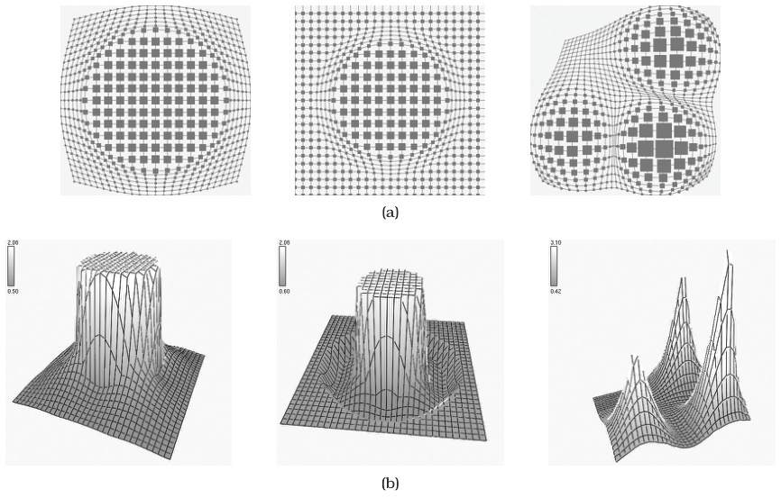

# Nonlinear Magnification Fields

## Idiom box

<!-- verbatim p.359 -->
> What: Data Any data.
<!-- /verbatim -->

<!-- verbatim p.359 -->
> How: Encode Any layout.
<!-- /verbatim -->

<!-- verbatim p.359 -->
> How: Reduce Embed: distort with magnification fields; multiple foci, local arbitrary regions, lens or stretch or data-driven interaction metaphors.
<!-- /verbatim -->

## What it is

A general computational framework with multiple foci of arbitrary magnification levels and shapes, whose scope can be constrained to local regions [p.358]. The underlying mathematics calculates the implicit magnification field needed to achieve a desired transformation, as Figure 14.9(a) shows [pp.358-359]. It supports many interaction metaphors, including lenses and stretchable surfaces, and can expose the magnification fields of Figure 14.9(b) directly to the user, for example for data-driven magnification trails of moving objects [p.359].

## Use when / avoid when

- **Use** over any data and layout when foci need arbitrary shapes, differing magnification levels, or local scope [pp.358-359].
- **Use** when magnification should follow the data, such as trails of moving objects [p.359].
- **Show the distortion.** Magnification fields often show a superimposed grid or shading implying the height of the stretched surface, so users notice the distortion [pp.359-360].
- **Avoid** for tasks needing distance or length comparisons, which distortion severely impairs [p.359].

## Figures

-  **Figure 14.9** [p.358]. General frameworks calculate the magnification and minimization fields needed to achieve desired transformations in the image. (a) Desired transformations. (b) Calculated magnification fields. From [Keahey 98, Figure 3].

## Alternatives and disambiguation

- **Stretch and Squish Navigation.** Also multiple foci, but restricted to global rectangular regions on a rubber sheet [p.356].
- **Fisheye Lens.** A single local radial focus, moved as a draggable lens [p.353].
- **Elastic presentation spaces.** The book names this as the other general focus+context framework, without describing it [p.363].

## Related

- [14.5 Distort](../ch14-embed-focus-context/s14-05-distort.md): the distortion design choices that this idiom's multiple, local, arbitrarily shaped foci instantiate [p.358]
- [14.6 Costs and Benefits: Distortion](../ch14-embed-focus-context/s14-06-costs-benefits-distortion.md): the grid or shading cue and the cost of drastic distortion [p.360]
- [14.7 Further Reading](../ch14-embed-focus-context/s14-07-further-reading.md): sources for both magnification frameworks [p.363]

## Implementation hints [NOT FROM BOOK]

### matplotlib

```python
import numpy as np, matplotlib.pyplot as plt
u = np.linspace(0, 1, 400)
def warp(t, foci):
    m = 1 + sum(a * np.exp(-((t - c) / w) ** 2) for c, a, w in foci)  # magnification field
    cdf = np.cumsum(m); cdf = (cdf - cdf[0]) / (cdf[-1] - cdf[0])
    return lambda v: np.interp(v, t, cdf)
fx = warp(u, [(0.3, 6, 0.05), (0.75, 3, 0.08)])
fy = warp(u, [(0.5, 4, 0.06)])
fig, ax = plt.subplots()
for g in np.linspace(0, 1, 21):  # warped grid shows the distortion
    ax.plot(fx(np.full_like(u, g)), fy(u), c="0.7", lw=0.5)
    ax.plot(fx(u), fy(np.full_like(u, g)), c="0.7", lw=0.5)
pts = np.random.default_rng(1).random((300, 2))
ax.scatter(fx(pts[:, 0]), fy(pts[:, 1]), s=6)
ax.set_aspect("equal")
```

### D3

```js
import * as d3 from "d3";
// Integrate a 1D magnification field into a monotone mapping per axis.
export function warp(foci, n = 512) {
  const t = d3.range(n + 1).map(i => i / n);
  const m = t.map(v => 1 + d3.sum(foci, f => f.a * Math.exp(-(((v - f.c) / f.w) ** 2))));
  const cdf = d3.cumsum(m), lo = cdf[0], hi = cdf[n];
  return d3.scaleLinear().domain(t).range(Array.from(cdf, c => (c - lo) / (hi - lo)));
}
```
