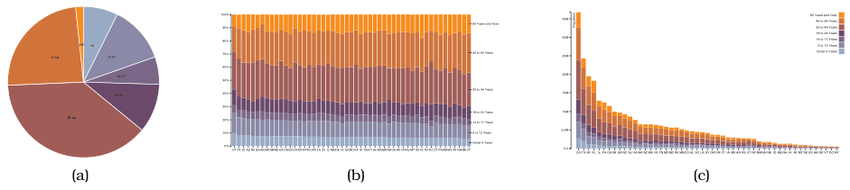

# Normalized Stacked Bar Charts

## Idiom box

<!-- verbatim p.195 -->
> What: Data Multidimensional table: one quantitative value attribute, two categorical key attributes.
<!-- /verbatim -->

<!-- verbatim p.195 -->
> What: Derived One quantitative value attribute (normalized version of original attribute).
<!-- /verbatim -->

<!-- verbatim p.195 -->
> Why: Task Part–whole relationship.
<!-- /verbatim -->

<!-- verbatim p.195 -->
> How: Encode Line marks with length channel; rectilinear layout.
<!-- /verbatim -->

<!-- verbatim p.195 -->
> Scale One dozen categories for stacked attribute. Several dozen categories for axis attribute.
<!-- /verbatim -->

## What it is

A stacked bar chart uses a composite glyph of sub-bars of different colours stacked on top of each other; a normalized stacked bar chart stretches each of these bars to the maximum possible length, showing percentages rather than absolute counts [p.194]. Each bar shows the same information as an entire pie chart [p.177], and an entire pie corresponds to a single bar [p.194]. Figure 7.18 shows US population by age group as a single pie, as normalized stacked bars for all 50 states, and as plain stacked bars [p.194].

Only the lowest sub-bar is aligned with the others in its category, so it uses the most accurate channel, position against a common frame; the other sub-bars use unaligned position, which is less accurate than aligned position but still more accurate than angle [p.194].

## Use when / avoid when

- **Use** to show the relative contribution of parts to a whole, such as percentages, with a more accurate length channel than a pie chart's angle [p.194].
- **Screen area**: it needs somewhat less area than pie charts, and a long narrow rectangle where a pie needs a square [p.194].
- **Avoid** for more than about a dozen categories in the stack [p.194].
- **Use a plain stacked bar chart instead** when absolute counts are wanted: it shows the absolute counts in each bar, in contrast to the percentages of a normalized one [p.194].

## Figures

-  **Figure 7.18** [p.194]. Relative contributions of parts to a whole. (a) A single pie chart shows the relative contributions of parts to a whole, such as percentages, using area judgements. (b) Each bar in a normalized stacked bar chart also shows the relative contributions of parts to a whole, with a higher-accuracy length encoding. (c) A stacked bar chart shows the absolute counts in each bar, in contrast to the percentages when each bar is normalized to the same vertical length. From <http://bl.ocks.org/mbostock/3887235>, <http://bl.ocks.org/mbostock/3886208>, <http://bl.ocks>. org/mbostock/3886394.

## Alternatives and disambiguation

- **Stacked bar charts** show absolute counts in each bar; normalizing makes every bar the same length and shows percentages [p.194].
- **Pie charts** show one whole with area and angle; an entire pie corresponds to a single normalized bar, so many wholes would need a list or matrix of pies [p.194].
- **Polar area charts** also target part–whole tasks, with wedge length on a radial layout [p.195].

## Related

- [7.6.3 Radial Layouts](../ch07-arrange-tables/s07-06-spatial-axis-orientation/s07-06-03-radial-layouts.md): the section that presents this idiom against pie charts [p.194]
- [7.5.1 List Alignment: One Key](../ch07-arrange-tables/s07-05-separate-order-align-categorical/s07-05-01-list-alignment-one-key.md): where stacked bar glyphs are introduced as a list alignment [p.194]
- [Stacked Bar Charts](stacked-bar-charts.md): the absolute-count version [p.177]
- [Pie Charts](pie-charts.md): the radial part–whole idiom it improves on [p.194]

## Implementation hints [NOT FROM BOOK]

### matplotlib

```python
import numpy as np
import matplotlib.pyplot as plt
from matplotlib.ticker import PercentFormatter

states = ["UT", "TX", "CA", "NY", "FL", "ME"]
ages = ["<18", "18-44", "45-64", "65+"]
counts = np.array([[9, 7, 9, 4, 4, 2], [12, 11, 15, 8, 7, 4], [6, 6, 9, 5, 6, 4], [3, 3, 5, 3, 4, 2]])
shares = counts / counts.sum(axis=0)
order = np.argsort(-shares[0])

fig, ax = plt.subplots(layout="constrained")
bottom = np.zeros(len(states))
for age, row in zip(ages, shares[:, order]):
    ax.bar(np.array(states)[order], row, bottom=bottom, width=0.9, label=age)
    bottom += row
ax.yaxis.set_major_formatter(PercentFormatter(1))
ax.legend(title="age", loc="upper left", bbox_to_anchor=(1, 1), reverse=True)
```

### D3

```js
const series = d3.stack().keys(keys).offset(d3.stackOffsetExpand)(data);
const y = d3.scaleLinear().domain([0, 1]).range([height, 0]);
svg.append("g").call(d3.axisLeft(y).ticks(10, "%"));
// draw rects exactly as for a stacked bar chart: y(d[1]) to y(d[0])
```
