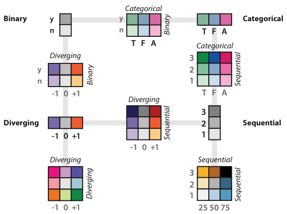
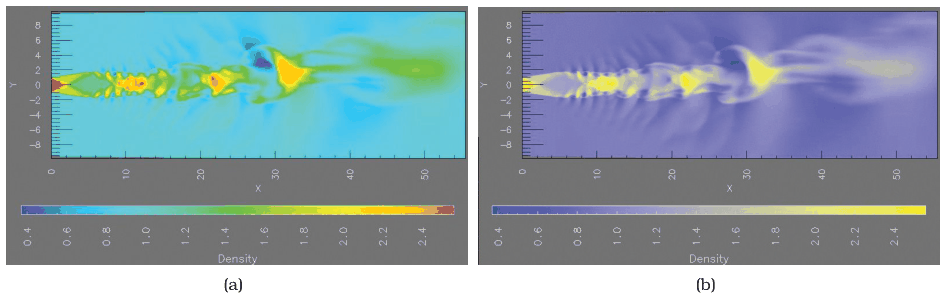
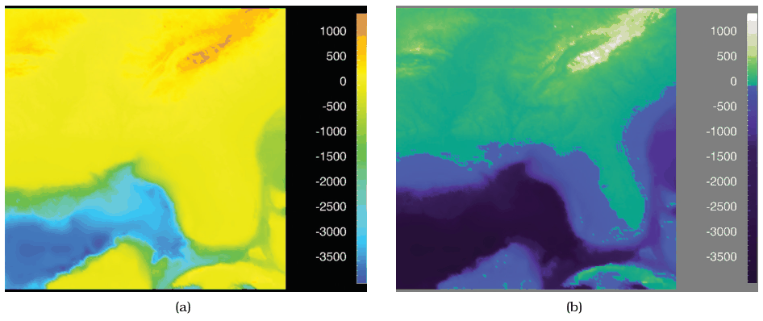
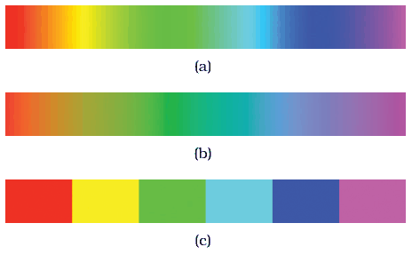

# Ordered Colormaps

## Idiom box

No idiom box in the book.

- **What: Data.** An ordinal or quantitative attribute; continuous colormaps are heavily used for quantitative attributes, especially those of inherently spatial fields [pp.250-254].
- **Why: Tasks.** Showing an attribute's progression from minimum to maximum (sequential), or its divergence either side of a zero point (diverging), at the high, middle or fine level of structure [pp.244-256].
- **How: Encode.** The magnitude channels of luminance and saturation, optionally with hue, as a continuous ramp or segmented into bins [pp.250-256].

## What it is

<!-- verbatim p.254 -->
> An ordered colormap is appropriate for encoding ordinal or quantitative attributes.
<!-- /verbatim -->

- **Sequential**: from a minimum to a maximum value. Luminance alone gives a grayscale ramp; with hue, one end is a saturated hue and the other pale or white (varying saturation) or dark or black (varying luminance) [pp.254-256].
- **Diverging**: two hues at the endpoints and a neutral midpoint such as white, gray, black, or a high-luminance colour such as yellow [p.256].

## Use when / avoid when

- **Use** sequential for an attribute with a minimum and maximum; **use** diverging when values diverge to negative and positive around a central zero point [pp.244-256].
- **Use** luminance and saturation, not hue alone, to carry order: hue has no implicit perceptual ordering [p.250].
- **Use** two hues to emphasise large-scale structure; many hues to emphasise mid-level neighbourhoods and make subranges nameable [pp.256-257].
- **Use** monotonically increasing luminance with multiple hues to address all three rainbow problems; the book's example shows high-, mid- and low-level structure, with a clear segmentation at zero, which is sea level, a semantically meaningful point [pp.257-258].
- **Use** a segmented map when task-driven semantics can guide the bins; it turns quantitative data into ordered data and beats letting the eye bin unevenly [p.259].
- **Use** continuous for ordinal data to stress its order, segmented to stress its discreteness [p.250].
- **Avoid** the continuous rainbow, though it is a common default: hue implies no order, equal steps are not perceived equally, and hue cannot show fine detail [p.257].
- **Avoid** many luminance steps: typically fewer than five are discriminable on a non-uniform background, and Ware suggests avoiding grayscale if more than two to four bins are required; saturation gives only around three bins [p.248].
- **Avoid** perceptually linear rainbows in most cases: they lose dynamic range and look almost dingy [pp.258-259].
- **Avoid** red–green diverging ramps for colour-deficient viewers [p.260].

## Figures

-  **Figure 10.6** [p.251]. The colormap categorization partially mirrors the data types: categorical versus ordered, and sequential and diverging within ordered. Bivariate encodings of two separate attributes at once is safe if one has only two levels, but they can be difficult to interpret when both attributes have multiple levels. After [Brewer 99].
-  **Figure 10.11** [p.257]. Rainbow versus two-hue continuous colormap. (a) Using many hues, as in this rainbow colormap, emphasizes mid-scale structure. (b) Using only two hues, the blue–yellow colormap emphasizes large-scale structure. From [Bergman et al. 95, Figures 1 and 2].
-  **Figure 10.12** [p.258]. Rainbow versus multiple-hue continuous colormap with monotonically increasing luminance. (a) Three major problems with the common continuous rainbow colormap are perceptual nonlinearity, the expres-sivity mismatch of using hue for ordering, and the accuracy mismatch of using hue for fine-grained detail. (b) A colormap that combines monotonically increasing luminance with multiple hues for semantic categories, with a clear segmentation at the zero point, succeeds in showing high-level, mid-level, and low-level structure. From [Rogowitz and Treinish 98, Figure 1].
-  **Figure 10.13** [p.259]. Appropriate use of rainbows. (a) The standard rainbow colormap is perceptually nonlinear. (b) Perceptually linear rainbows are possible [Kindlmann 02], but they are less bright with a decreased dynamic range. (c) Segmented rainbows work well for categorical data when the number of categories is small.

## Alternatives and disambiguation

- **Categorical Colormaps** are for categories and use hue; a segmented rainbow is fine for few categories, and could also be used for ordered data, while not ideal, because explicit binning solves the perceptual nonlinearity problem [pp.250-259].
- **Bivariate Colormaps** combine a sequential or diverging attribute with a second attribute; safe when one is binary [pp.259-260].
- **Size Channels** and **Angle Channel** are other magnitude channels for ordered data; length judgements are extremely accurate, and angle also supports diverging and cyclic tiltmaps [pp.261-262].

## Related

- [10.3.2 Ordered Colormaps](../ch10-map-color-other-channels/s10-03-colormaps/s10-03-02-ordered-colormaps.md): the full section with the rainbow critique [p.254]
- [10.2.2 Color Spaces](../ch10-map-color-other-channels/s10-02-color-theory/s10-02-02-color-spaces.md): L\*a\*b\*, where interpolation should be done rather than in RGB or HSL [p.247]
- [Colorblind-Safe Colormaps](colorblind-safe-colormaps.md): avoiding red–green diverging ramps [p.260]
- [2.4.3 Fields](../ch02-what-data-abstraction/s02-04-dataset-types/s02-04-03-fields.md): continuous versus discrete semantics, behind continuous versus segmented maps [p.250]

## Implementation hints [NOT FROM BOOK]

### matplotlib

```python
import matplotlib.pyplot as plt
import numpy as np
from matplotlib.colors import TwoSlopeNorm, BoundaryNorm
x, y = np.meshgrid(np.linspace(-3, 3, 200), np.linspace(-3, 3, 200))
z = np.sin(x) * np.cos(y) * 2000 - 500
fig, axs = plt.subplots(1, 3, figsize=(11, 3))
axs[0].imshow(z, cmap="viridis")  # sequential, monotonic luminance
axs[1].imshow(z, cmap="RdBu_r", norm=TwoSlopeNorm(vcenter=0))  # diverging at a meaningful zero
bounds = [-2500, -1000, 0, 1000, 1500]
axs[2].imshow(z, cmap="viridis", norm=BoundaryNorm(bounds, 256))  # segmented by task-driven bins
for ax in axs:
    ax.axis("off")
```

### D3

```js
import * as d3 from "d3";
const seq = d3.scaleSequential([0, 100], d3.interpolateViridis);
const div = d3.scaleDiverging([-2000, 0, 1500], d3.interpolateRdBu);
const binned = d3.scaleThreshold([-1000, 0, 1000], d3.schemeBlues[4]);
const lab = d3.scaleLinear([0, 100], ["#081d58", "#ffffd9"]).interpolate(d3.interpolateLab);
console.log(seq(50), div(0), binned(500), lab(50));
```
