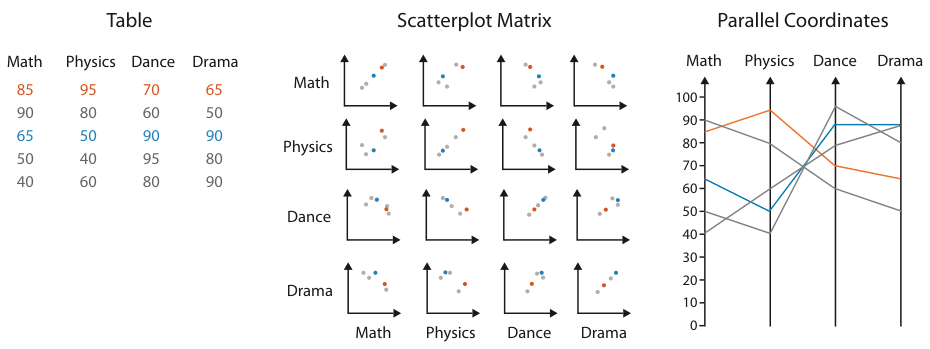
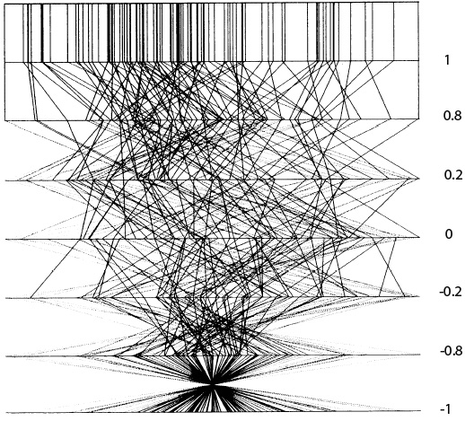
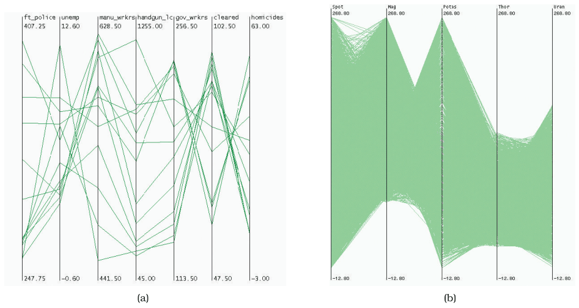

# Parallel Coordinates

## Idiom box

<!-- verbatim p.191 -->
> What: Data Table: many value attributes.
<!-- /verbatim -->

<!-- verbatim p.191 -->
> How: Encode Parallel layout: horizontal spatial position used to separate axes, vertical spatial position used to express value along each aligned axis with connection line marks as segments between them.
<!-- /verbatim -->

<!-- verbatim p.191 -->
> Why: Tasks Find trends, outliers, extremes, correlation.
<!-- /verbatim -->

<!-- verbatim p.191 -->
> Scale Attributes: dozens along secondary axis. Items: hundreds.
<!-- /verbatim -->

## What it is

An approach for visualising many quantitative attributes at once with spatial position: the axes are placed parallel to each other rather than at right angles [p.187]. Where a scatterplot shows an item as a dot, parallel coordinates show it as a jagged line (a polyline) that crosses each axis exactly once, at the item's value for that attribute [p.187]. It answers a limit of rectilinear layouts: perpendicular axes give high-precision position for only two attributes, a third spatial dimension is low precision, and channel inseparability limits how many nonspatial channels combine well [p.187].

Correlation shows between neighbouring axes: mostly parallel segments mean high positive correlation, segments crossing at a single spot mean high negative correlation, and a mix of crossing angles means uncorrelated attributes (Figure 7.13) [p.188]. The idiom uses two dimensions of spatial position: one along each axis, and the second to lay out the axes [p.188]. It was proposed independently, at the same time, by a geometer and a statistician [p.201].

## Use when / avoid when

- **Use** for overview over all attributes, finding the range of individual attributes, selecting a range of items and detecting outliers [p.188].
- **Prefer a SPLOM for correlation**: correlation was an original motivation, but in practice SPLOMs are typically easier for that task [pp.187-188].
- **Scale, attributes**: many values can be discriminated along each axis, roughly in proportion to its extent in pixels; dozens of attributes is common, giving a wide and flat display that needs enough room between axes to see crossings or parallelism [pp.188-189].
- **Avoid** for thousands of items: the basic idiom scales to hundreds, and too many overplotted lines yield little information; with over 16,000 items only the minimum and maximum of each axis could be read (Figure 7.14) [p.189].
- **Plan the axis order**: the visible patterns are pairwise between neighbouring axes, so ordering the axes is the crucial limitation; most implementations allow interactive reordering, but exploring every order by hand becomes prohibitively slow as axes grow [pp.189-190].
- **Expect training time**: first-time users have no intuitions about the patterns, which must be taught; pairing the view with familiar scatterplots and linked highlighting accelerates learning [p.190].

## Figures

-  **Figure 7.12** [p.188]. Comparison of scatterplot matrix and parallel coordinate idioms for a small data table. After [McGuffin 14].
-  **Figure 7.13** [p.189]. Parallel coordinates were designed to show correlation between neighboring axes. At the top, parallel lines show perfect positive correlation. At the bottom, all of the lines cross over each other at a single spot in between the two axes, showing perfect negative correlation. In the middle, the mix of crossings shows uncorrelated data. From [Wegman 90, Figure 3].
-  **Figure 7.14** [p.190]. Parallel coordinates scale to dozens of attributes and hundreds of items, but not to thousands of items. (a) Effective use with 13 items and 7 attributes. (b) Ineffective use with over 16,000 items and 5 attributes. From [Fua et al. 99, Figures 1 and 2].

## Alternatives and disambiguation

- **Scatterplot matrices** show the same table as a matrix of scatterplots and make correlation easier to find [pp.187-188].
- **Scatterplots** show two attributes with perpendicular axes; they are often linked to a parallel coordinates view [p.190].
- **Hierarchical parallel coordinates** scale the idiom to larger datasets [p.189].

## Related

- [7.6.2 Parallel Layouts](../ch07-arrange-tables/s07-06-spatial-axis-orientation/s07-06-02-parallel-layouts.md): the section that presents this idiom [p.187]
- [5.5.3 Separability](../ch05-marks-channels/s05-05-channel-effectiveness/s05-05-03-separability.md): why extra nonspatial channels do not solve many attributes [p.187]
- [6.3 No Unjustified 3D](../ch06-rules-thumb/s06-03-no-unjustified-3d/node.md): why a third spatial dimension is not the answer [p.187]
- [13.4.1 Item Aggregation](../ch13-reduce-items-attributes/s13-04-aggregate/s13-04-01-item-aggregation.md): hierarchical parallel coordinates for larger datasets [p.189]
- [12.3 Juxtapose and Coordinate Views](../ch12-facet-into-multiple-views/s12-03-juxtapose-coordinate-views/node.md): using it as one of several linked views [p.190]
- [12.4 Partition into Views](../ch12-facet-into-multiple-views/s12-04-partition-into-views/node.md): further multiple-view design choices [p.190]
- [Hierarchical Parallel Coordinates](hierarchical-parallel-coordinates.md): the aggregated variant [p.189]
- [Scatterplot Matrix (SPLOM)](scatterplot-matrix-splom.md): the matrix alternative [p.188]

## Implementation hints [NOT FROM BOOK]

### matplotlib

Normalise each attribute to its own axis, draw one polyline per item, and label each axis with its range. `pandas.plotting.parallel_coordinates` exists but shares one scale across all axes.

```python
import numpy as np
import matplotlib.pyplot as plt

rng = np.random.default_rng(6)
names = ["Math", "Physics", "Dance", "Drama", "Art"]
math = rng.uniform(40, 100, 40)
data = np.column_stack([math, math + rng.normal(0, 6, 40), 140 - math + rng.normal(0, 8, 40),
                        rng.uniform(30, 95, 40), rng.uniform(50, 90, 40)])

lo, hi = data.min(axis=0), data.max(axis=0)
scaled = (data - lo) / (hi - lo)
axes_x = np.arange(len(names))

fig, ax = plt.subplots(figsize=(8, 4))
ax.plot(axes_x, scaled.T, color="C0", alpha=0.4, lw=1)
for x, name, a, b in zip(axes_x, names, lo, hi):
    ax.axvline(x, color="0.2", lw=1)
    ax.text(x, -0.06, f"{name}\n{a:.0f}", ha="center", va="top")
    ax.text(x, 1.02, f"{b:.0f}", ha="center", va="bottom")
ax.set_axis_off()
```

### D3

```js
const x = d3.scalePoint().domain(dims).range([0, width]);
const y = new Map(dims.map(k => [k, d3.scaleLinear(d3.extent(data, d => d[k]), [height, 0]).nice()]));
const line = d => d3.line()(dims.map(k => [x(k), y.get(k)(d[k])]));
svg.append("g").attr("fill", "none").attr("stroke", "steelblue").attr("stroke-opacity", 0.4)
  .selectAll("path").data(data).join("path").attr("d", line);
svg.selectAll("g.axis").data(dims).join("g").attr("class", "axis")
  .attr("transform", k => `translate(${x(k)},0)`).each(function (k) { d3.select(this).call(d3.axisLeft(y.get(k))); });
```

Add `d3.brushY()` on each axis to select a range of items, and `d3.drag` on axes to reorder them.
