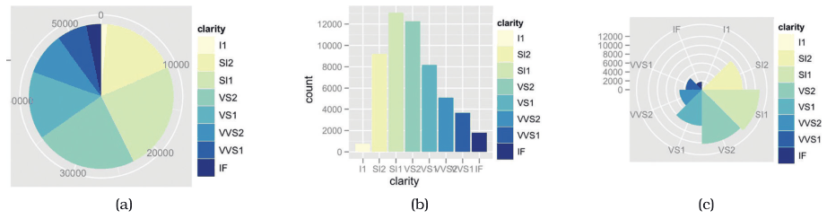
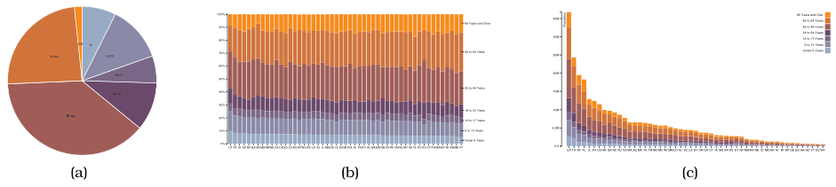

# Pie Charts

## Idiom box

<!-- verbatim p.195 -->
> What: Data Table: one quantitative attribute, one categorical attribute.
<!-- /verbatim -->

<!-- verbatim p.195 -->
> Why: Task Part–whole relationship.
<!-- /verbatim -->

<!-- verbatim p.195 -->
> How: Encode Area marks (wedges) with angle channel; radial layout.
<!-- /verbatim -->

<!-- verbatim p.195 -->
> Scale One dozen categories.
<!-- /verbatim -->

## What it is

The most commonly used radial statistical graphic: a pie chart encodes a single attribute with area marks and the angle channel [p.193].

<!-- verbatim p.193 -->
> Despite their popularity, pie charts are clearly problematic when considered according to the visual channel properties discussed in Section 5.5.
<!-- /verbatim -->

Angle judgements on area marks are less accurate than length judgements on line marks, and the wedges widen from the centre outward, which makes the area judgement particularly difficult [p.193]. Figure 7.17 colours each wedge redundantly for legibility, but the idiom could be used without colour coding [p.193].

The most useful property of a pie is that it shows the relative contribution of parts to a whole: the wedge angles sum to 360°, matching normalised data such as percentages that sum to 100% [p.194]. That property is not unique to pies [p.194].

## Use when / avoid when

- **Use** for a part–whole relationship over a small number of categories, at most around a dozen [pp.194-195].
- **Not unique to pies**: a single bar of a normalized stacked bar chart shows the same part–whole property with the more accurate length channel [p.194].
- **Individual values**: a bar chart of the same data needs only high-accuracy position along a common scale [p.193].
- **Expect more screen area**: pies need somewhat more area than normalized stacked bars because angle is lower precision than length, and they need a square where bars need a long narrow rectangle [p.194].
- **Comparing several wholes** needs a list or matrix of pies, since one entire pie corresponds to a single normalized bar [p.194].
- The general radial-layout guidelines also apply: angle is less accurate than position and is cyclic [p.191].

## Figures

-  **Figure 7.17** [p.193]. Pie chart versus bar chart accuracy. (a) Pie charts require angle and area judgements. (b) Bar charts require only high-accuracy length judgements for individual items. (c) Polar area charts are a more direct equivalent of bar charts, where the length of each wedge varies like the length of each bar. From [Wickham 10, Figures 15 and 16].
-  **Figure 7.18** [p.194]. Relative contributions of parts to a whole. (a) A single pie chart shows the relative contributions of parts to a whole, such as percentages, using area judgements. (b) Each bar in a normalized stacked bar chart also shows the relative contributions of parts to a whole, with a higher-accuracy length encoding. (c) A stacked bar chart shows the absolute counts in each bar, in contrast to the percentages when each bar is normalized to the same vertical length. From <http://bl.ocks.org/mbostock/3887235>, <http://bl.ocks.org/mbostock/3886208>, <http://bl.ocks>. org/mbostock/3886394.

## Alternatives and disambiguation

- **Polar area charts** keep the wedges but vary their length, as a bar chart varies bar length, rather than their angle [p.193].
- **Normalized stacked bar charts** show the same part–whole information per bar with length, and fit many wholes side by side [p.194].
- **Bar charts** show the same data with position along a common scale [p.193].

## Related

- [7.6.3 Radial Layouts](../ch07-arrange-tables/s07-06-spatial-axis-orientation/s07-06-03-radial-layouts.md): the section that presents this idiom [p.193]
- [5.5 Channel Effectiveness](../ch05-marks-channels/s05-05-channel-effectiveness/node.md): the channel properties that make pies problematic [p.193]
- [7.8 Further Reading](../ch07-arrange-tables/s07-08-further-reading.md): the history of the pie chart and other statistical graphics [p.200]
- [Normalized Stacked Bar Charts](normalized-stacked-bar-charts.md): the more accurate part–whole idiom [p.194]
- [Polar Area Charts](polar-area-charts.md): the length-coded radial sibling [p.193]

## Implementation hints [NOT FROM BOOK]

### matplotlib

Start at 12 o'clock and run clockwise. Keep ordered categories such as age bands in their natural order; sort unordered categories by size.

```python
import matplotlib.pyplot as plt

shares = {"<5": 7, "5-13": 12, "14-17": 5, "18-24": 10, "25-44": 27, "45-64": 26, "65+": 13}
labels, values = zip(*shares.items())

fig, ax = plt.subplots()
ax.pie(values, labels=labels, autopct="%d%%", startangle=90, counterclock=False,
       wedgeprops={"edgecolor": "white", "linewidth": 1})
ax.set_aspect("equal")
```

### D3

```js
const pie = d3.pie().value(d => d.value).sort(null);
const arc = d3.arc().innerRadius(0).outerRadius(radius);
svg.append("g").attr("transform", `translate(${width / 2},${height / 2})`)
  .selectAll("path").data(pie(data)).join("path")
  .attr("d", arc).attr("fill", d => color(d.data.key)).attr("stroke", "white");
```
