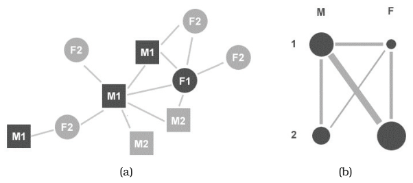
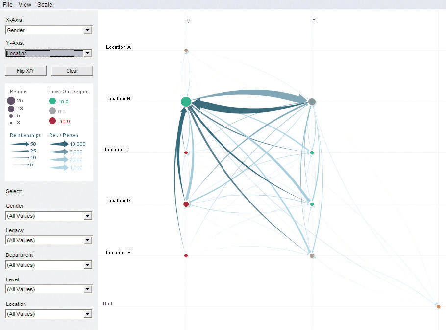

# PivotGraph

## Idiom box

<!-- verbatim p.383 -->
> What: Data Network.
<!-- /verbatim -->

<!-- verbatim p.383 -->
> What: Derived Derived network of aggregate nodes and links by roll-up into two chosen attributes.
<!-- /verbatim -->

<!-- verbatim p.383 -->
> Why: Tasks Cross-attribute comparison of node groups.
<!-- /verbatim -->

<!-- verbatim p.383 -->
> How: Encode Nodes linked with connection marks, size.
<!-- /verbatim -->

<!-- verbatim p.383 -->
> How: Manipulate Change: animated transitions.
<!-- /verbatim -->

<!-- verbatim p.383 -->
> How: Reduce Aggregation, filtering.
<!-- /verbatim -->

<!-- verbatim p.383 -->
> Scale Nodes/links in original network: unlimited. Roll-up attributes: 2. Levels per roll-up attribute: several, up to one dozen.
<!-- /verbatim -->

## What it is

PivotGraph encodes a derived network rather than the original one: groups of nodes and links are aggregated into a roll-up according to categorical attribute values on the nodes, whereas connection, containment and matrix views all encode the original link structure [p.380]. With two roll-up attributes the aggregate nodes sit on a grid, with one on a line; grid positions minimise link-crossing clutter, and links are drawn as curves [p.380].

Node size encodes the number of original nodes in each group, and the line width of each derived link encodes the number of original edges between the two groups [p.381]. Figure 15.12 also encodes an additional quantitative attribute, the number of inward versus outward links at each node, with a diverging red–green colormap [pp.381-382]. The user selects attributes to filter the derived network, changes roll-up with an animated transition between layouts, and drills down on any node or link for detail [p.380].

## Use when / avoid when

- **Use** for comparing node groups across attributes at the aggregate level: the book calls it very well suited to this task, which is difficult with previous approaches [p.383].
- **Scale.** It is highly scalable: it summarises an arbitrarily large number of nodes and links, easily handling thousands to millions, and the derived layout's visual complexity depends only on the number of levels of the two roll-up attributes [p.382].
- **Role.** Because it complements node–link and matrix views, it could serve as one of several linked multiform views as well as on its own as a single view [pp.382-383].
- **Avoid** for understanding the topological features of a network: the book calls it poorly suited to that task, which is easy with node–link views when the network is not too large [p.383].
- **Limits.** A roll-up uses at most two attributes at once, each with several and up to one dozen levels [p.380] [p.383].

## Figures

-  **Figure 15.11** [p.381]. The PivotGraph idiom. (a) Node–link view of small network with two attributes on nodes: gender (M/F) is encoded by node shape, and company division (1/2) is encoded by grayscale value. (b) The schematic PivotGraph roll-up of the same simple network where size of nodes and links of the derived graph shows the number of items in these aggregated groups. From [Wattenberg 06, Figure 4].
-  **Figure 15.12** [p.382]. PivotGraph on graph rolled up by gender and location, showing most cross-gender communication occurs in location B. From [Wattenberg 06, Figure 5].

## Alternatives and disambiguation

- **Force-directed placement and other node–link layouts** show the full original network and emphasise its topology, as in Figure 15.11(a); understanding topological features is easy with node–link views when the network is not too large [pp.381-383].
- **Adjacency matrix view** encodes the same original link structure as node–link views, so like them it depicts link structure; PivotGraph instead encodes a derived network and suits aggregate cross-attribute comparisons, which the book calls difficult with previous approaches [pp.380-383].

## Related

- [15.6 PivotGraph](../ch15-analysis-case-studies/s15-06-pivotgraph.md): the full analysis and both worked examples [p.380]
- [9.4 Costs and Benefits: Connection versus Matrix](../ch09-arrange-networks-trees/s09-04-costs-benefits-connection-matrix.md): the standard network layouts PivotGraph complements [p.383]
- [Force-Directed Placement](force-directed-placement.md): the node–link alternative for topology tasks [p.383]
- [Adjacency Matrix View](adjacency-matrix-view.md): the matrix alternative over the same original link structure [p.380]
- [Animated Transitions](animated-transitions.md): the transition between roll-ups [p.380]
- [13.4.1 Item Aggregation](../ch13-reduce-items-attributes/s13-04-aggregate/s13-04-01-item-aggregation.md): the aggregation choice behind the roll-up [p.380]

## Implementation hints [NOT FROM BOOK]

### matplotlib

```python
import collections, matplotlib.pyplot as plt
attrs = ["M1", "F1", "M2", "F2", "M1", "F1", "M2", "M1", "F2", "F1"]
edges = [(0, 1), (0, 2), (1, 3), (4, 5), (2, 6), (7, 0), (8, 9), (3, 9), (5, 1)]
size = collections.Counter(attrs)
links = collections.Counter(tuple(sorted((attrs[a], attrs[b]))) for a, b in edges)
pos = {f"{g}{d}": ("MF".index(g), -"12".index(d)) for g in "MF" for d in "12"}
fig, ax = plt.subplots()
for (a, b), n in links.items():
    if a != b:
        ax.plot(*zip(pos[a], pos[b]), lw=2 * n, color="grey", zorder=1)
for k, (x, y) in pos.items():
    ax.scatter(x, y, s=400 * size[k], zorder=2)
    ax.annotate(k, (x, y), ha="center", va="center")
ax.set_xticks([0, 1], ["M", "F"]); ax.set_yticks([0, -1], ["div 1", "div 2"])
ax.margins(0.4)
```

### D3

Aggregate with `d3.rollup(nodes, v => v.length, d => d.gender, d => d.division)` for node sizes and `d3.rollup(links, v => v.length, l => key(l.source), l => key(l.target))` for link widths. Place the groups with two `d3.scalePoint()` axes, size circles with `d3.scaleSqrt()`, draw links as `d3.linkHorizontal()` curves with `stroke-width` from a `d3.scaleLinear()`, and animate a roll-up change with `selection.transition()` on the new positions.
