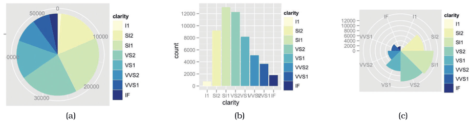

# Polar Area Charts

## Idiom box

<!-- verbatim p.195 -->
> What: Data Table: one quantitative attribute, one categorical attribute.
<!-- /verbatim -->

<!-- verbatim p.195 -->
> Why: Task Part–whole relationship.
<!-- /verbatim -->

<!-- verbatim p.195 -->
> How: Encode Area marks (wedges) with length channel; radial layout.
<!-- /verbatim -->

<!-- verbatim p.195 -->
> Scale One dozen categories.
<!-- /verbatim -->

## What it is

A radial chart that is a more direct equivalent of a bar chart transformed into polar coordinates: it encodes a single quantitative attribute by varying the length of each wedge, just as a bar chart varies the length of each bar, rather than varying the angle as a pie chart does [p.193]. Synonyms are rose plot and coxcomb plot; Florence Nightingale first popularised them in the 19th century, analysing Crimean war medical data [p.193]. Figure 7.17(c) shows the clarity distribution of diamonds, with each wedge redundantly coloured for legibility, though the idiom could be used without colour [p.193].

## Use when / avoid when

- **Use** for a part–whole relationship over about a dozen categories, per the idiom box [p.195].
- The radial-layout guidelines apply: radial layouts may show periodic patterns better, but angle is less accurate than position and is cyclic, so nonperiodic data may mislead, and the layout implies one attribute matters more than the other [pp.191-192].
- The book gives no further task guidance specific to polar area charts [pp.193-195].

## Figures

-  **Figure 7.17** [p.193]. Pie chart versus bar chart accuracy. (a) Pie charts require angle and area judgements. (b) Bar charts require only high-accuracy length judgements for individual items. (c) Polar area charts are a more direct equivalent of bar charts, where the length of each wedge varies like the length of each bar. From [Wickham 10, Figures 15 and 16].

## Alternatives and disambiguation

- **Pie charts** vary the angle of each wedge; polar area charts vary its length [p.193].
- **Bar charts** vary bar length on a rectilinear layout, using high-accuracy position along a common scale [p.193].
- **Radial bar charts** also use length on a radial layout, but with line marks rather than wedges [pp.192-193].

## Related

- [7.6.3 Radial Layouts](../ch07-arrange-tables/s07-06-spatial-axis-orientation/s07-06-03-radial-layouts.md): the section that presents this idiom [p.193]
- [Pie Charts](pie-charts.md): the angle-coded sibling [p.193]
- [Bar Charts](bar-charts.md): the rectilinear equivalent [p.193]

## Implementation hints [NOT FROM BOOK]

### matplotlib

Full-width bars on polar axes. Radius is linear in value here, so wedge area grows with its square; use `np.sqrt(counts)` if wedge area should track value.

```python
import numpy as np
import matplotlib.pyplot as plt

clarity = ["I1", "SI2", "SI1", "VS2", "VS1", "VVS2", "VVS1", "IF"]
counts = np.array([741, 9194, 13065, 12258, 8171, 5066, 3655, 1790])
theta = np.linspace(0, 2 * np.pi, len(counts), endpoint=False)

fig, ax = plt.subplots(subplot_kw={"projection": "polar"})
ax.bar(theta, counts, width=2 * np.pi / len(counts), align="edge",
       color=plt.cm.viridis(np.linspace(0.9, 0.1, len(counts))), edgecolor="white")
ax.set_xticks(theta + np.pi / len(counts), clarity)
ax.set_theta_zero_location("N")
ax.set_theta_direction(-1)
```

### D3

```js
const angle = d3.scaleBand().domain(data.map(d => d.key)).range([0, 2 * Math.PI]);
const r = d3.scaleLinear().domain([0, d3.max(data, d => d.value)]).range([0, radius]);
const arc = d3.arc().innerRadius(0).outerRadius(d => r(d.value))
  .startAngle(d => angle(d.key)).endAngle(d => angle(d.key) + angle.bandwidth());
svg.append("g").attr("transform", `translate(${width / 2},${height / 2})`)
  .selectAll("path").data(data).join("path").attr("d", arc).attr("fill", d => color(d.key)).attr("stroke", "white");
```
