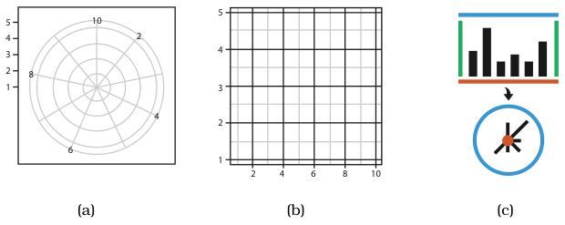
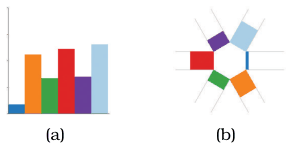

# Radial Bar Charts

## Idiom box

<!-- verbatim p.193 -->
> What: Data Table: one quantitative attribute, one categorical attribute.
<!-- /verbatim -->

<!-- verbatim p.193 -->
> How: Encode Length coding of line marks; radial layout.
<!-- /verbatim -->

The box has no Why: Task or Scale field [p.193].

## What it is

Figure 7.16 encodes the same five-attribute dataset as a rectilinear bar chart and as a radial bar chart: both use line marks to encode a quantitative attribute with the length channel, and the only difference is the radial versus rectilinear orientation of the axes [p.192].

A radial layout distributes items around a circle, using the angle channel in addition to one or more linear spatial channels; its natural coordinate system is polar, with one dimension an angle from a starting line and the other a distance from a centre point [p.191]. Mathematically, rectilinear and radial layouts are equivalent under a transformation that collapses one bounding line to the centre and wraps the other into a circle (Figure 7.15) [p.191].

## Use when / avoid when

The book states these as guidelines for radial layouts in general, not for this idiom alone [pp.191-196].

- **Periodic patterns**: a radial layout may be more effective than a rectilinear one at showing them [p.191]. In glyphmaps, radial plots showed cyclic patterns better, and rectilinear ones showed differences between linear and nonlinear trends better [p.195].
- **Nonperiodic data**: the angle channel is less accurately perceived than rectilinear position, and it is cyclic, so encoding nonperiodic data with it may be misleading [pp.191-192].
- **Avoid** when the two attributes have equal importance: radial layouts imply an asymmetry of importance between them [p.192].
- In an empirical study of memorising object positions, rectilinear grids beat radial ones on speed and tended to on accuracy; the results suggest radial layouts can be justified when one attribute is more important, with that attribute in the sectors and the other in the rings [pp.195-196].

## Figures

-  **Figure 7.15** [p.192]. Layout coordinate systems. (a) Radial layouts use polar coordinates, with one spatial position and one angle channel. (b) Rectlinear layouts use two perpendicular spatial position channels. After [Wickham 10, Figure 8]. (c) Transforming rectilinear to radial layouts maps two parallel bounding lines to a point at the center and a circle at the perimeter.
-  **Figure 7.16** [p.192]. Radial versus rectilinear layouts. (a) Rectilinear bar chart. (b) Radial bar chart. After [Booshehrian et al. 11, Figure 4].

## Alternatives and disambiguation

- **Bar charts** encode the same data with the same channel on a rectilinear layout [p.192].
- **Polar area charts** use wedge-shaped area marks whose length varies, rather than line marks [p.193].
- **Pie charts** encode the value with the angle of area marks [p.193].

## Related

- [7.6.3 Radial Layouts](../ch07-arrange-tables/s07-06-spatial-axis-orientation/s07-06-03-radial-layouts.md): the section that presents this idiom and the radial-layout guidelines [p.191]
- [5.5 Channel Effectiveness](../ch05-marks-channels/s05-05-channel-effectiveness/node.md): the accuracy ranking behind the angle-versus-length argument [p.193]
- [Bar Charts](bar-charts.md): the rectilinear equivalent [p.192]
- [Polar Area Charts](polar-area-charts.md): the wedge-based radial equivalent of a bar chart [p.193]

## Implementation hints [NOT FROM BOOK]

### matplotlib

Narrow bars on polar axes, starting from an inner radius so short bars stay visible.

```python
import numpy as np
import matplotlib.pyplot as plt

labels = ["A", "B", "C", "D", "E"]
values = np.array([4, 9, 6, 7, 3])
theta = np.linspace(0, 2 * np.pi, len(values), endpoint=False)

fig, ax = plt.subplots(subplot_kw={"projection": "polar"})
ax.bar(theta, values, width=0.35, bottom=2, color=[f"C{i}" for i in range(len(values))])
ax.set_xticks(theta, labels)
ax.set_yticks([])
ax.set_theta_zero_location("N")
ax.set_theta_direction(-1)
```

### D3

```js
const angle = d3.scaleBand().domain(data.map(d => d.key)).range([0, 2 * Math.PI]).padding(0.6);
const r = d3.scaleLinear().domain([0, d3.max(data, d => d.value)]).range([inner, outer]);
const arc = d3.arc().innerRadius(inner).outerRadius(d => r(d.value))
  .startAngle(d => angle(d.key)).endAngle(d => angle(d.key) + angle.bandwidth());
svg.append("g").attr("transform", `translate(${width / 2},${height / 2})`)
  .selectAll("path").data(data).join("path").attr("d", arc).attr("fill", (d, i) => d3.schemeTableau10[i]);
```
