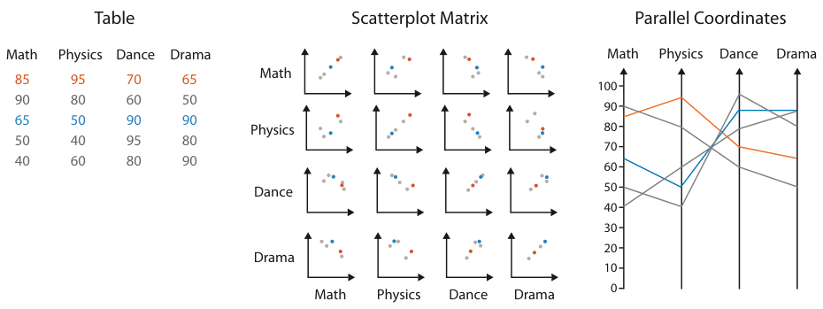

<a id="idiom:scatterplot-matrix"></a>

# Scatterplot Matrix (SPLOM)

## Idiom box

<!-- verbatim p.186 -->
> What: Data Table.
<!-- /verbatim -->

<!-- verbatim p.186 -->
> What: Derived Ordered key attribute: list of original attributes.
<!-- /verbatim -->

<!-- verbatim p.186 -->
> How: Encode Scatterplots in 2D matrix alignment.
<!-- /verbatim -->

<!-- verbatim p.186 -->
> Why: Task Find correlation, trends, outliers.
<!-- /verbatim -->

<!-- verbatim p.186 -->
> Scale Attributes: one dozen. Items: dozens to hundreds.
<!-- /verbatim -->

## What it is

A scatterplot matrix (SPLOM) is a matrix where each cell contains an entire scatterplot, showing all pairwise combinations of attributes with the original attributes as the rows and columns [p.185]. Unlike a heatmap, where each cell shows one value, each cell shows a complete chart [p.185]. It is the book's example of an idiom with many keys and values that recursively subdivides space [p.171].

The key is a simple derived attribute, the same for rows and columns: an index listing all the attributes in the original dataset, and the matrix could be reordered by any ordered attribute [p.185]. Usually only the lower or upper triangle is shown, rather than the redundant full square, and the diagonal cells are typically omitted, often showing axis labels instead [p.186]. SPLOMs are an example of small-multiple views [p.185].

## Use when / avoid when

- **Use** for finding correlations, trends and outliers, as with its constituent scatterplots [p.186].
- **Use** over parallel coordinates for finding correlation: in practice SPLOMs are typically easier for that task [p.188].
- **Scale**: each cell needs roughly 100 × 100 pixels to plot every item discernibly, which limits a SPLOM to around one dozen attributes and hundreds of items [p.186].

## Figures

-  **Figure 7.12** [p.188]. Comparison of scatterplot matrix and parallel coordinate idioms for a small data table. After [McGuffin 14].

## Alternatives and disambiguation

- **Scatterplots** show one pair of quantitative attributes [p.171].
- **Parallel coordinates** show the same table with parallel axes and polylines; they are more often used for overview, attribute ranges, range selection and outliers than for correlation [pp.187-188].
- **Heatmaps** use matrix alignment with one value per cell [p.185].
- **Scagnostics and compact heatmap-style overviews** are extensions of SPLOMs [p.186].

## Related

- [7.5.2 Matrix Alignment: Two Keys](../ch07-arrange-tables/s07-05-separate-order-align-categorical/s07-05-02-matrix-alignment-two-keys.md): the section that presents this idiom [p.185]
- [12.3.2 Share Data: All, Subset, None](../ch12-facet-into-multiple-views/s12-03-juxtapose-coordinate-views/s12-03-02-share-data-all-subset.md): SPLOMs as small multiples [p.185]
- [15.3 Graph-Theoretic Scagnostics](../ch15-analysis-case-studies/s15-03-graph-theoretic-scagnostics.md): an extension using derived attributes [p.186]
- [15.5 Hierarchical Clustering Explorer](../ch15-analysis-case-studies/s15-05-hierarchical-clustering-explorer.md): a compact heatmap-style overview [p.186]
- [Parallel Coordinates](parallel-coordinates.md): the parallel-axis alternative shown with the same table [p.187]

## Implementation hints [NOT FROM BOOK]

### matplotlib

Lower triangle only, with attribute names on the diagonal. `pandas.plotting.scatter_matrix(df)` draws the full square in one call.

```python
import numpy as np
import matplotlib.pyplot as plt

rng = np.random.default_rng(5)
names = ["Math", "Physics", "Dance", "Drama"]
cov = [[1, 0.8, -0.3, -0.2], [0.8, 1, -0.2, -0.1], [-0.3, -0.2, 1, 0.7], [-0.2, -0.1, 0.7, 1]]
scores = rng.multivariate_normal([70, 65, 60, 60], np.array(cov) * 100, 120)

n = len(names)
fig, axes = plt.subplots(n, n, figsize=(7, 7), sharex="col", sharey="row")
for i in range(n):
    for j in range(n):
        ax = axes[i, j]
        if i > j:
            ax.scatter(scores[:, j], scores[:, i], s=4, alpha=0.6)
        elif i == j:
            ax.text(0.5, 0.5, names[i], transform=ax.transAxes, ha="center", va="center")
            ax.tick_params(left=False, bottom=False, labelleft=False, labelbottom=False)
        else:
            ax.set_visible(False)
fig.subplots_adjust(wspace=0.05, hspace=0.05)
```

### D3

```js
const size = 120, pad = 10;
const scales = new Map(attrs.map(a => [a, d3.scaleLinear(d3.extent(data, d => d[a]), [pad, size - pad])]));
const pairs = d3.cross(attrs, attrs).filter(([a, b]) => attrs.indexOf(a) < attrs.indexOf(b));
svg.selectAll("g.cell").data(pairs).join("g").attr("class", "cell")
  .attr("transform", ([a, b]) => `translate(${attrs.indexOf(a) * size},${attrs.indexOf(b) * size})`)
  .each(function ([a, b]) {
    d3.select(this).selectAll("circle").data(data).join("circle").attr("r", 2)
      .attr("cx", d => scales.get(a)(d[a])).attr("cy", d => size - scales.get(b)(d[b]));
  });
```

Add `d3.brush` per cell and restyle the other cells' circles for linked brushing.
