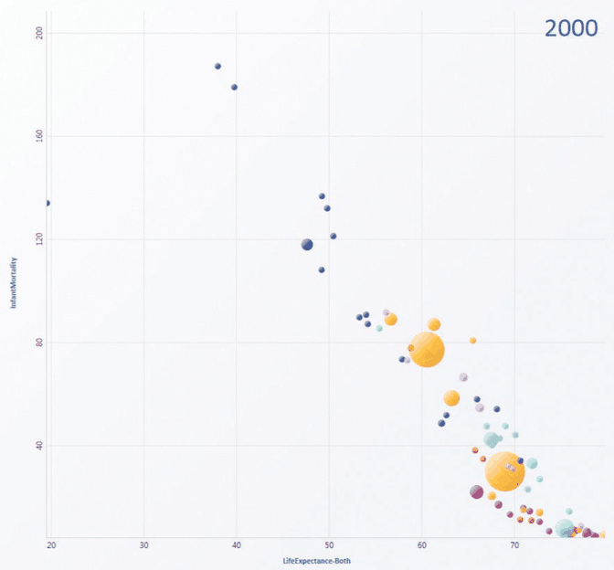
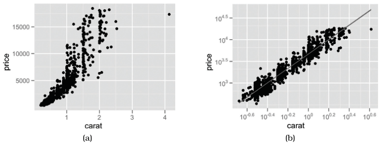

# Scatterplots

## Idiom box

<!-- verbatim p.173 -->
> What: Data Table: two quantitative value attributes.
<!-- /verbatim -->

<!-- verbatim p.173 -->
> How: Encode Express values with horizontal and vertical spatial position and point marks.
<!-- /verbatim -->

<!-- verbatim p.173 -->
> Why: Task Find trends, outliers, distribution, correlation; locate clusters.
<!-- /verbatim -->

<!-- verbatim p.173 -->
> Scale Items: hundreds.
<!-- /verbatim -->

## What it is

Scatterplots encode two quantitative value variables with both the vertical and horizontal spatial position channels, and the mark type is necessarily a point [p.171]. They are the canonical example of an idiom that shows only values, with no keys [p.171].

Colour coding often shows an additional attribute, and size coding can show yet another; size-coded scatterplots are sometimes called bubble plots [p.173]. Figure 7.2 plots infant mortality against life expectancy, with colour for country and size for population [pp.172-173].

Transformations can shed more light on the data: in Figure 7.3, log-scaled derived attributes of diamond price and weight are strongly positively correlated [p.172]. When judging correlation is the primary task, a calculated regression line is often superimposed on the points [p.173].

## Use when / avoid when

- **Use** for overviews and characterising distributions, and specifically for finding outliers and extreme values [p.171].
- **Use** to judge the correlation between two attributes: the stronger the correlation, the closer the points fall along a diagonal line, sloping upward for positive and downward for negative correlation [pp.171-172].
- **Use** for dozens or hundreds of items; scalability is limited by the need to distinguish points from each other [p.173].
- **Avoid** for more than two quantitative attributes on position alone: perpendicular axes give high-precision planar position for only two attributes, and channel inseparability limits how many nonspatial channels can be added [p.187].

## Figures

-  **Figure 7.2** [p.172]. Scatterplot. Each point mark represents a country, with horizontal and vertical spatial position encoding the primary quantitative attributes of life expectancy and infant mortality. The color channel is used for the categorical country attribute and the size channel for quantitative population attribute. From [Robertson et al. 08, Figure 1c].
-  **Figure 7.3** [p.173]. Scatterplots. (a) Original diamond price/carat data. (b) Derived log-scale attributes are highly positively correlated. From [Wickham 10, Figure 10].

## Alternatives and disambiguation

- **Scatterplot matrix (SPLOM)** puts one scatterplot per pair of attributes in a matrix, for tables with up to about a dozen attributes [pp.185-186].
- **Parallel coordinates** show many quantitative attributes at once with parallel axes; correlation shows as parallel or crossing segments rather than a diagonal, and SPLOMs are typically easier for that task [pp.187-188].
- **Dot charts** are like a scatterplot where one axis shows a categorical attribute rather than both showing quantitative attributes [p.180].

## Related

- [7.4 Express: Quantitative Values](../ch07-arrange-tables/s07-04-express-quantitative-values.md): the section that presents this idiom [p.171]
- [2.6.1 Key versus Value Semantics](../ch02-what-data-abstraction/s02-06-semantics/s02-06-01-key-value-semantics.md): why a scatterplot shows values and no keys [p.170]
- [12.4 Partition into Views](../ch12-facet-into-multiple-views/s12-04-partition-into-views/node.md): glyphs and views, for multi-attribute marks [p.171]
- [Scatterplot Matrix (SPLOM)](scatterplot-matrix-splom.md): the matrix of scatterplots for many attributes [p.185]
- [Parallel Coordinates](parallel-coordinates.md): the parallel-axis alternative for many attributes [p.187]

## Implementation hints [NOT FROM BOOK]

### matplotlib

`c=` and `s=` on `scatter` add colour and size channels (a bubble plot).

```python
import numpy as np
import matplotlib.pyplot as plt

rng = np.random.default_rng(0)
carat = rng.lognormal(-0.4, 0.5, 300)
price = 4000 * carat**1.7 * rng.lognormal(0, 0.2, 300)

fig, ax = plt.subplots()
ax.scatter(carat, price, s=10, alpha=0.5)
ax.set(xscale="log", yscale="log", xlabel="carat", ylabel="price")
slope, intercept = np.polyfit(np.log10(carat), np.log10(price), 1)
xs = np.geomspace(carat.min(), carat.max(), 50)
ax.plot(xs, 10**intercept * xs**slope, color="C1", label=f"slope {slope:.2f}")
ax.legend()
```

### D3

```js
const x = d3.scaleLog().domain(d3.extent(data, d => d.carat)).range([0, width]).nice();
const y = d3.scaleLog().domain(d3.extent(data, d => d.price)).range([height, 0]).nice();
svg.append("g").attr("transform", `translate(0,${height})`).call(d3.axisBottom(x));
svg.append("g").call(d3.axisLeft(y));
svg.append("g").attr("fill-opacity", 0.5)
  .selectAll("circle").data(data).join("circle")
  .attr("cx", d => x(d.carat)).attr("cy", d => y(d.price)).attr("r", 2.5);
```

Use `d3.scaleSqrt` on a third attribute for bubble radius, so area tracks value.
