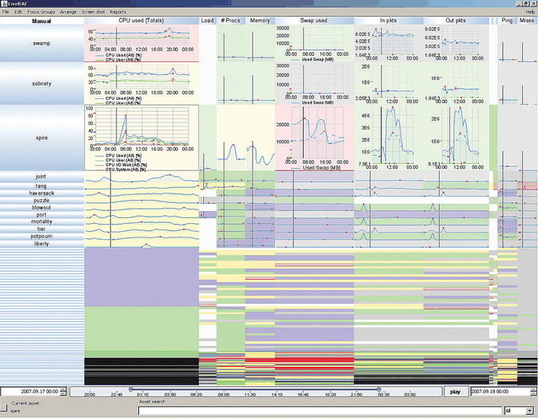
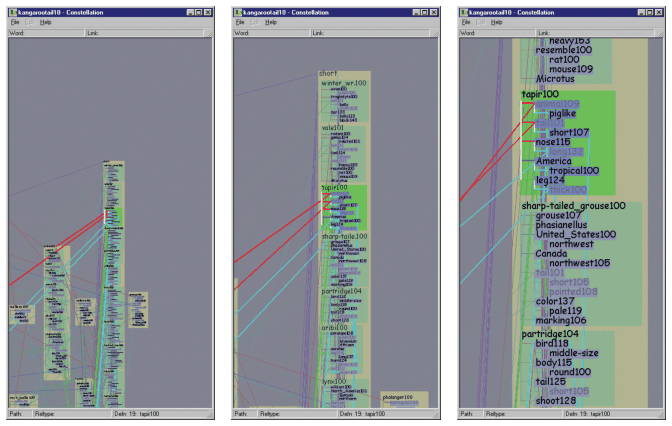

# Semantic Zooming

## Idiom box

No idiom box in the book.

- **What: Data.** Any items drawn in image-space regions whose size changes, such as documents in boxes or time series in a grid of cells [pp.280-281].
- **Why: Tasks.** Keep each item legible and informative at whatever size it is drawn [p.280].
- **How: Manipulate.** Navigate by zooming, with the representation adapting to the available pixels [p.280].

## What it is

<!-- verbatim p.280 -->
> With semantic zooming, the representation of the object adapts to the number of pixels available in the image-space region occupied by the object.
<!-- /verbatim -->

- It is a nongeometric approach that does not correspond to simply moving a virtual camera; appearance can change subtly or dramatically at different scales, rather than simply shrinking or enlarging [p.268] [p.280].
- **Text file example.** A box always represents the file, but holds only its name when small, the full document title at medium size, and a multiline summary when large [p.280].
- **LiveRAC (Figure 11.7).** A very large grid of time-series line charts of system resource usage adapts as rows and columns are stretched and squished: tiny cells show one categorical variable by colour; slightly larger ones add sparklines with dots at the minimum and maximum; past further thresholds, axes appear and multiple line charts are superimposed [pp.280-281].

## Use when / avoid when

- **Use** when content would be illegible if simply shrunk: without the change, multiple lines of text in a small box cannot be read [p.280].
- **Example of use.** LiveRAC applies it in a very large stretchable grid of time-series line charts, with stretch-and-squish navigation, which the book calls a focus+context approach [pp.280-281].
- The book gives no failure cases for semantic zooming [pp.280-281].

## Figures

-  **Figure 11.7** [p.281]. LiveRAC uses semantic zooming within a stretchable grid of time-series line charts. From [McLachlan et al. 08, Figure 2b].
-  **Figure 15.20** [p.391]. Constellation uses a subtle version of the semantic zooming design choice, where the space allocated for the first word versus the rest of the definition changes according to the zoom level. From [Munzner 00, Figure 5.19].

## Alternatives and disambiguation

- **Geometric Zooming** keeps appearance fixed and changes only drawn size [p.280].
- **Stretch and squish navigation** is the focus+context idiom LiveRAC pairs with semantic zooming: it decides how much space each cell gets, and semantic zooming decides what the cell draws in it [pp.280-281].
- **Semantic zooming versus distortion.** The book does not rank them as rivals. Semantic zooming is the choice that answers illegible content, because it changes the representation rather than only the drawn size [p.280]; the focus+context distortion idioms, and their costs, are in Chapter 14 [p.281].

## Related

- [11.5 Navigate: Changing Viewpoint](../ch11-manipulate-view/s11-05-navigate-changing-viewpoint.md#s11.05.02): the idiom in context [p.280]
- [Geometric Zooming](geometric-zooming.md): the geometric alternative [p.280]
- [Stretch and Squish Navigation](stretch-and-squish-navigation.md): the navigation LiveRAC uses [p.281]
- [14 Embed: Focus+Context](../ch14-embed-focus-context/node.md): focus+context approaches [p.281]
- [Line Charts](line-charts.md): the charts LiveRAC's cells grow into [p.280]
- [11.7 Further Reading](../ch11-manipulate-view/s11-07-further-reading.md): Pad++ and LiveRAC sources [p.287]

## Implementation hints [NOT FROM BOOK]

### matplotlib

Re-render on `xlim_changed`, choosing the representation from the data span visible per pixel.

```python
import numpy as np, matplotlib.pyplot as plt
rng = np.random.default_rng(2)
xy = rng.random((60, 2)) * 100
names = [f"item {i}: a longer description" for i in range(60)]
fig, ax = plt.subplots()
pts = ax.scatter(*xy.T, s=10)
labels = [ax.text(x, y, "", fontsize=7, clip_on=True) for x, y in xy]

def adapt(ax):
    span = np.diff(ax.get_xlim())[0]
    for t, n in zip(labels, names):
        t.set_text("" if span > 60 else n.split(":")[0] if span > 20 else n)
    pts.set_sizes([10 if span > 60 else 30])

ax.callbacks.connect("xlim_changed", adapt)
adapt(ax)
```

### D3

```js
// semantic: rescale positions, keep mark size; swap detail by zoom level k
svg.call(d3.zoom().scaleExtent([1, 40]).on("zoom", ({ transform: t }) => {
  const zx = t.rescaleX(x), zy = t.rescaleY(y);
  nodes.attr("transform", d => `translate(${zx(d.x)},${zy(d.y)})`);
  nodes.select("text").text(d => t.k < 4 ? "" : t.k < 12 ? d.name : `${d.name}: ${d.summary}`);
}));
```
