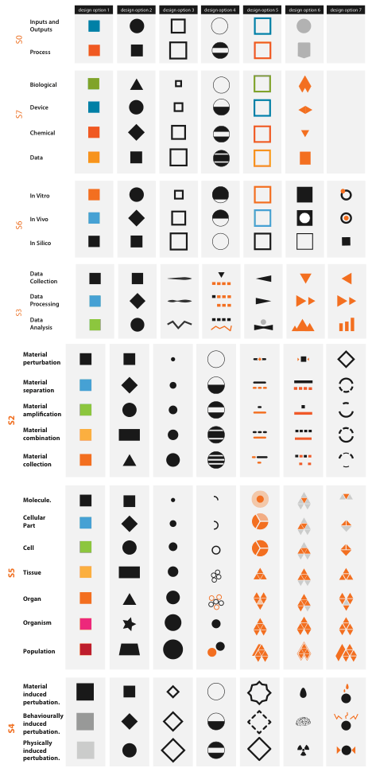

# Shape Channel

## Idiom box

No idiom box in the book.

- **What: Data.** Categorical attributes, as an identity channel [p.263].
- **Why: Tasks.** Distinguishing categories, including when colour has too few bins [pp.254-263].
- **How: Encode.** Shape of point marks; on line marks, stipple patterns such as dotted and dashed lines [p.263].
- **Scale.** Dozens or even hundreds of bins for large enough points; roughly a dozen within 10×10 pixels, with careful design [p.263].

## What it is

The book treats shape, a catch-all for a complex perceptual phenomenon built from lower-level preattentive features (closure, curvature, termination, intersection and others), as an identity channel for point and line marks [p.263].

<!-- verbatim p.263 -->
> The shape channel cannot be applied to area marks because their shape is constrained by definition.
<!-- /verbatim -->

## Use when / avoid when

- **Use** on point marks, the common and easily understood case [p.263].
- **Use** on line marks as dotted and dashed stipple patterns [p.263].
- **Use** with large enough marks when there are many categories: dozens or even hundreds of bins [p.263].
- **Use** filled shapes such as disks when the marks also carry colour hue; they are a good substrate for it [p.263].
- **Use** alongside or instead of colour when a categorical attribute has more levels than colour can distinguish, as in the 27-level workflow design (Figure 10.9) [p.254].
- **Avoid** on area marks [p.263].
- **Avoid** many shapes in small marks: far fewer bins exist in small regions, and within 10×10 pixels careful design might give roughly a dozen [p.263].
- **Avoid** sparse line-oriented shapes such as crosses when also encoding colour: they have fewer pixels for it [p.263].

## Figures

-  **Figure 10.9** [p.255]. Effective categorical colormap use: A large space of visual encoding possibilities for 27 categories was considered systematically in addition to the color channel, including size and shape channels and more complex glyphs. From [Maguire et al. 12, Figure 5].

## Alternatives and disambiguation

- **Categorical Colormaps**: hue gives six to twelve bins in small separated regions and ranks just after position for categories [p.251].
- **Texture and Stippling**: patterns combining orientation, scale and contrast give one or two dozen categorical bins; stippled lines are shape on line marks [pp.263-265].
- **Motion Channels**: the other identity channel, but safe only for a binary distinction [p.264].

## Related

- [10.4 Other Channels](../ch10-map-color-other-channels/s10-04-other-channels.md#s10.04.04): the full subsection [p.263]
- [10.3.1 Categorical Colormaps](../ch10-map-color-other-channels/s10-03-colormaps/s10-03-01-categorical-colormaps.md): the workflow example moving categories from colour to shape and glyphs [p.254]
- [Size Channels](size-channels.md): shape and size interfere with each other [p.263]

## Implementation hints [NOT FROM BOOK]

### matplotlib

```python
import matplotlib.pyplot as plt
import numpy as np
rng = np.random.default_rng(2)
for i, m in enumerate(["o", "s", "^", "D", "v", "P"]):  # filled shapes keep room for colour
    plt.scatter(*rng.normal(i, 0.5, (2, 15)), marker=m, s=40, label=f"cat {i}")
plt.plot([0, 6], [0, 6], linestyle="--", color="gray")  # shape on a line mark
plt.legend(fontsize=7)
```

### D3

```js
import * as d3 from "d3";
const shape = d3.scaleOrdinal(["a", "b", "c"], d3.symbolsFill);
const path = d3.symbol().type(shape("b")).size(64)();
console.log(path);
```
