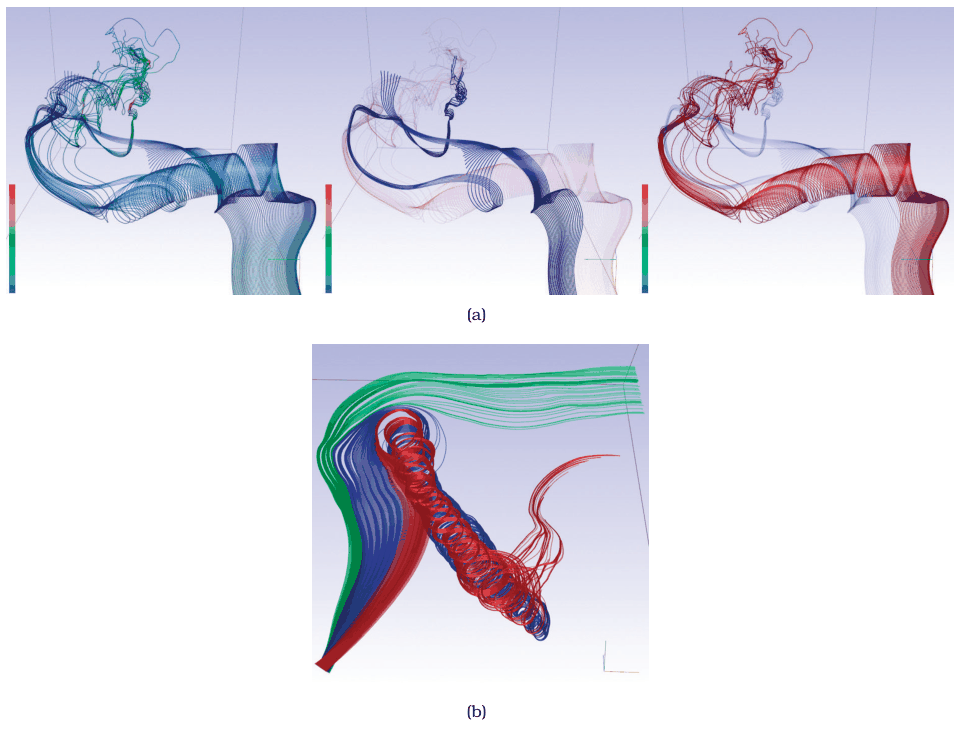

# Similarity-Clustered Streamlines

## Idiom box

<!-- verbatim p.218 -->
> What: Data Spatial field: 3D vector field.
<!-- /verbatim -->

<!-- verbatim p.218 -->
> What: Derived Geometry: streamlines or pathlines.
<!-- /verbatim -->

<!-- verbatim p.218 -->
> What: Derived One attribute per streamline/pathline (signature).
<!-- /verbatim -->

<!-- verbatim p.218 -->
> What: Derived Cluster hierarchy of streamlines/pathlines.
<!-- /verbatim -->

<!-- verbatim p.218 -->
> How: Encode Use derived geometry of lines, color, and opacity according to cluster.
<!-- /verbatim -->

<!-- verbatim p.218 -->
> Why: Tasks Find features, query shape.
<!-- /verbatim -->

<!-- verbatim p.218 -->
> Scale Field: millions of samples. Geometry: hundreds of streamlines.
<!-- /verbatim -->

## What it is

A seeding strategy for streamlines and pathlines based on a derived similarity measure, proposed by McLoughlin et al. [p.217].

- **Derived geometry.** Streamlines (steady fields) or pathlines (unsteady fields) are computed from the original 3D vector field [pp.216-217].
- **Derived attributes.** Each line gets curvature (deviation from a straight line), torsion (how much it bends out of its plane) and tortuosity (how twisted it is) [pp.217-218].
- **Signature and clusters.** A complex algorithm combines the three into a fourth attribute, the line's signature; signatures form a similarity matrix, which in turn yields a cluster hierarchy [p.218].
- **Filtering.** Users interactively filter which lines are seeded by cluster membership, so that as much detail as possible is preserved [p.218].
- **Encoding.** Lines are drawn in 3D and coloured by cluster, with interactive control over how many clusters show. Selecting a cluster emphasises it as a high-opacity foreground layer over a low-opacity translucent background layer [p.218].
- **Navigation.** Geometric 3D navigation lets users rotate to any viewpoint [p.218].

Figure 8.9(a) shows all streamlines at full opacity, then the purple and the red clusters emphasised; Figure 8.9(b) shows an unsteady field with three clusters of pathlines [p.218].

## Use when / avoid when

- **Use** for finding features and querying shape in a 3D vector field of millions of samples, shown as hundreds of streamlines [p.218].
- **Use** when choosing which lines to seed is the problem: seeding is the crucial geometric-flow choice, where poor choices cause visual clutter and occlusion and a well-chosen strategy supports inspecting 2D and 3D fields; this idiom seeds by derived similarity [pp.216-217].

## Figures

-  **Figure 8.9** [p.217]. Geometric flow vis idioms showing a sparse set of particle trajectories, with seeding and coloring according to similarity. (a) Streamlines: all clusters equally opaque; purple cluster emphasized; red cluster emphasized. (b) Pathlines, colored by three clusters. From [McLoughlin et al. 13, Figures 7 and 11c].

## Alternatives and disambiguation

- **Flow glyphs** show local information per cell, for example arrows; in 3D they suffer from occlusion, and in the Laidlaw et al. 2D study the two arrow-glyph idioms fared worst [pp.215-216].
- **Texture flow** such as LIC also traces particles, but with dense seeds across the whole field, mostly for 2D fields or fields on 2D surfaces [p.218].
- **Feature flow** locates structures such as critical points and vortices explicitly, rather than leaving users to infer them from trajectories [pp.218-219].
- **Ellipsoid Tensor Glyphs** address tensor rather than vector fields; their sparse-geometry counterparts are hyperstreamlines and tensorlines [pp.221-222].

## Related

- [8.5.2 Geometric Flow](../ch08-arrange-spatial-data/s08-05-vector-fields-multiple-values/s08-05-02-geometric-flow.md): streamlines, pathlines and seeding [p.216]
- [13.3 Filter](../ch13-reduce-items-attributes/s13-03-filter/node.md): filtering lines by cluster [p.218]
- [12.5 Superimpose Layers](../ch12-facet-into-multiple-views/s12-05-superimpose-layers/node.md): foreground and background layers [p.218]
- [11.5 Navigate: Changing Viewpoint](../ch11-manipulate-view/s11-05-navigate-changing-viewpoint.md): geometric 3D navigation [p.216]

## Implementation hints [NOT FROM BOOK]

### matplotlib

```python
import numpy as np, matplotlib.pyplot as plt
from matplotlib.colors import to_rgba
y, x = np.mgrid[-2:2:100j, -3:3:150j]
u, v = -1 - x**2 + y, 1 + x - y**2
seeds = np.column_stack([np.linspace(-2.8, 2.8, 24), np.zeros(24)])
cluster = (seeds[:, 0] > 0).astype(int)  # stand-in for signature-based clusters
emph = 1
fig, ax = plt.subplots()
for c, colour in enumerate(["tab:purple", "tab:red"]):
    alpha = 1.0 if c == emph else 0.15  # emphasised cluster opaque, others translucent
    ax.streamplot(x, y, u, v, start_points=seeds[cluster == c], color=to_rgba(colour, alpha),
                  linewidth=1.2, arrowsize=0.6, density=3, broken_streamlines=False)
ax.set_aspect("equal")
```

### D3

```js
function trace(field, [x, y], steps = 200, h = 0.01) {
  const pts = [[x, y]];
  for (let i = 0; i < steps; i++) {
    const [u, v] = field(x, y);
    x += h * u; y += h * v; pts.push([x, y]);
  }
  return pts;
}
export function draw(svg, field, seeds, clusterOf, emphasised, xs, ys) {
  const color = d3.scaleOrdinal(d3.schemeTableau10);
  const line = d3.line().x(d => xs(d[0])).y(d => ys(d[1]));
  svg.selectAll("path").data(seeds).join("path")
    .attr("d", s => line(trace(field, s)))
    .attr("fill", "none").attr("stroke", s => color(clusterOf(s)))
    .attr("stroke-opacity", s => clusterOf(s) === emphasised ? 1 : 0.15);
}
```
