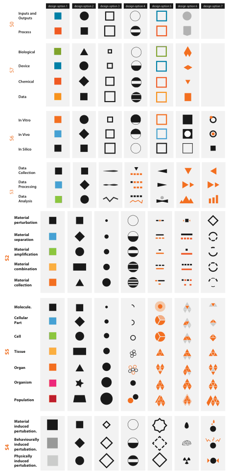

# Size Channels

## Idiom box

No idiom box in the book.

- **What: Data.** Ordered attributes [p.261].
- **Why: Tasks.** Judging magnitudes; accuracy depends strongly on which size dimension is used [p.261].
- **How: Encode.** Length (1D: height or width), area (2D) or volume (3D) of marks [p.261].

## What it is

<!-- verbatim p.261 -->
> Size is a magnitude channel suitable for ordered data. It interacts with most other channels: when marks are too small, encodings in another channel such as shape or orientation simply cannot be seen.
<!-- /verbatim -->

| Size channel | Accuracy |
| --- | --- |
| Length | Extremely accurate, close to unaligned planar position; only aligned planar position beats it [p.261] |
| Area | Significantly less accurate; Stevens exponent 0.7; mid-ranking, below angle, above 3D depth [p.261] |
| Volume | Quite inaccurate; bottom of the rankings with curvature [p.261] |

## Use when / avoid when

- **Use** length for ordered attributes that need accurate judgement [p.261].
- **Use** with care for hue and saturation: size interacts particularly strongly with both, and both are harder to perceive in small regions [pp.248-261].
- **Avoid** volume: encoding with it is rarely the right choice [p.261].
- **Avoid** encoding different attributes with length and area at once: a larger-dimensional size subsumes a smaller one [p.261].
- **Avoid** expecting width and height to stay separable: they are usually integral (Figure 5.10 gave three groups, not four), and people judging area may just judge length [p.261].
- **Avoid** marks so small that shape or orientation encodings on them cannot be seen [p.261]; hue and saturation are also harder to perceive in small regions [pp.248-249].

## Figures

-  **Figure 10.9** [p.255]. Effective categorical colormap use: A large space of visual encoding possibilities for 27 categories was considered systematically in addition to the color channel, including size and shape channels and more complex glyphs. From [Maguire et al. 12, Figure 5].

## Alternatives and disambiguation

- **Angle Channel** is less accurate than length but more than area [p.262].
- **Curvature Channel** shares volume's bottom ranking and applies only to line marks [p.263].
- **Ordered Colormaps** encode order with luminance or saturation, with few discriminable steps (luminance typically fewer than five on a non-uniform background, saturation around three) [p.248].

## Related

- [10.4 Other Channels](../ch10-map-color-other-channels/s10-04-other-channels.md#s10.04.01): the full subsection [p.261]
- [5.5.1 Accuracy](../ch05-marks-channels/s05-05-channel-effectiveness/s05-05-01-accuracy.md): the Stevens exponents in Figure 5.7 [p.261]
- [5.5.3 Separability](../ch05-marks-channels/s05-05-channel-effectiveness/s05-05-03-separability.md): the integral width and height example of Figure 5.10 [p.261]
- [Shape Channel](shape-channel.md): the channel most affected when marks are small [p.263]

## Implementation hints [NOT FROM BOOK]

### matplotlib

```python
import matplotlib.pyplot as plt
import numpy as np
vals = np.array([3, 7, 12, 20])
fig, (ax1, ax2) = plt.subplots(1, 2, figsize=(8, 3))
ax1.barh(range(len(vals)), vals)  # length: the accurate choice
ax2.scatter(range(len(vals)), np.zeros(len(vals)), s=vals * 40)  # area: s is in points^2
ax2.set_yticks([])
```

### D3

```js
import * as d3 from "d3";
const length = d3.scaleLinear([0, 20], [0, 300]);
const radius = d3.scaleSqrt([0, 20], [0, 30]); // area proportional to value
console.log(length(10), radius(10));
```
