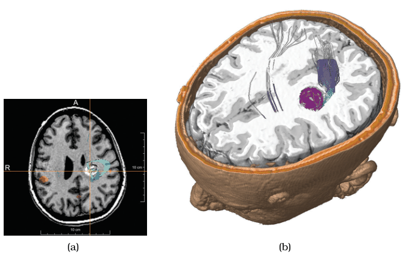
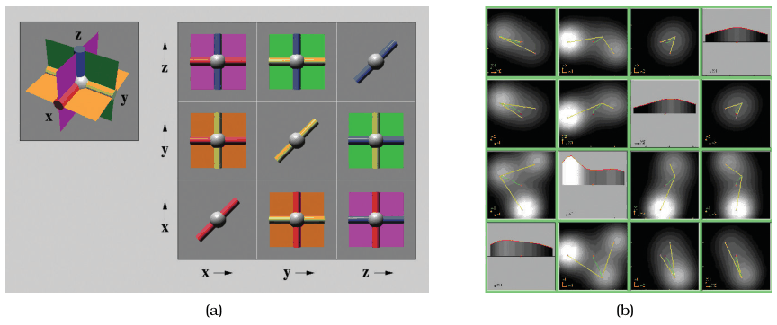

# Slice

## Idiom box

No idiom box in the book.

- **What: Data.** Very commonly spatial field datasets; sometimes abstract data with many attributes [p.283] [p.284].
- **Why: Tasks.** Reduce the number of attributes (dimensions) shown, for example to inspect the inside of a 3D scan cross section by cross section [p.283].
- **How: Manipulate.** Navigate to reduce attributes: choose one value of the dimension to eliminate and extract only the matching items [p.283].

## What it is

<!-- verbatim p.283 -->
> With the slice design choice, a single value is chosen from the dimension to eliminate, and only the items matching that value for the dimension are extracted to include in the lower-dimensional slice.
<!-- /verbatim -->

- It extracts a single slice from the view volume, an idea motivated by the camera metaphor of assigning attributes to spatial dimensions [p.268].
- **Figure 11.8(a).** A 3D head scan inspected by interactively moving the slice to different heights; each extracted point keeps its 2D position and colour [p.283].
- **Axis-aligned slices** follow the original dimensions of data capture and may match familiar views, such as the coronal, sagittal and horizontal planes medical students learn anatomy in [p.283].
- **Arbitrary orientation** is possible but more complex: finding the values may need significant computation rather than a look-up, and sampling and interpolation artefacts must be minimised [p.283].
- **Higher dimensions.** The slicing plane can be a hyperplane, or a line when reducing to one dimension; several dimensions can go at once, for example six to one [p.284].

## Use when / avoid when

- **Use** to reduce spatial data from 3D to 2D, where slicing is a particularly intuitive metaphor [p.283].
- **Axis-aligned slices** have the benefit that they may correspond to views familiar to the viewer, such as the standard cross sections of anatomy [p.283].
- **Use** on abstract data with many attributes, as HyperSlice does for scalar functions of many variables [p.284].
- **Cut shows more.** A cut at the same level shows more information than the 2D slice alone, because the 3D context behind the plane stays visible [p.285].

## Figures

-  **Figure 11.8** [p.284]. The slice choice eliminates a dimension/attribute by extracting only the items with a chosen value in that dimension. The cut choice eliminates all data on one side of a spatial cutting plane. (a) Axis-aligned slice. (b) Axis-aligned cut. From [Rieder et al. 08, Figures 7c and 0].
-  **Figure 11.9** [p.285]. The HyperSlice system uses extracting only the items with a chosen value in that dimension. (a) Three 3D planes that intersect at right angles. (b) Four-dimensional dataset where function value is encoded with luminance. From [van Wijk and van Liere 93, Figures 1 and 4].

## Alternatives and disambiguation

- **Cut** removes everything on the camera's side of a plane but keeps the 3D context behind it; slice keeps only the plane [p.285].
- **Project** keeps every item and drops the chosen dimensions' values instead of selecting one value [p.286].
- **HyperSlice** is a system that shows all orthogonal 2D slices of many-variable data in a linked matrix [p.284].

## Related

- [11.6 Navigate: Reducing Attributes](../ch11-manipulate-view/s11-06-navigate-reducing-attributes.md#s11.06.01): the idiom in context [p.283]
- [Cut](cut.md): the context-keeping alternative [p.285]
- [HyperSlice](hyperslice.md): slicing many-variable abstract data [p.284]
- [8.4 Scalar Fields: One Value](../ch08-arrange-spatial-data/s08-04-scalar-fields-one-value/node.md): sampling and interpolation for arbitrary slices [p.283]

## Implementation hints [NOT FROM BOOK]

### matplotlib

An axis-aligned slice is array indexing; a `Slider` moves the slice.

```python
import numpy as np, matplotlib.pyplot as plt
from matplotlib.widgets import Slider
z, y, x = np.mgrid[-1:1:40j, -1:1:64j, -1:1:64j]
vol = np.exp(-(x**2 + y**2 + z**2) * 3) + 0.3 * np.sin(6 * x) * np.cos(4 * z)
fig, ax = plt.subplots()
fig.subplots_adjust(bottom=0.2)
im = ax.imshow(vol[20], cmap="gray", vmin=vol.min(), vmax=vol.max())
s = Slider(fig.add_axes([0.2, 0.05, 0.6, 0.04]), "z", 0, vol.shape[0] - 1, valinit=20, valstep=1)
s.on_changed(lambda k: (im.set_data(vol[int(k)]), fig.canvas.draw_idle()))
```

For an arbitrary plane, sample with `scipy.ndimage.map_coordinates` (interpolated, so watch the artefacts).

### D3

```js
// vol: Float32Array of nz*ny*nx; draw slice k into a canvas through a sequential scale
const color = d3.scaleSequential(d3.interpolateGreys).domain(d3.extent(vol));
function drawSlice(k) {
  const img = ctx.createImageData(nx, ny);
  for (let i = 0; i < nx * ny; i++) {
    const c = d3.rgb(color(vol[k * nx * ny + i]));
    img.data.set([c.r, c.g, c.b, 255], i * 4);
  }
  ctx.putImageData(img, 0, 0);
}
d3.select("#slice").on("input", function () { drawSlice(+this.value); });
```
