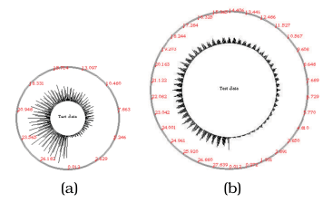

# SolarPlot

## Idiom box

<!-- verbatim p.335 -->
> What: Data Table: one quantitative attribute.
<!-- /verbatim -->

The What: Derived field breaks across a page and Figure 13.8, so it is quoted in two parts [pp.335-336]:

<!-- verbatim p.335 -->
> What: Derived Derived table: one derived ordered key attribute (bin), one derived quantitative value attribute (item
<!-- /verbatim -->

<!-- verbatim p.336 -->
> count per bin). Number of bins interactively controlled.
<!-- /verbatim -->

<!-- verbatim p.336 -->
> How: Encode Radial layout, line marks. Line length: express derived value attribute; angle: key attribute.
<!-- /verbatim -->

<!-- verbatim p.336 -->
> How: Reduce Item aggregation.
<!-- /verbatim -->

<!-- verbatim p.336 -->
> Scale Original items: unlimited. Derived bins: proportional to screen space allocated.
<!-- /verbatim -->

The box has no Why: Tasks field [pp.335-336].

## What it is

SolarPlot is a radial histogram with an interactively controllable aggregation level [p.335]. The user directly manipulates the size of the base circle, which is the chart's radial axis; changing the radius indirectly changes the number of available bins, and so the aggregation level [p.335]. Like all histograms, its aggregation operator is count: the height of a bar is the number of items in its set [p.335].

Figure 13.8 shows ticket sales over 30 years, starting at the base of the circle and progressing counterclockwise [p.335]. The small circle (a) is heavily aggregated and shows an increase in sales over the years; the larger circle (b) is less aggregated, and seasonal patterns within each year can be distinguished [p.335].

## Use when / avoid when

- **Use** when the user should change the aggregation level on the fly; the book calls aggregation particularly powerful in such interactive idioms [p.330] [p.335].
- **Patterns at more than one level.** In the book's example, the heavily aggregated small circle shows an increase in ticket sales over the years, and the larger, less aggregated circle also shows seasonal patterns within each year [p.335].
- **Expect** the number of bins to be limited by screen space: derived bins are proportional to the screen space allocated [p.336].

## Figures

-  **Figure 13.8** [p.336]. The SolarPlot circular histogram idiom provides indirect control of aggregation level by changing the circle size. (a) The small circle shows the increase in ticket sales over time. (b) Enlarging the circle shows seasonal patterns in addition to the gradual increase. From [Chuah 98, Figures 1 and 2].

## Alternatives and disambiguation

- **Histograms** use a rectilinear layout; SolarPlot is a radial histogram whose bin count the user controls indirectly through circle size, where a plain histogram's bin count is computed or set with explicit controls [p.331] [p.335].
- **Hierarchical parallel coordinates** also give interactive control of aggregation level, through a slider over a cluster hierarchy rather than a circle radius [p.337].

## Related

- [13.4.1 Item Aggregation](../ch13-reduce-items-attributes/s13-04-aggregate/s13-04-01-item-aggregation.md): the section that presents the idiom and dynamic aggregation in general [p.335]
- [Histograms](histograms.md): the rectilinear idiom SolarPlot makes radial [p.335]
- [7.6.3 Radial Layouts](../ch07-arrange-tables/s07-06-spatial-axis-orientation/s07-06-03-radial-layouts.md): the radial layout family [p.336]
- [Hierarchical Parallel Coordinates](hierarchical-parallel-coordinates.md): another idiom with interactive aggregation level [p.336]

## Implementation hints [NOT FROM BOOK]

### matplotlib

```python
import numpy as np, matplotlib.pyplot as plt
rng = np.random.default_rng(0)
t = np.sort(rng.uniform(0, 30, 20_000))
season = 1 + 0.5 * np.sin(2 * np.pi * t)
t = t[rng.uniform(0, 1.5, t.size) < season * (t / 30 + 0.2)]
n_bins = 360
counts, edges = np.histogram(t, bins=n_bins, range=(0, 30))
theta = -np.pi / 2 + 2 * np.pi * edges[:-1] / 30
ax = plt.subplot(projection="polar")
ax.bar(theta, counts, width=2 * np.pi / n_bins, bottom=counts.max() * 0.5, align="edge")
ax.set_xticks([]); ax.set_yticks([])
```

Tie `n_bins` to the base radius (for example a `matplotlib.widgets.Slider`) to mimic indirect control.

### D3

Bin with `d3.bin().thresholds(n)` where `n` is derived from the base radius, map bins to angle with `d3.scaleLinear().domain([t0, t1]).range([0, 2 * Math.PI])` and draw bars with `d3.arc().innerRadius(r0).outerRadius(d => r0 + h(d.length))`. Recompute `n` on drag of the base circle.
