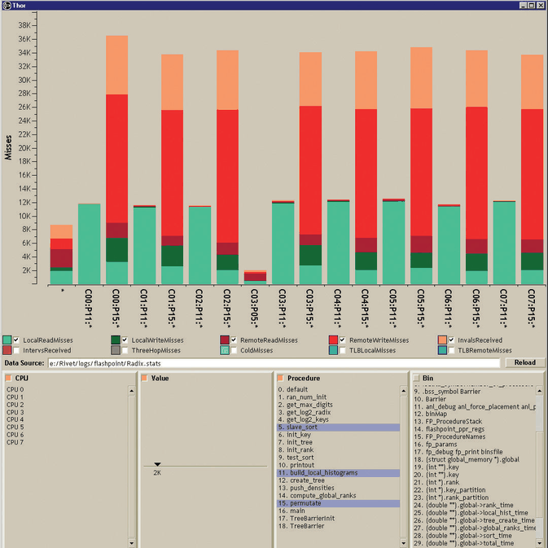
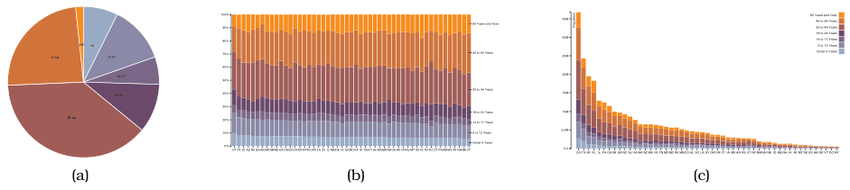

# Stacked Bar Charts

## Idiom box

<!-- verbatim p.178 -->
> What: Data Multidimensional table: one quantitative value attribute, two categorical key attributes.
<!-- /verbatim -->

<!-- verbatim p.178 -->
> How: Encode Bar glyph with length-coded subcomponents of value attribute for each category of secondary key attribute. Separate bars by category of primary key attribute.
<!-- /verbatim -->

<!-- verbatim p.178 -->
> Why: Task Part-to-whole relationship, lookup values, find trends.
<!-- /verbatim -->

<!-- verbatim p.178 -->
> Scale Key attribute (main axis): dozens to hundreds of levels. Key attribute (stacked glyph axis): several to one dozen
<!-- /verbatim -->

## What it is

A stacked bar chart uses a more complex glyph for each bar, with multiple sub-bars stacked vertically: the length of the composite glyph still encodes a value, and each subcomponent also encodes a length-encoded value [p.176]. It shows a two-dimensional table with two keys: the glyphs are arranged as a list by the primary key, and the secondary key builds the vertical structure of each glyph [p.176]. Both stacked bar charts and streamgraphs can be oriented vertically or horizontally [p.178].

Each subcomponent is coloured by the same key that sets the vertical ordering; abutted end to end at equal width, the subcomponents would not be distinguishable without different colours, and black outlines with white fill would make comparing them across bars considerably more difficult [p.176]. In Figure 7.5, a memory profiler distributes bars by processor and procedure, and stacks and colours them by type of cache miss [p.176].

## Use when / avoid when

- **Use** to look up values by either of the two keys [p.176].
- **Typically used** for absolute data; relative proportions of parts to a whole can be shown with a normalized stacked bar chart [p.177].
- **Compare** the lowest component and the full bar height across bars: both are read against the flat baseline, a judgement of position against a common scale [p.176].
- **Harder to compare**: the other components across bars, because their starting points are not aligned to a common scale; the stacking order therefore decides which patterns are most easily visible [pp.176-177].
- **Scale**: the main axis scales like a standard bar chart; the stacked key works well with several categories, up to around one dozen [p.177].

## Figures

-  **Figure 7.5** [p.177]. Stacked bar chart. The Thor memory profiler shows cache misses stacked and colored by miss type. From [Bosch 01, Figure 4.1].
-  **Figure 7.18** [p.194]. Relative contributions of parts to a whole. (a) A single pie chart shows the relative contributions of parts to a whole, such as percentages, using area judgements. (b) Each bar in a normalized stacked bar chart also shows the relative contributions of parts to a whole, with a higher-accuracy length encoding. (c) A stacked bar chart shows the absolute counts in each bar, in contrast to the percentages when each bar is normalized to the same vertical length. From <http://bl.ocks.org/mbostock/3887235>, <http://bl.ocks.org/mbostock/3886208>, <http://bl.ocks>. org/mbostock/3886394.

## Alternatives and disambiguation

- **Bar charts** show one key; stacked bars add a second key inside each glyph [p.176].
- **Normalized stacked bar charts** stretch every bar to the same length to show percentages rather than absolute counts [p.194].
- **Streamgraphs** emphasise the continuity of layers across time rather than vertical glyphs at a point in time, and scale to more categories because most layers do not span the whole timeline [pp.178-179].
- **Pie charts** show one whole; a single normalized stacked bar shows the same information with more accurate length judgements [p.194].

## Related

- [7.5.1 List Alignment: One Key](../ch07-arrange-tables/s07-05-separate-order-align-categorical/s07-05-01-list-alignment-one-key.md): the section that presents this idiom as a list alignment with two keys [p.176]
- [7.6.3 Radial Layouts](../ch07-arrange-tables/s07-06-spatial-axis-orientation/s07-06-03-radial-layouts.md): normalized stacked bars compared with pie charts [p.177]
- [Normalized Stacked Bar Charts](normalized-stacked-bar-charts.md): the part-to-whole variant [p.177]
- [Streamgraphs](streamgraphs.md): the generalised stacked display over time [p.178]

## Implementation hints [NOT FROM BOOK]

### matplotlib

Put the most important series at the bottom, where it sits on the common baseline.

```python
import numpy as np
import matplotlib.pyplot as plt

procedures = ["p0:solve", "p0:io", "p1:solve", "p1:io", "p2:solve"]
miss_types = ["compulsory", "capacity", "conflict"]
counts = np.array([[40, 10, 35, 8, 30], [25, 5, 30, 4, 20], [12, 2, 18, 3, 9]])

fig, ax = plt.subplots()
bottom = np.zeros(len(procedures))
for miss_type, row in zip(miss_types, counts):
    ax.bar(procedures, row, bottom=bottom, label=miss_type)
    bottom += row
ax.set_ylabel("cache misses")
ax.legend(title="miss type", reverse=True)
```

With a pandas frame (rows are bars, columns are stack levels), `df.plot.bar(stacked=True)` does the same.

### D3

```js
const series = d3.stack().keys(keys)(data);
const x = d3.scaleBand().domain(data.map(d => d.name)).range([0, width]).padding(0.1);
const y = d3.scaleLinear().domain([0, d3.max(series.at(-1), d => d[1])]).nice().range([height, 0]);
const color = d3.scaleOrdinal(keys, d3.schemeTableau10);
svg.selectAll("g.layer").data(series).join("g").attr("class", "layer").attr("fill", s => color(s.key))
  .selectAll("rect").data(s => s).join("rect")
  .attr("x", d => x(d.data.name)).attr("width", x.bandwidth())
  .attr("y", d => y(d[1])).attr("height", d => y(d[0]) - y(d[1]));
```
