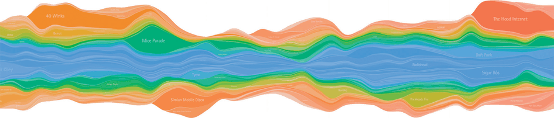
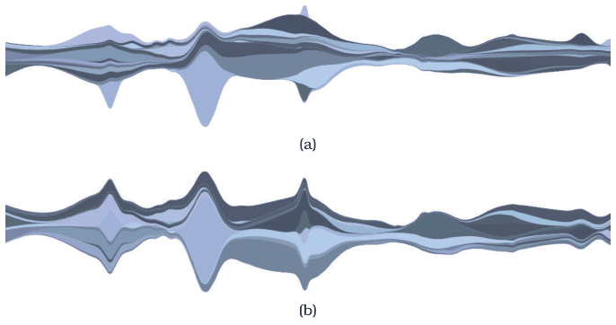

# Streamgraphs

## Idiom box

<!-- verbatim p.179 -->
> What: Data Multidimensional table: one quantitative value attribute (counts), one ordered key attribute (time), one categorical key attribute (artist).
<!-- /verbatim -->

<!-- verbatim p.179 -->
> What: Derived One quantitative attribute (for layer ordering).
<!-- /verbatim -->

<!-- verbatim p.179 -->
> How: Encode Use derived geometry showing artist layers across time, layer height encodes counts.
<!-- /verbatim -->

<!-- verbatim p.179 -->
> Scale Key attributes (time, main axis): hundreds of time points. Key attributes (artists, short axis): dozens to hundreds
<!-- /verbatim -->

The box has no Why: Task field [p.179].

## What it is

A more complex generalised stacked graph display; Figure 7.6 shows music listening history, one time series per artist counting weekly listens [p.178]. The streamgraph shows derived geometry that emphasises the continuity of the horizontal layers for each artist, rather than individual vertical glyphs that would emphasise listening behaviour at a specific point in time [p.178]. That geometry is the result of a global computation, whereas individual glyphs need only calculations about their own local region [p.178].

The deliberately organic silhouette emphasises the legibility of individual streams rather than using the horizontal axis as the baseline [pp.178-179]. The shape is optimised as a trade-off between the external silhouette, the deviation of each layer from the baseline and the amount of wiggle in the baseline [p.179]. Layer order comes from an algorithm that emphasises a derived value, such as the volatility of an artist's popularity or the onset time when they began to gain attention (Figure 7.7) [p.179]. Streamgraphs can be oriented either vertically or horizontally [p.178].

The idiom was popularised with the ThemeRiver system, and later work analyses its geometry and aesthetics [p.200].

## Use when / avoid when

- **Use** to follow individual series across time, where layer continuity matters more than one time point [p.178].
- **Use** when there are more categories than a stacked bar chart can take: most layers do not extend across the entire timeline [p.179].
- **Prefer individual vertical glyphs** (stacked bars) when behaviour at a specific point in time is the focus [p.178].

## Figures

-  **Figure 7.6** [p.178]. Streamgraph of music listening history. From [Byron and Wattenberg 08, Figure 0].
-  **Figure 7.7** [p.179]. Streamgraphs with layers ordered by different derived attributes. (a) Volatility of artist’s popularity. (b) Onset time when artist’s music of first gained attention. From [Byron and Wattenberg 08, Figure 15].

## Alternatives and disambiguation

- **Stacked bar charts** build each glyph locally at one key value and suit several to a dozen stacked categories; streamgraphs compute the whole shape globally and suit dozens to hundreds [pp.178-179].
- **Line charts** show trend for one value attribute over an ordered key, without stacking [p.181].

## Related

- [7.5.1 List Alignment: One Key](../ch07-arrange-tables/s07-05-separate-order-align-categorical/s07-05-01-list-alignment-one-key.md): the section that presents this idiom [p.178]
- [7.8 Further Reading](../ch07-arrange-tables/s07-08-further-reading.md): ThemeRiver and the geometry analysis [p.200]
- [Stacked Bar Charts](stacked-bar-charts.md): the glyph-based stacked display [p.178]

## Implementation hints [NOT FROM BOOK]

### matplotlib

`baseline="weighted_wiggle"` is the Byron and Wattenberg streamgraph baseline; `"sym"` gives ThemeRiver's symmetric one. Order layers by onset so early streams sit in the middle.

```python
import numpy as np
import matplotlib.pyplot as plt

rng = np.random.default_rng(1)
weeks = np.arange(150)
onsets = rng.integers(0, 120, 12)
layers = np.array([np.exp(-((weeks - t - 15) / rng.uniform(8, 25)) ** 2) * rng.uniform(5, 20) for t in onsets])

order = np.argsort(onsets)
inside_out = np.concatenate([order[::2][::-1], order[1::2]])
fig, ax = plt.subplots(figsize=(10, 4))
ax.stackplot(weeks, layers[inside_out], baseline="weighted_wiggle", colors=plt.cm.tab20.colors)
ax.set(xlabel="week", yticks=[])
```

### D3

```js
const series = d3.stack().keys(artists)
  .offset(d3.stackOffsetWiggle).order(d3.stackOrderInsideOut)(rows);
const y = d3.scaleLinear()
  .domain([d3.min(series, s => d3.min(s, d => d[0])), d3.max(series, s => d3.max(s, d => d[1]))])
  .range([height, 0]);
const area = d3.area().curve(d3.curveBasis)
  .x(d => x(d.data.week)).y0(d => y(d[0])).y1(d => y(d[1]));
svg.selectAll("path").data(series).join("path").attr("d", area).attr("fill", s => color(s.key));
```
