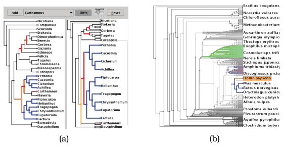
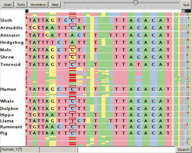

# Stretch and Squish Navigation

## Idiom box

<!-- verbatim p.358 -->
> What: Data Any data.
<!-- /verbatim -->

<!-- verbatim p.358 -->
> How: Encode Any layout.
<!-- /verbatim -->

<!-- verbatim p.358 -->
> How: Reduce Embed: distort with stretch and squish; multiple foci, global rectangular regions, stretch and squish navigation interaction metaphor.
<!-- /verbatim -->

## What it is

A distortion idiom with multiple rectangular foci of global extent, where enlarging some regions causes others to shrink: the scene is drawn on a rubber sheet, and stretching one region squishes the rest [p.356]. The sheet's borders stay fixed, so every item stays in the viewport, though it may be projected to an arbitrarily small region [p.356]. Users can stretch rectangular focal regions separately in the horizontal and vertical directions [p.356]. TreeJuxtaposer uses it to compare two small trees with linked highlighting and navigation, and to stretch many regions within one large tree [p.356].

**Guaranteed visibility.** The examples also show this encoding idiom, which keeps important objects visible however small, by aggregating at the subpixel level while taking each item's importance attribute into account [p.356]. Realistic graphics can skip distant objects, but in abstract scenes camera distance is a poor stand-in for importance, so an original or derived attribute is used instead of, or with, geometric distance [pp.356-357]. In PRISequenceJuxtaposer, gene sequences over 16,000 nucleotides wide fit under 700 pixels, and red difference marks stay visible even where hundreds or thousands of items share a pixel [p.357]. In Figure 11.7, red alert boxes are always visible because their colour also encodes importance [pp.357-358].

## Use when / avoid when

- **Use** over any data and layout when several separate regions need detail at once and everything must stay inside the viewport [pp.356-358].
- **Use** with guaranteed visibility when important marks must not vanish in heavily squished regions [pp.356-357].
- **Examples.** TreeJuxtaposer uses it to compare trees and PRISequenceJuxtaposer to compare gene sequences [pp.356-357].
- **Avoid** for tasks needing distance or length comparisons, which distortion severely impairs [p.359].
- **Mind the distortion load.** Constrained and predictable distortion is better tolerated than drastic distortion, and tracking cost grows with the amount of distortion [p.360].

## Figures

-  **Figure 14.7** [p.357]. TreeJuxtaposer uses stretch and squish navigation with multiple rectangular foci for exploring phylogenetic trees. (a) Stretching a single region when comparing two small trees. (b) Stretching multiple regions within a large tree. From [Munzner et al. 03, Figures 5 and 1].
-  **Figure 14.8** [p.357]. PRISequenceJuxtaposer supports comparing gene sequences using the stretch and squish navigation idiom with the guaranteed visibility of marks representing items with a high importance value, via a rendering algorithm with custom subpixel aggregation. From [Slack et al. 06, Figure 3].

## Alternatives and disambiguation

- **Nonlinear Magnification Fields.** Also multiple foci, but local regions of arbitrary shape and level, with lens, stretch or data-driven metaphors [pp.358-359].
- **Fisheye Lens.** One local radial focus moved as a lens, rather than several global rectangular foci [p.353].
- **Semantic Zooming.** The book cites Figure 11.7, the LiveRAC grid that Chapter 11 presents as semantic zooming, as an example of this idiom [p.356], where red alert boxes also show guaranteed visibility [pp.357-358].

## Related

- [14.5 Distort](../ch14-embed-focus-context/s14-05-distort.md): the distortion design choices and the full example [p.356]
- [11.5 Navigate: Changing Viewpoint](../ch11-manipulate-view/s11-05-navigate-changing-viewpoint.md): home of Figure 11.7, the LiveRAC example [p.356]
- [Semantic Zooming](semantic-zooming.md): the idiom LiveRAC uses within its stretchable grid [p.357]
- [13.4.1 Item Aggregation](../ch13-reduce-items-attributes/s13-04-aggregate/s13-04-01-item-aggregation.md): aggregation, which guaranteed visibility performs at the subpixel level [p.356]
- [14.7 Further Reading](../ch14-embed-focus-context/s14-07-further-reading.md): TreeJuxtaposer and PRISAD sources [p.363]

## Implementation hints [NOT FROM BOOK]

### matplotlib

```python
import numpy as np, matplotlib.pyplot as plt
from matplotlib.scale import FuncScale
x = np.arange(16000)
diff = np.zeros_like(x); diff[[300, 4100, 4120, 9000, 15500]] = 1
data_pts = [0, 4000, 4300, 16000]      # focus region 4000-4300
screen_pts = [0, 0.2, 0.7, 1.0]        # stretched to half the width
fwd = lambda v: np.interp(v, data_pts, screen_pts)
inv = lambda v: np.interp(v, screen_pts, data_pts)
fig, ax = plt.subplots(figsize=(8, 1.5))
ax.set_xscale(FuncScale(ax, (fwd, inv)))
ax.vlines(x[diff == 1], 0, 1, colors="red", lw=1.5)  # guaranteed-visible marks
ax.axvspan(4000, 4300, alpha=0.1)
ax.set_xlim(0, 16000)
```

### D3

```js
import * as d3 from "d3";
// Piecewise scale: each focus interval gets more pixels; borders stay fixed.
export const x = d3.scaleLinear()
  .domain([0, 4000, 4300, 16000])
  .range([0, 140, 490, 700]);
// Stretch by editing the range stops on drag, then rerender with a transition.
```
