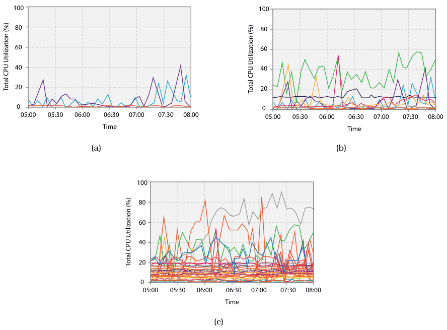
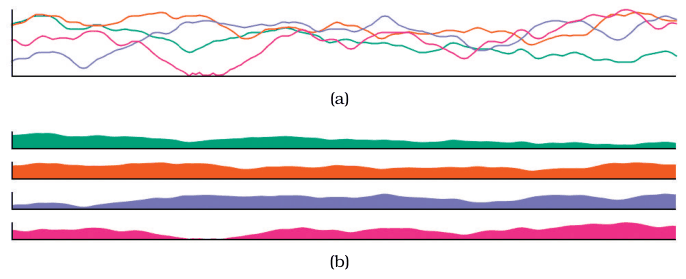

# Superimposed Line Charts

## Idiom box

<!-- verbatim p.316 -->
> What: Data Multidimensional table: one ordered key attribute (time), one categorical key attribute (machine), one quantitative value attribute (CPU utilization).
<!-- /verbatim -->

<!-- verbatim p.316 -->
> How: Encode Line charts, colored by machine attribute.
<!-- /verbatim -->

<!-- verbatim p.316 -->
> How: Facet Superimpose: static layers, distinguished with color.
<!-- /verbatim -->

<!-- verbatim p.316 -->
> Scale Ordered key attribute: hundreds. Categorical key attribute: one dozen.
<!-- /verbatim -->

The box gives no Why: Tasks field [p.316].

## What it is

A common use of superimposition: several lines representing different items are drawn in one shared frame to create combined charts (Figure 12.14). Alignment is straightforward, since every line sits directly on top of the others in the same frame [p.315]. It works because the only mark is a thin line, mostly disjoint from the other marks [p.315]. Static layers are all displayed at once, and the user chooses which to focus on by directing attention [p.314].

## Use when / avoid when

- **Use** for a few series: occlusion is very small with three lines, and the idiom is still usable with nearly a dozen [p.315]. The book is inconsistent about the limit: the text says nearly one dozen and the idiom box's Scale says one dozen, while the caption of Figure 12.14(b) says up to a few dozen lines can still be understood [pp.315-316].
- **Avoid** for many dozens or hundreds of series: the approach does not scale (Figure 12.14(c)) [p.315].
- **Use** for comparison within a local visual span, such as finding the highest series at one point in time; an empirical study found superimposed lines performed best there [p.317].
- **Avoid** for dispersed tasks needing large visual spans, such as the highest increase over the whole period: juxtaposed small multiples were better, especially as the number of series increased [p.317].

## Figures

-  **Figure 12.14** [p.316]. Multiple line charts can be superimposed within the same global frame. (a) A small number of items is easily readable. (b) Up to a few dozen lines can still be understood. (c) This technique does not scale to hundreds of items.
-  **Figure 12.15** [p.317]. Empirical study comparing superimposed line charts to juxtaposed filled-area line charts. (a) Superimposed line charts performed best for tasks carried out within a local visual span. (b) Juxtaposed filled area charts were best for global tasks, especially as the number of time series increased. From [Javed et al. 10, Figures 1 and 2].

## Alternatives and disambiguation

- **Juxtaposed small multiples of filled-area charts** suit global tasks such as overall slope or discrimination across time points; in the study they were given the same total screen area as the superimposed view [p.317].
- **Line Charts** is the single-series idiom being layered here [p.315].
- **Cartographic Layering** is static layering by luminance and saturation contrast between area and line layers, rather than many same-weight lines told apart by colour [pp.314-315].

## Related

- [12.5.2 Static Layers](../ch12-facet-into-multiple-views/s12-05-superimpose-layers/s12-05-02-static-layers.md): the idiom and the empirical study in context [p.315]
- [12.5.1 Visually Distinguishable Layers](../ch12-facet-into-multiple-views/s12-05-superimpose-layers/s12-05-01-visually-distinguishable-layers.md): why many layers are feasible only when each holds very little, such as a single line [p.314]
- [Line Charts](line-charts.md): the constituent idiom [p.315]
- [Multiform Overview–Detail Microarrays](multiform-overview-detail-microarrays.md): uses globally superimposed line charts as its overview [p.297]
- [12.3.2 Share Data: All, Subset, None](../ch12-facet-into-multiple-views/s12-03-juxtapose-coordinate-views/s12-03-02-share-data-all-subset.md): small multiples, the juxtaposed alternative [p.317]

## Implementation hints [NOT FROM BOOK]

### matplotlib

```python
import numpy as np, matplotlib.pyplot as plt
rng = np.random.default_rng(6)
t = np.arange(180)                                        # ordered key: hundreds
cpu = np.clip(50 + rng.normal(0, 3, (6, 180)).cumsum(axis=1), 0, 100)
fig, ax = plt.subplots(figsize=(8, 4))
for i, series in enumerate(cpu):                          # categorical key: about a dozen at most; tab10 has 10 hues
    ax.plot(t, series, lw=1.2, color=plt.cm.tab10(i), label=f"machine {i}")
ax.set_ylim(0, 100); ax.set_ylabel("CPU %"); ax.legend(fontsize=7, ncol=3)
```

### D3

```js
import * as d3 from "d3";
const x = d3.scaleLinear().domain([0, 179]).range([0, 600]);
const y = d3.scaleLinear().domain([0, 100]).range([300, 0]);
const color = d3.scaleOrdinal(d3.schemeTableau10);
const line = d3.line().x((d, i) => x(i)).y(d => y(d));
function draw(series) {                                   // series: [{machine, values}]
  d3.select("svg").selectAll("path").data(series).join("path")
    .attr("fill", "none").attr("stroke", d => color(d.machine)).attr("d", d => line(d.values));
}
```
