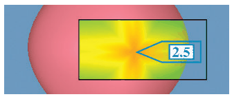

# Toolglass and Magic Lenses

## Idiom box

No idiom box in the book.

The book describes Toolglass and Magic Lenses in a System box rather than an Idiom box; its fields are quoted here [p.351].

<!-- verbatim p.351 -->
> What: Data Spatial, quantitative curvature attribute across surface.
<!-- /verbatim -->

<!-- verbatim p.351 -->
> How: Encode Use given, color by curvature.
<!-- /verbatim -->

<!-- verbatim p.351 -->
> How: Reduce Embed: superimpose.
<!-- /verbatim -->

## What it is

The system uses a see-through lens to show colour-coded Gaussian curvature in a foreground layer, atop a background layer holding the rest of the 3D scene [p.351]. Details appear within the lens, and the unchanged remainder of the view gives context; the lens layer occludes the region beneath it [p.351]. The focus layer is local, not a global layer across the whole view [p.351]. In Figure 14.3 the lens shows that an object rendered as a perfect sphere is really faceted from multiple patches, and gives a numeric value for the point at its centre [p.351].

## Use when / avoid when

- **Use** when a local region needs a different encoding of the same data, such as an extra attribute, while the rest of the view stays unchanged as context [p.351].
- **Data types.** The system handled many kinds of data with different visual encodings; the book's example is 3D spatial data [p.351].
- **Accept occlusion.** The lens hides the region beneath it [p.351].

## Figures

-  **Figure 14.3** [p.351]. The Toolglass and Magic Lenses idiom provides focus and context through a superimposed local layer: the see-through lens color codes the patch-work sphere with Gaussian curvature information and provides a numeric value for the point at the center. From [Bier et al. 93, Figure 12].

## Alternatives and disambiguation

- **Global superimposed layers.** Cover the whole view rather than a local region; Section 12.5 covers them [p.351].
- **Fisheye Lens.** Also a moveable lens whose layer replaces what is beneath, but it distorts geometry rather than re-encoding [p.353].
- **DOITrees Revisited.** Embeds by eliding items rather than layering [pp.350-351].

## Related

- [14.4 Superimpose](../ch14-embed-focus-context/s14-04-superimpose.md): the superimpose design choice this example illustrates [p.351]
- [12.5 Superimpose Layers](../ch12-facet-into-multiple-views/s12-05-superimpose-layers/node.md): global superimposed layers [p.351]
- [Fisheye Lens](fisheye-lens.md): the distorting lens compared with the magic lens [p.353]
- [8.2 Why Use Given?](../ch08-arrange-spatial-data/s08-02-why-use-given.md): the given spatial layout the box names [p.351]

## Implementation hints [NOT FROM BOOK]

### matplotlib

```python
import numpy as np, matplotlib.pyplot as plt
from matplotlib.patches import Circle
y, x = np.mgrid[-2:2:300j, -2:2:300j]
z = np.exp(-(x**2 + y**2)) * np.cos(3 * x)
curv = np.gradient(np.gradient(z, axis=0), axis=0) + np.gradient(np.gradient(z, axis=1), axis=1)
fig, ax = plt.subplots()
ax.imshow(z, cmap="Greys", origin="lower", extent=(-2, 2, -2, 2))  # context layer
lens = Circle((0.5, 0.3), 0.7, transform=ax.transData, fill=False, lw=2)
m = abs(curv).max()  # diverging map centred on zero curvature
top = ax.imshow(curv, cmap="RdBu", vmin=-m, vmax=m, origin="lower", extent=(-2, 2, -2, 2))  # focus layer
top.set_clip_path(lens)
ax.add_patch(lens)
```

### D3

Draw the context layer, then the alternate encoding in a `g` with `clip-path="url(#lens)"`, where `#lens` is a `clipPath` holding a `circle`; move the circle with `d3.drag()` or on `pointermove` via `d3.pointer(event)`.
