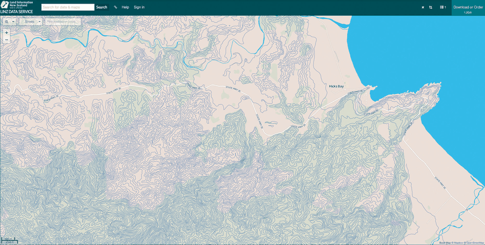

<a id="idiom:topographic-terrain-maps"></a>

# Topographic Terrain Map

## Idiom box

<!-- verbatim p.208 -->
> What: Data 2D spatial field; geographic data.
<!-- /verbatim -->

<!-- verbatim p.208 -->
> What: Derived Geometry: set of isolines computed from field.
<!-- /verbatim -->

<!-- verbatim p.208 -->
> How: Encode Use given geographic data geometry of points, lines, and region marks. Use derived geometry as line marks (blue).
<!-- /verbatim -->

<!-- verbatim p.208 -->
> Why: Tasks Query shape.
<!-- /verbatim -->

<!-- verbatim p.208 -->
> Scale Dozens of contour levels.
<!-- /verbatim -->

## What it is

Topographic terrain maps are a familiar example of isolines in widespread public use: contours of equal elevation above sea level layered on top of the spatial substrate of a geographic map [p.208]. Isolines are lines representing the contours of one level of a scalar field; synonyms are contour lines and isopleths [p.208]. In Figure 8.4 there are contours every 10 metres, nearly 80 levels in all; small closed contours indicate mountain peaks, and flat regions near sea level have no lines [pp.208-209].

## Use when / avoid when

- **Use** to show many levels of a 2D scalar field at once: isolines are far apart where change is slow and close together where it is fast, but never overlap, so many contours fit without excessive visual clutter [p.208].
- **Use** for the task of querying shape, at a scale of dozens of contour levels [p.208].
- **Avoid** carrying the many-contours approach into 3D: showing contour surfaces for dozens of values at once is not feasible there, because outer surfaces occlude inner ones [p.209].

## Figures

-  **Figure 8.4** [p.209]. Topographic terrain map, with isolines in blue. From <https://data.linz.govt.nz/layer/768-nz-mainland> -contours-topo-150k.

## Alternatives and disambiguation

- **Contour plot.** Colour-codes the regions between contours with a sequential colormap, as in Figure 6.9(c) [p.208].
- **Flexible Isosurfaces.** The 3D counterpart: derived surfaces rather than lines, where outer surfaces occlude inner ones, so its box's scale is one dozen contour levels and a simplified contour tree helps users find structure [pp.209-211].
- **Choropleth Map.** Also on a geographic base, but colours given regions by one value each instead of deriving lines from a continuous field [pp.206-208].

## Related

- [8.4.1 Isocontours](../ch08-arrange-spatial-data/s08-04-scalar-fields-one-value/s08-04-01-isocontours.md): isolines, isosurfaces and their scalar-field context [p.208]
- [Flexible Isosurfaces](flexible-isosurfaces.md): isocontours in 3D [p.210]
- [Choropleth Map](choropleth-map.md): the region-based geographic idiom [p.206]

## Implementation hints [NOT FROM BOOK]

### matplotlib

```python
import numpy as np, matplotlib.pyplot as plt
x, y = np.meshgrid(np.linspace(-3, 3, 300), np.linspace(-3, 3, 300))
z = 900 * np.exp(-((x - 1) ** 2 + y ** 2)) + 600 * np.exp(-((x + 1.5) ** 2 + (y - 1) ** 2) / 0.5)
fig, ax = plt.subplots()
ax.imshow(np.ones_like(z), extent=(-3, 3, -3, 3), cmap="Greys", vmin=0, vmax=4)  # base map stand-in
cs = ax.contour(x, y, z, levels=np.arange(10, 1500, 10), colors="tab:blue", linewidths=0.4)
ax.clabel(cs, cs.levels[::10], fontsize=6)
ax.set_aspect("equal")
```

### D3

```js
export function draw(svg, elevations, n, m, width) {
  const contours = d3.contours().size([n, m]).thresholds(d3.range(10, 1500, 10));
  svg.selectAll("path").data(contours(elevations)).join("path")
    .attr("d", d3.geoPath(d3.geoIdentity().scale(width / n)))
    .attr("fill", "none").attr("stroke", "steelblue");
}
```
