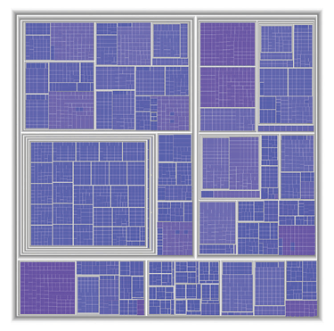
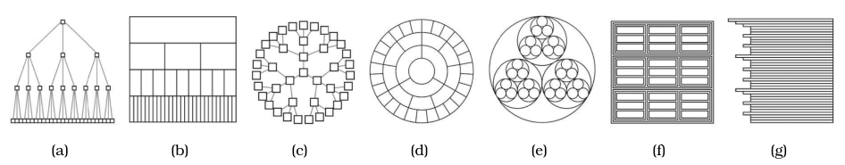

# Treemaps

## Idiom box

<!-- verbatim p.239 -->
> What: Data Tree.
<!-- /verbatim -->

<!-- verbatim p.239 -->
> How: Encode Area marks and containment, with rectilinear layout.
<!-- /verbatim -->

<!-- verbatim p.239 -->
> Why: Tasks Query attributes at leaf nodes.
<!-- /verbatim -->

<!-- verbatim p.239 -->
> Scale Leaf nodes: one million. Links: one million.
<!-- /verbatim -->

## What it is

An alternative to node–link tree drawings that shows hierarchical relationships with containment rather than connection: all of a node's children are enclosed in the area allocated to that node, creating a nested layout, and node size is mapped to some attribute of the node [p.238]. In Figure 9.8, a 5161-node file system, size encodes file size [pp.238-239]. Containment marks show complete information about hierarchical structure, where connection marks show only pairwise relationships [p.238].

## Use when / avoid when

- **Use** to understand attribute values at the leaves of a tree [p.239].
- **Use** to spot outliers with very large attribute values, such as large files [p.239].
- Treemaps are often used when hierarchies are shallow rather than deep [p.239].
- **Avoid** for topological tasks such as tracing paths through the tree, where containment is less effective than connection [p.239].
- A cited study identified the data densities at which length-encoded bar charts become less effective than area-encoded treemaps, but the book does not give the densities [p.242].

## Figures

-  **Figure 9.8** [p.238]. Treemap layout showing hierarchical structure with containment rather than connection, in contrast to the node–link diagrams of the same 5161-node tree in Figure 9.3.
-  **Figure 9.9** [p.239]. Seven visual encoding idioms showing the same tree dataset, using different combinations of visual channels. (a) Rectilinear vertical node–link, using connection to show link relationships, with vertical spatial position showing tree depth and horizontal spatial position showing sibling order. (b) Icicle, with vertical spatial position and size showing tree depth, and horizontal spatial position showing link relationships and sibling order. (c) Radial node– link, using connection to show link relationships, with radial depth spatial position showing tree depth and radial angular position showing sibling order. (d) Concentric circles, with radial depth spatial position and size showing tree depth and radial angular spatial position showing link relationships and sibling order. (e) Nested circles, using radial containment, with nesting level and size showing tree depth. (f) Treemap, using rectilinear containment, with nesting level and size showing tree depth. (g) Indented outline, with horizontal spatial position showing tree depth and link relationships and vertical spatial position showing sibling order. From [McGuffin and Robert 10, Figure 1].

## Alternatives and disambiguation

- **Node–link tree layouts** (vertical, radial) use connection and suit path tracing; treemaps use containment and suit leaf attributes [pp.238-239].
- **Nested circles** also use containment, but radial rather than rectilinear; both show depth by nesting level and size [p.239].
- **Icicle, concentric circles and indented outline** show parent–child relationships with spatial position and no connection marks [pp.239-240].
- **GrouseFlocks** uses containment for a cluster hierarchy over a network rather than for a plain tree [p.240].

## Related

- [9.5 Containment: Hierarchy Marks](../ch09-arrange-networks-trees/s09-05-containment-hierarchy-marks.md): the idiom in context, with the seven tree encodings [p.238]
- [9.2 Connection: Link Marks](../ch09-arrange-networks-trees/s09-02-connection-link-marks.md): node–link layouts of the same 5161-node tree [p.238]
- [GrouseFlocks](grouseflocks.md): containment applied to a compound network [p.240]

## Implementation hints [NOT FROM BOOK]

### matplotlib

Matplotlib has no treemap. This slice-and-dice layout nests each child inside its parent, alternating the split direction by depth; the `squarify` package gives squarified tiles for one level at a time.

```python
import matplotlib.pyplot as plt
from matplotlib.patches import Rectangle
tree = {"a": {"a1": 5, "a2": 3}, "b": {"b1": 4, "b2": 2, "b3": 1}, "c": 6}
size = lambda node: sum(map(size, node.values())) if isinstance(node, dict) else node

def slice_and_dice(node, x, y, w, h, depth, ax):
    for name, child in node.items():
        frac = size(child) / size(node)
        cw, ch = (w * frac, h) if depth % 2 == 0 else (w, h * frac)
        ax.add_patch(Rectangle((x, y), cw, ch, facecolor=f"C{depth}", edgecolor="white", lw=3 - depth))
        if isinstance(child, dict):
            slice_and_dice(child, x + 0.01, y + 0.01, cw - 0.02, ch - 0.02, depth + 1, ax)  # inset shows the parent
        else:
            ax.text(x + cw / 2, y + ch / 2, name, ha="center", va="center")
        x, y = (x + cw, y) if depth % 2 == 0 else (x, y + ch)

fig, ax = plt.subplots()
slice_and_dice(tree, 0, 0, 1, 1, 0, ax)
ax.set_axis_off()
```

### D3

```js
const root = d3.hierarchy(data).sum(d => d.size).sort((a, b) => b.value - a.value);
d3.treemap().tile(d3.treemapSquarify).size([w, h]).paddingInner(1).paddingTop(12)(root);
// draw root.leaves() (or root.descendants() for nesting) as rects at x0, y0, x1 - x0, y1 - y0
```

`d3.pack` gives the nested-circles variant; `d3.partition` gives icicles.
