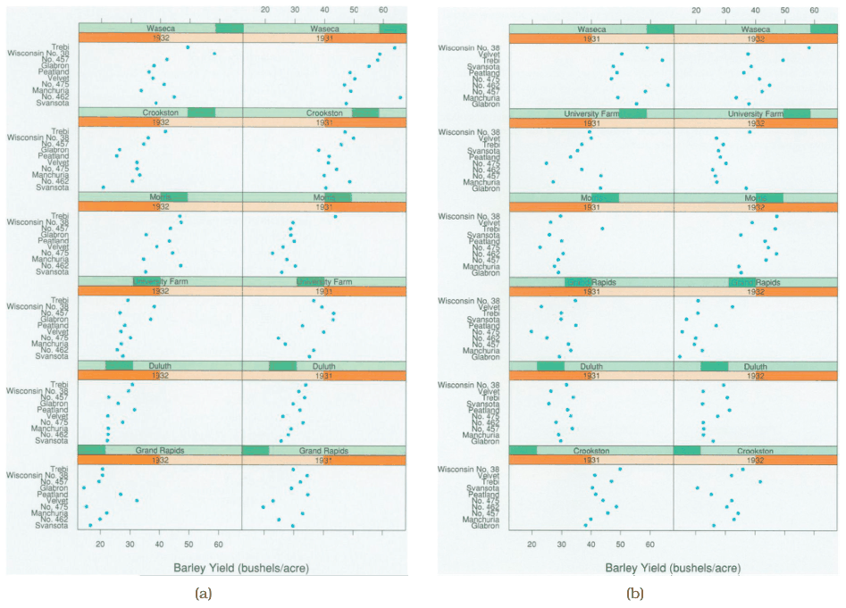
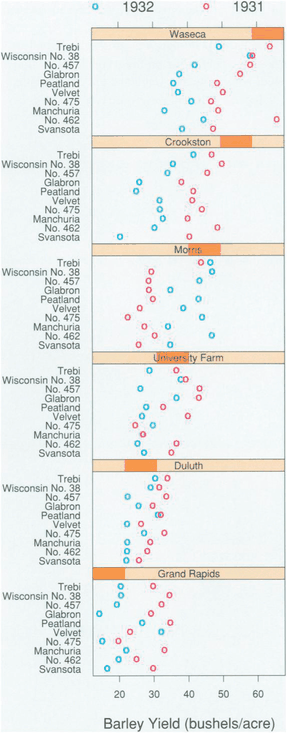

# Trellis

## Idiom box

No idiom box in the book.

The book describes Trellis in a System box rather than an Idiom box; its fields are quoted here [p.309].

<!-- verbatim p.309 -->
> What: Data Multidimensional table: three categorical key attributes, one quantitative value attribute.
<!-- /verbatim -->

<!-- verbatim p.309 -->
> What: Derived Medians for each partition.
<!-- /verbatim -->

<!-- verbatim p.309 -->
> How: Encode Dot charts aligned in 2D matrix.
<!-- /verbatim -->

<!-- verbatim p.309 -->
> How: Facet Partitioned by any combination of keys into regions.
<!-- /verbatim -->

The System box gives no Why: Tasks or Scale field [p.309].

## What it is

Trellis partitions a multiattribute dataset into multiple views and orders them in a 2D matrix alignment as its main avenue for exploration [p.307]. In the barley example (Figure 12.9), three categorical keys, site (six levels), variety (ten) and year (two, treated as categorical), index a quantitative yield [p.307]. Columns are partitioned by year and rows by site; within each dot chart the vertical axis is separated by variety and yield is horizontal position [p.307].

It orders with main-effects ordering: the median is computed for each group the partitioning creates and used to order the groups, at every partitioning scale [p.307]. The user controls partitioning and ordering [p.308].

## Use when / avoid when

- **Use** main-effects ordering to spot both general trends and outliers that run against them: in the barley data the Morris site in the third row does not fit, suggesting that perhaps its years had been switched [pp.307-308].
- **Avoid** alphabetical ordering of plots and axes when looking for outliers: no general trend is visible, so the display gives no useful hint of outliers [pp.307-308].
- **Use** a coarser partition to investigate an anomaly further: partitioning only by site and encoding year with colour (Figure 12.10) gave convincing evidence that the Morris data is incorrect [p.308].

## Figures

-  **Figure 12.9** [p.308]. Trellis facets the data into a matrix of dot chart views, allowing the user control of partitioning and orderering. (a) With main-effects ordering, the plots are ordered by median values within the plots for the sites, and the shared vertical axis within each plot is ordered by median values within the varieties. The Morris site in the third row is a visible outlier that does not fit the general trends. (b) With a simple alphabetical ordering of plots and axes, no trends are visible, so no outliers can be detected. From [Becker et al. 96, Figures 1 and 3].
-  **Figure 12.10** [p.309]. A second Trellis plot combines the years into a single plot with year encoded by color, showing strong evidence of an anomaly in the data. From [Becker et al. 96, Figure 2].

## Alternatives and disambiguation

- **Small-multiple bar charts in a list** use two levels of partitioning: they split by one key into a 1D list of views with the second along each chart's axis; Trellis splits by two keys into a 2D matrix of views with the third along each dot chart's axis [pp.306-307].
- **HiVE recursive subdivision** nests partitions more than two levels deep and lets the user reorder splits, size regions by count or switch to maps [p.310] [p.313].
- **A coarser partition**, as in Figure 12.10, stops at site and puts both years in one view distinguished by colour instead of separate columns [p.308].

## Related

- [12.4.3 Matrix Alignments](../ch12-facet-into-multiple-views/s12-04-partition-into-views/s12-04-03-matrix-alignments.md): the full Trellis narrative [p.307]
- [Dot Charts](dot-charts.md): the view in each panel [p.307]
- [7.5.1 List Alignment: One Key](../ch07-arrange-tables/s07-05-separate-order-align-categorical/s07-05-01-list-alignment-one-key.md): dot charts discussed [p.307]
- [12.4.4 Recursive Subdivision](../ch12-facet-into-multiple-views/s12-04-partition-into-views/s12-04-04-recursive-subdivision.md): deeper, user-reconfigurable partitioning [p.310]

## Implementation hints [NOT FROM BOOK]

### matplotlib

```python
import numpy as np, pandas as pd, matplotlib.pyplot as plt
rng = np.random.default_rng(5)
sites, varieties, years = list("ABCDEF"), [f"v{i}" for i in range(10)], [1931, 1932]
df = pd.DataFrame([(s, v, y, rng.normal(30 + 3 * i, 5)) for i, s in enumerate(sites)
                   for v in varieties for y in years], columns=["site", "variety", "year", "yield"])
site_order = df.groupby("site")["yield"].median().sort_values().index      # main effects
var_order = df.groupby("variety")["yield"].median().sort_values().index
fig, axs = plt.subplots(len(sites), 2, sharex=True, sharey=True, figsize=(6, 12))
for r, s in enumerate(site_order):
    for c, y in enumerate(years):
        d = df[(df.site == s) & (df.year == y)].set_index("variety").loc[var_order]
        axs[r, c].plot(d["yield"], range(len(d)), "o", ms=3)
        axs[r, c].set_title(f"{s} {y}", fontsize=7)
axs[0, 0].set_yticks(range(len(var_order)), var_order, fontsize=6)
```

### D3

```js
import * as d3 from "d3";
// Main-effects ordering: order facets and within-facet bands by group medians.
const order = (rows, key) => d3.groupSort(rows, g => d3.median(g, d => d.yield), d => d[key]);
function layout(rows) {
  const fx = d3.scaleBand(order(rows, "year"), [0, 600]).padding(0.1);
  const fy = d3.scaleBand(order(rows, "site"), [0, 900]).padding(0.1);
  const y = d3.scalePoint(order(rows, "variety"), [0, fy.bandwidth()]);
  return { fx, fy, y };
}
```
