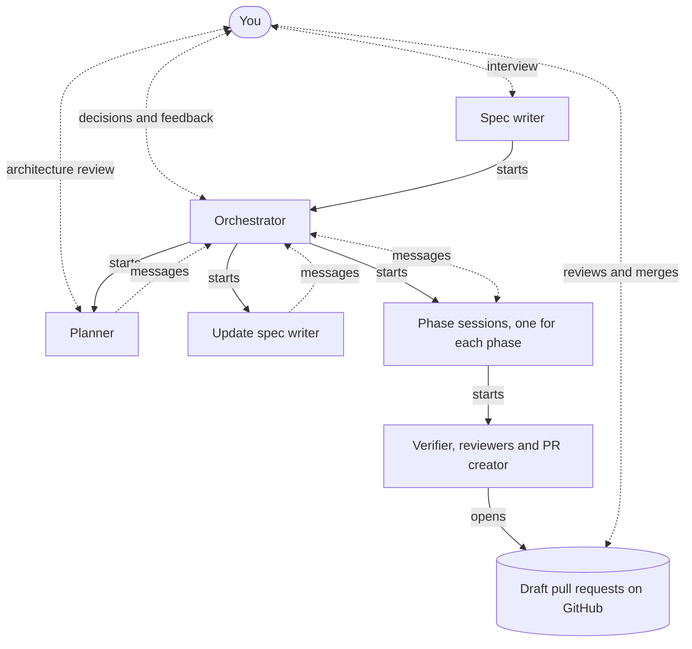
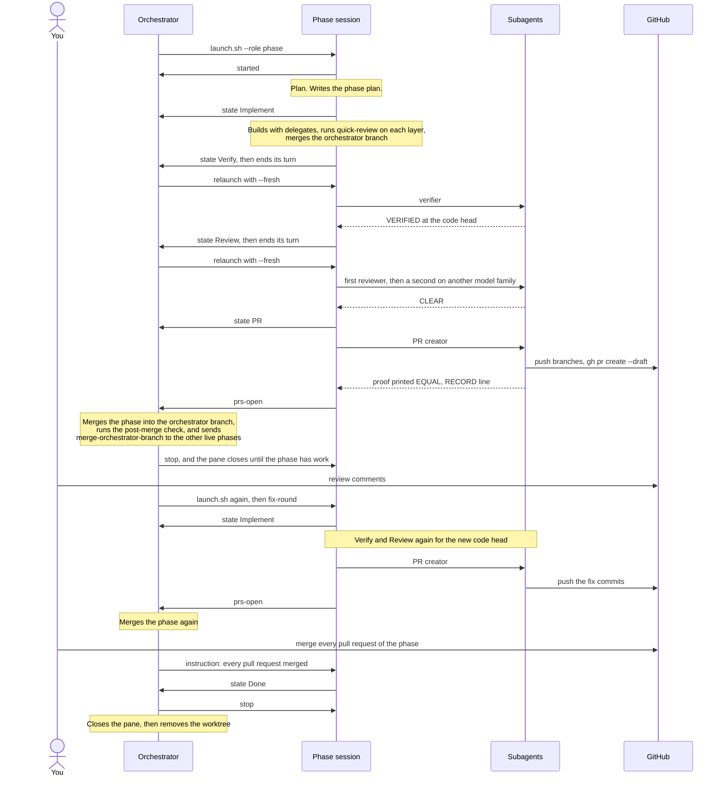
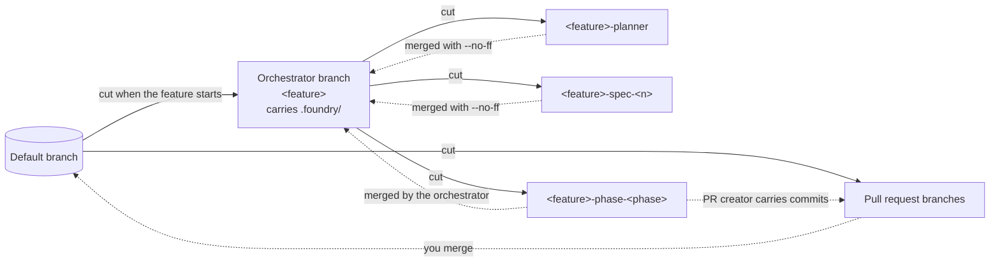
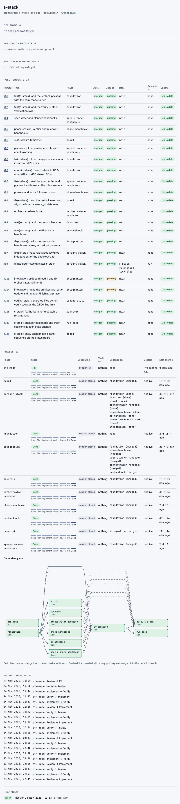
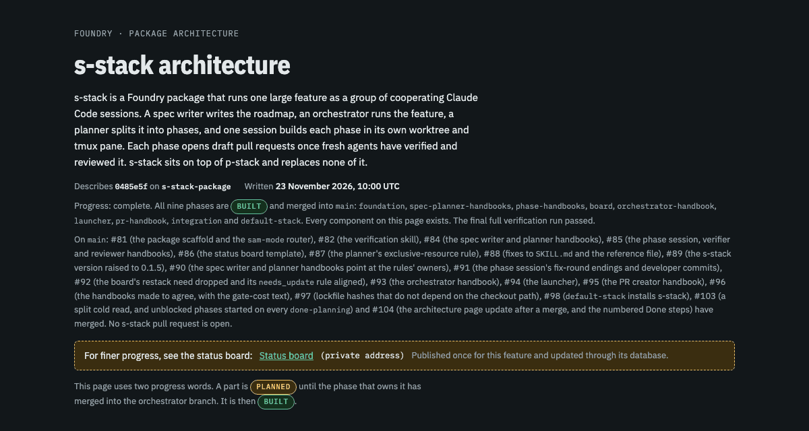
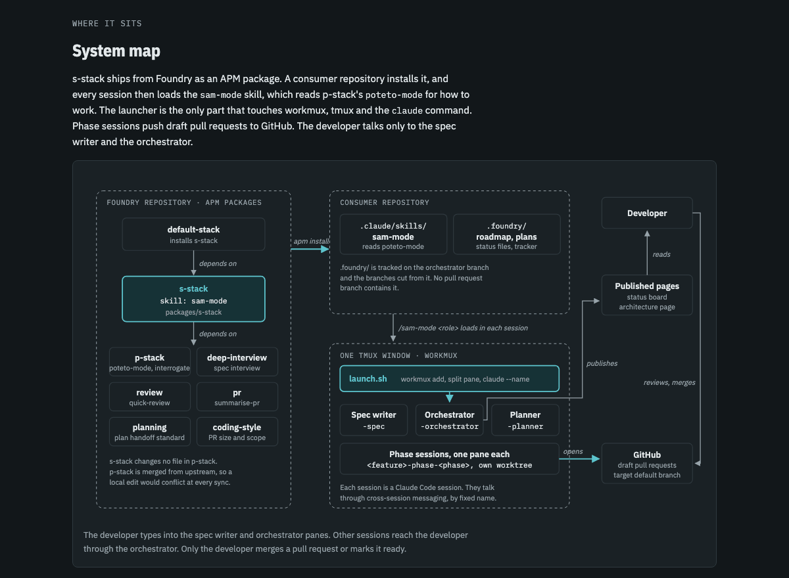
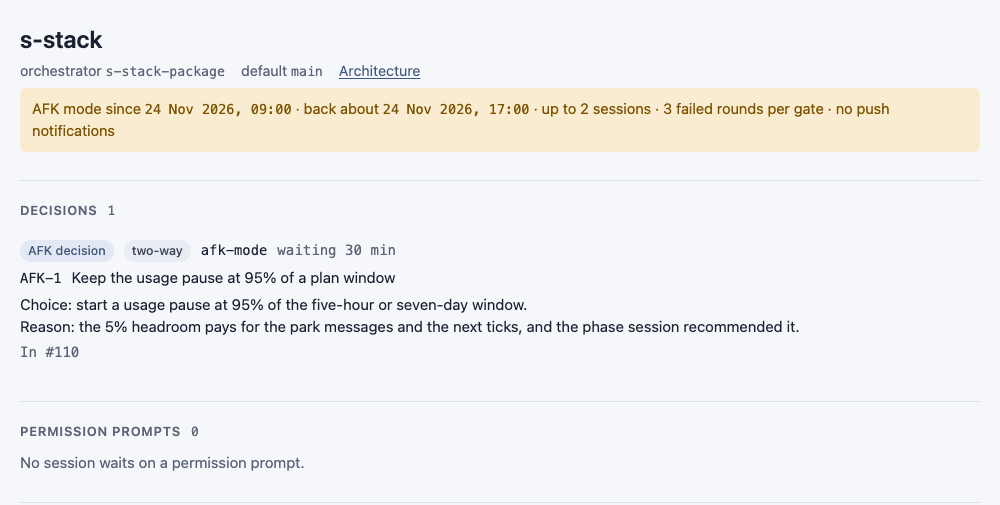
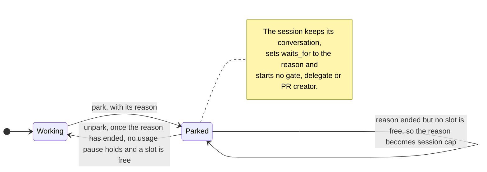

# s-stack guide

s-stack runs one large feature as a group of Claude Code sessions. Each session has one role, its own git worktree and its own [tmux](https://github.com/tmux/tmux/wiki) pane. The sessions plan the feature, build it in phases that run at the same time, check each phase with fresh agents, and open draft pull requests for you to review.

This guide explains how the parts fit together, then how to run a feature. The rules themselves live in the `sam-mode` skill and its handbooks. Each section below names the file that owns its rules, so you can read further.

| File | Owns |
| --- | --- |
| [`SKILL.md`](.apm/skills/sam-mode/SKILL.md) | The rules for every session: artefacts, states, branches, pull requests and decisions |
| [`references/status-and-messages.md`](.apm/skills/sam-mode/references/status-and-messages.md) | The status file, the code head, the merge rule, waivers and every message |
| [`references/afk-mode.md`](.apm/skills/sam-mode/references/afk-mode.md) | AFK mode: decisions, parks and usage while you are away |
| [`handbooks/`](.apm/skills/sam-mode/handbooks/) | One handbook for each role |
| [`scripts/launch.sh`](.apm/skills/sam-mode/scripts/launch.sh) | Starting, closing and removing sessions, and placing their panes |
| [`assets/status-board.html`](.apm/skills/sam-mode/assets/status-board.html) | The status board page and its data schema |
| [`scripts/afk-watchdog.sh`](.apm/skills/sam-mode/scripts/afk-watchdog.sh) | Keeping the Mac awake and the watchdog that restarts the orchestrator, in AFK mode |
| [`assets/usage-mod/`](.apm/skills/sam-mode/assets/usage-mod/) | The tool that gives the orchestrator the plan's usage figures |

## When to use it

Use s-stack for a large feature that splits into several phases, some of which can run at the same time.

Do not use it for a small patch or a minor bug fix. One Claude Code session in p-stack's `poteto-mode` handles those with far less overhead. s-stack builds on `poteto-mode` and replaces none of it. Every s-stack session reads `poteto-mode` for how to work, and its handbook adds only what is specific to s-stack.

## The roles

Four roles run as main sessions, each started by the launcher in its own pane. Three more run as subagents inside a phase session.

| Role | Kind | Does | Handbook |
| --- | --- | --- | --- |
| Spec writer | Main session | Interviews you and writes the feature roadmap. An update spec writer edits the approved roadmap later. | [`spec-writer.md`](.apm/skills/sam-mode/handbooks/spec-writer.md) |
| Orchestrator | Main session | Runs the feature. Starts sessions, merges finished phases, relays your decisions and feedback, and keeps the status board current. Never writes code. | [`orchestrator.md`](.apm/skills/sam-mode/handbooks/orchestrator.md) |
| Planner | Main session | Turns the roadmap into a feature plan of phases, each sized for one session | [`planner.md`](.apm/skills/sam-mode/handbooks/planner.md) |
| Phase session | Main session, one for each phase | Plans, builds and gates one phase, and alone changes its state | [`phase-session.md`](.apm/skills/sam-mode/handbooks/phase-session.md) |
| Verifier | Subagent of a phase session | Runs the phase's code and checks its behaviour | [`verifier.md`](.apm/skills/sam-mode/handbooks/verifier.md) |
| Reviewers | Subagents of a phase session | Try to break the change, on two model families | [`reviewer.md`](.apm/skills/sam-mode/handbooks/reviewer.md) |
| PR creator | Subagent of a phase session | Turns the verified phase into draft pull requests and keeps them current | [`pr-creator.md`](.apm/skills/sam-mode/handbooks/pr-creator.md) |

You talk to the spec writer, the orchestrator, and the planner while you review the planned architecture. Every other session sends its questions for you to the orchestrator. You can still type into any pane, and that session follows your instruction.

The diagram shows who starts whom, with solid arrows, and who talks to whom, with dotted arrows. Phase sessions may also message each other to settle an interface between their phases.



A message only wakes its receiver. It is never the record. A sender commits each fact to its own file first and then sends the message, so a lost message costs time and loses nothing. [`references/status-and-messages.md`](.apm/skills/sam-mode/references/status-and-messages.md#messages) lists every message kind.

## The phase lifecycle

Every phase moves through seven states: Spec, Plan, Implement, Verify, Review, PR and Done. A phase moves forward one state at a time and skips none. It can move back any number of states. Only the phase session changes its phase's state, by committing its status file and then sending the orchestrator a `state` message.

The phase session commits its first status file in Plan. A phase returns to Spec only after a roadmap update touches it, and it waits there until the planner has revised the plan and you have approved the planned architecture.


The back edges come from these events.

| Event | Moves the phase back to | Owner |
| --- | --- | --- |
| The verifier returns NOT VERIFIED or INCONCLUSIVE | Implement | [`phase-session.md`](.apm/skills/sam-mode/handbooks/phase-session.md#verify) |
| The reviewers find a significant problem | Implement | [`phase-session.md`](.apm/skills/sam-mode/handbooks/phase-session.md#review) |
| You review a pull request, a check fails, or a conflict with the default branch reaches the phase | Implement | [`phase-session.md`](.apm/skills/sam-mode/handbooks/phase-session.md#fix-rounds) |
| Merging the orchestrator branch moves the code head while the phase is in Verify or later | Implement | [`phase-session.md`](.apm/skills/sam-mode/handbooks/phase-session.md#messages-from-the-orchestrator) |
| An instruction asks for a code change in Verify, Review, PR or Done | Implement | [`phase-session.md`](.apm/skills/sam-mode/handbooks/phase-session.md#instructions-from-the-developer) |
| A check on the orchestrator branch fails after the phase merged | Implement | [`orchestrator.md`](.apm/skills/sam-mode/handbooks/orchestrator.md#merging-a-phase) |
| A Done phase's branch gains commits that move its code head | Implement | [`orchestrator.md`](.apm/skills/sam-mode/handbooks/orchestrator.md#finishing-a-phase) |
| The planner revises the phase's plan entry | Plan | [`orchestrator.md`](.apm/skills/sam-mode/handbooks/orchestrator.md#starting-the-feature) |
| A roadmap update changes behaviour the phase builds | Spec, then Plan | [`orchestrator.md`](.apm/skills/sam-mode/handbooks/orchestrator.md#roadmap-updates) |

There is no blocked state. A phase that waits for an answer, a blocked merge or a `move-back` stays in its state and sets `waits_for` in its status file to one line saying what it waits for.

## One phase from start to finish

The sequence below follows one phase on the common path: no failed gate and one round of your review feedback. The message names are the ones [`references/status-and-messages.md`](.apm/skills/sam-mode/references/status-and-messages.md#messages) defines.



Two details in the sequence are easy to miss.

- **Fresh sessions at gate boundaries.** When a phase moves from Implement to Verify, or records a Verify or Review verdict, it ends its turn. The orchestrator relaunches it with `--fresh`, and the new conversation continues from the committed files. Each gate starts with a short context.
- **The orchestrator merges before you do.** Once a phase sends `prs-open` and its verdicts cover its current code head, the orchestrator merges the phase branch into the orchestrator branch and runs the checks in that merge's blast radius. Phases that start later build on that merged code. Only your merge of a pull request into the default branch counts as merged on the board.

## Where state lives

Every fact lives in a committed file or in live state that git, tmux or GitHub reports. A session that restarts reads the files again and continues.

### Repositories

A feature can span several repositories. The home repository is the one where you ran `/sam-mode start`. The roadmap names every repository and which is home, and the feature plan's Repositories table gives each one's checkout path, default branch, check command and regenerate command. Every phase works in exactly one repository and changes files there only. Each repository has its own orchestrator branch, `<feature>`, which the launcher cuts from that repository's default branch when the first phase starts there. A feature in one repository works the same way, with one row. [`SKILL.md`](.apm/skills/sam-mode/SKILL.md#repositories) owns the rules.

### Links between repositories

Phases in two repositories that build one interface are joined by a link, which the feature plan's Links table records. A link has one of two kinds.

- **`api`.** One repository provides an interface that another consumes. The provider and consumer phases run at the same time against a contract written in the feature plan, and each verifier checks its own side against it. The provider's change is additive, so either side can merge first. The board's **Ready for your review** tells you to merge the provider's pull requests first.
- **`library`.** One repository is a library that another consumes as a released dependency. The consumer phase builds against the library's feature worktree through a link command that changes no tracked file, which the planner proves by experiment. It waits in Review until you have merged and released the library's change, then pins the released version, passes both gates again and opens its pull requests, so none of them ships the link. When no such link command exists, the consumer phase starts only once the library is released.

Once every phase of a link has merged into its own orchestrator branch, each later phase merge into either repository also runs the link's integration check, in a scratch workspace of both orchestrator branches. A failure counts as a failed check of that merge. [`planner.md`](.apm/skills/sam-mode/handbooks/planner.md#the-links-table) defines a link, and [`orchestrator.md`](.apm/skills/sam-mode/handbooks/orchestrator.md#links) owns the checks.

### Files under `.foundry/`

Every file under `.foundry/` has one writer. Git tracks `.foundry/` on every repository's orchestrator branch and on every branch cut from one, so no repository of the feature may ignore it. A pull request branch never contains it. The roadmap, the feature plan and the tracker live only in the home repository. A phase's own files live on its phase branch, in its repository.

| Artefact | Path | Writer |
| --- | --- | --- |
| Feature roadmap | `.foundry/feature-roadmaps/<id>/` | Spec writer. The orchestrator writes only `run-decisions.md` in it. |
| Feature plan | `.foundry/plans/<id>/README.md` | Planner |
| Phase plan | `.foundry/plans/<id>/phases/<phase>.md` | That phase's session |
| Status file | `.foundry/plans/<id>/status/<phase>.md` | That phase's session |
| Evidence file | `.foundry/plans/<id>/status/<phase>-evidence.md` | That phase's session |
| Tracker | `.foundry/plans/<id>/status/orchestrator.md` | Orchestrator |

`<id>` is the roadmap's directory name, `<date-time>-<feature>`. `run-decisions.md` records the decisions you make during the run. Each row amends the roadmap until a roadmap update folds it in.

A status file starts with a YAML header that a program can read: the state, the code head, every verdict, every pull request, open decision requests and the decisions made for the phase. The orchestrator reads each status file through git in the phase's repository, with `git -C <that repository's feature worktree> show <phase branch>:<path>`, so no session reads inside another session's worktree.

### Branches and worktrees



- The first spec writer and the orchestrator share the feature worktree, on the orchestrator branch. The planner, each update spec writer and each phase session get a worktree and branch of their own, which the launcher creates with [workmux](https://workmux.raine.dev). Once a session's work is merged into the orchestrator branch, the orchestrator removes its worktree and branch with `scripts/clean-worktree.sh`, which first stops the Docker Compose projects started in it, with their volumes and built images. Each phase removes its reviewers' worktrees the same way after each review. The script refuses, and deletes nothing, while a process works in the worktree or it holds uncommitted changes or unmerged commits.
- Every session's pane sits in the orchestrator's window, so `workmux remove` of the feature worktree closes that window and ends every session in it, and deletes the orchestrator branch. Start any session of your own, such as a cleanup or review session, in a worktree of its own, never in a run's worktree, so that removing it after it finishes cannot take the run with it. The orchestrator pushes each orchestrator branch to a private `origin` at every tick, so a removal costs a restart of the sessions, not the run's state.
- The PR creator cuts pull request branches from the default branch, or from the branch of the pull request they depend on. They hold the phase's commits and never `.foundry/`.
- No session pushes an orchestrator branch, or a branch cut from one, in any repository, to a public remote unless you say so. The orchestrator pushes only orchestrator branches, and only to a private `origin`. The PR creator pushes only pull request branches.
- s-stack never assumes a default branch is `main`. It resolves each name from its repository.

### Panes

The launcher places every pane in the feature's tmux window. The orchestrator holds the first column after the workmux sidebar. Spec writers and the planner stack in its column, and every other session opens to its right, as in this example. The launcher tags each pane it starts with the session's name, and never splits a pane that is not tagged, so your own panes stay where you put them.

Every pane runs in your own tmux server, yours included. No session runs `tmux kill-server`, and none ends a session, window or pane that the run did not start. The launcher's `--close` closes the panes the run started. A test that needs tmux starts its own server on its own socket and kills only that one. [`SKILL.md`](.apm/skills/sam-mode/SKILL.md#tmux) owns the rule.

```text
+---------+--------------------+--------------------+
| workmux | <feature>-         | <feature>-phase-a  |
| sidebar | orchestrator       |                    |
|         +--------------------+--------------------+
|         | <feature>-planner  | <feature>-phase-b  |
|         +--------------------+                    |
|         | <feature>-spec-1   |                    |
+---------+--------------------+--------------------+
```

When the window has no room for another pane, the launcher exits with code 4 and the orchestrator starts the session once a pane closes.

### The status board and the architecture page

The orchestrator publishes two private pages for each feature and records their addresses in the tracker.

- **The status board** shows how the work is going. The orchestrator publishes it once from [`assets/status-board.html`](.apm/skills/sam-mode/assets/status-board.html) and then updates only its database, in one batch each tick. Every value comes from a status file, workmux's status or a pull request's live state.
- **The architecture page** shows what is being built: a map of the system, its components, data model and main flows, each part marked as planned or built. A fresh subagent writes it, rebuilds it from the plan for each architecture review, and updates it after each phase merge that passes its check.

The board has seven sections under its header. In AFK mode the header also shows a notice with the mode's start, your expected return and its settings.

| Section | Shows |
| --- | --- |
| Decisions | Decision requests waiting for you, decisions the orchestrator took alone (`run-<n>`) and AFK decisions (`AFK-<n>`), each with its id and the decision in full |
| Permission prompts | Sessions waiting on a permission prompt, with the pane that shows it |
| Ready for your review | Draft pull requests, ordered so that each comes after the pull requests it depends on and those it must merge after in another repository |
| Phases | A dependency map of the phases, then each phase's place in the seven states and its session |
| Pull requests | Every pull request with its state, checks, base and whether it needs an update |
| Recent changes | The last 20 state changes |
| Heartbeat | When the orchestrator last ticked. The board marks itself stale after 40 minutes without a tick. |

The screenshot shows the board from the run that built s-stack, rendered from that run's data near its end. Nine of the eleven phases are Done, `afk-mode` is in PR, and nothing waits for you. The dependency map at the top of Phases draws a solid line where a phase needs another merged into the orchestrator branch, and a dashed line where it needs every pull request of the other merged into the default branch.



The architecture page has no template. A subagent designs it for each feature. The two screenshots below come from the page the run that built s-stack published. The first shows its header, which names the commit it describes, its progress and the pull requests merged so far. The second shows its system map. The status board's address is redacted.





## The gates

A phase reaches PR only after two gates, each run by fresh subagents that did not build the phase.

### The code head and the merge rule

A verdict covers one code head. The code head is the newest commit on the phase branch that changes a file outside `.foundry/`. A commit that only records status leaves it where it is, and so does a clean merge of the orchestrator branch, because the merged code already passed its own gates. Generated paths and lines that the feature plan names, such as lockfiles and `version:` lines, also leave it where it is.

The merge rule decides when a phase may move to PR. The newest `verify` verdict must be VERIFIED or WAIVED, the newest `review` verdict must be CLEAR or WAIVED, and both must name the current code head. [`references/status-and-messages.md`](.apm/skills/sam-mode/references/status-and-messages.md#status-files) gives the exact command that computes the code head.

### Verify

The verifier runs the phase's real code the way its user would and checks it against the roadmap and the plans. It may edit verification code only, never product code.

- It works out the blast radius, which is every check whose files the phase's changes since the last VERIFIED code head touch, and runs those checks from every phase's check file.
- It adds the phase's own checks to `checks/<phase>.md` in the feature's verification skill. A `## Rerun` section holds cheap, repeatable checks that later merges run again. An `## Evidence` section holds costly checks that only the phase's own verifier runs.
- It adds formal verification where the phase adds concurrency, retries, a state machine or a parser.
- It checks prose that an agent follows, such as a skill or a handbook, with a cold read by a fresh subagent against an answer written down before the run.

| Verdict | Means | Next state |
| --- | --- | --- |
| VERIFIED | Every check ran and none failed | Review |
| WAIVED | The change passes the waiver rule, and nothing ran | Review |
| NOT VERIFIED | At least one check failed | Implement |
| INCONCLUSIVE | No check failed, but at least one could not run | Implement |

The owner is [`verifier.md`](.apm/skills/sam-mode/handbooks/verifier.md).

### Review

Reviewers try to break the change through p-stack's `interrogate` skill. They see the change and the repository, and nothing under `.foundry/`. The code must explain itself, and a part that a reader cannot follow without the plan is itself a finding.

The phase session starts one reviewer first, which may waive. When it reviews, a second reviewer on another model family joins. A finding is significant only when a run shows that the change crashes, gives a wrong result, loses data, opens a security hole, breaks a documented contract or the repository's checks, or leads an agent to the wrong action. A preference between two working designs is not significant. One significant finding makes the verdict SIGNIFICANT and sends the phase back to Implement. Otherwise it is CLEAR.

The owner is [`reviewer.md`](.apm/skills/sam-mode/handbooks/reviewer.md).

### Waivers

A gate may return WAIVED instead of running when its brief allows a waiver and the change alters nothing that a user, a program or an agent reading the file would act on differently.

| Waivable | Never waivable |
| --- | --- |
| Generated files only | Any change to logic or control flow |
| Formatting, import order or a linter's auto-fix | A change to a public interface or contract |
| A complete rename of a local variable or private function | A dependency added or bumped by hand |
| Comments, docstrings, log wording | Authentication, permissions, secrets, input handling or the commands the code runs |
| A small, isolated change whose whole effect the agent can state from the diff | A test change that alters an expected result |
| | A change to a prompt, skill or handbook |

A waiver counts only when the gate's last verdict that was not a waiver passed. The next real Verify or Review covers everything since the last one that ran. The full rule is in [`references/status-and-messages.md`](.apm/skills/sam-mode/references/status-and-messages.md#status-files).

### Checks after a phase merges

When the orchestrator merges a phase into the orchestrator branch, a fresh subagent runs the checks in that merge's blast radius. If a check fails, that repository's orchestrator branch freezes: no new phase starts there and no other phase merges into it until the failing check passes on a new merge of the same phase. Other repositories carry on. The phase moves back to Implement to fix it. When the last phase of a repository merges, a subagent runs that repository's whole verification skill. When every phase is Done, it runs again in each repository unless a full run has passed there since its last phase merge.

The orchestrator merges at most one phase per repository each tick, so a failing check always points at one change. [`orchestrator.md`](.apm/skills/sam-mode/handbooks/orchestrator.md#merging-a-phase) owns the procedure.

### Pull requests

The PR creator turns the phase into pull requests that together hold exactly the verified diff, because you review the pull requests and not the phase branch.

- Every pull request is a draft. s-stack never marks one ready for review and never merges one. You do both.
- Each pull request is one atomic change within the repository's scope and size rules. In Foundry, section 11 of the `coding-style` package's software engineering rules caps a pull request at 2,500 hand-written changed lines against its base.
- A pull request with one open dependency joins that pull request's `gh stack` when nothing else is stacked on it. One with several open dependencies targets the default branch and carries their changes until they merge.
- A script proves that the pull requests equal the phase diff before anything is pushed. Nothing is pushed unless the proof prints `EQUAL`.
- The PR creator never force-pushes, and pushes only pull request branches.
- When the default branch moves or a dependency merges, the PR creator refreshes each branch with a merge commit, so every push is a fast-forward.

You may add commits to a pull request branch, use **Update branch** and leave comments. The phase takes your commits back into the phase branch and passes both gates again. Do not amend, squash or rebase a pull request branch, including with **Update with rebase**: every later round stops until you have said whether the rewritten branch holds edits of yours.

The owners are [`pr-creator.md`](.apm/skills/sam-mode/handbooks/pr-creator.md) and [`references/pr-commands.md`](.apm/skills/sam-mode/references/pr-commands.md).

## Running on its own

Once you approve the roadmap and then the planned architecture, the orchestrator runs on its own and asks you only for real decisions. These rules keep it going whether or not you watch. [AFK mode](#afk-mode) adds rules for when you are away.

- **The tick.** The orchestrator arms a recurring Claude Code scheduled task every 20 minutes, off the hour and half hour. Each tick reconciles every status file, session and pull request, merges each repository's default branch, starts phases whose dependencies are met, merges at most one phase per repository, puts new decisions to you, sends fix rounds and updates the board. A scheduled task fires only while the orchestrator runs and is idle, and expires after seven days, so the orchestrator creates it again at every start.
- **Short contexts.** At the end of every sixth tick, the orchestrator relaunches itself with a fresh conversation. Phase sessions start fresh at each gate boundary.
- **Stalled sessions.** The orchestrator judges a session by its commits and pull request activity. A session that still has work, waits for nothing, and has made no commit or pull request change for two ticks gets `stop`, then a fresh relaunch, then every message it left unanswered.
- **Restarts.** The launcher resumes a session's last conversation. Every session reads its committed files again before it continues, and the orchestrator resends unanswered messages.
- **Permission prompts.** The orchestrator sends you a push notification naming the pane and the action, and lists the prompt under **Permission prompts** on the board. Only you approve it, in that pane.

Run every session of a feature in the same permission mode. Claude Code holds a message for approval when the receiver runs in a bypass mode and the sender does not.

## AFK mode

AFK mode keeps a feature moving while you are away from the keyboard. The orchestrator answers two-way doors itself and records each answer for your review, one-way doors wait for you, usage stays under the plan limits, and on macOS the machine stays awake. Nothing changes for pull requests: every one is a draft, and s-stack never marks one ready or merges one.

Only the orchestrator reads the rules, in [`references/afk-mode.md`](.apm/skills/sam-mode/references/afk-mode.md).

### Starting and ending it

Type it in the orchestrator's pane, for example "AFK until 08:00". Each setting is optional.

| Setting | Default | Meaning |
| --- | --- | --- |
| `until` | none | When you expect to return. It appears in the return report and on the board, and does not end the mode. |
| `sessions` | 2 | The most phase sessions working at once |
| `rounds` | 3 | The most failed verdicts of one gate for a phase before it parks |
| `notify` | off | When on, a permission prompt still sends a push notification |

The orchestrator then does these in order.

1. It reminds you to set or lower the monthly spend limit at claude.ai/settings/usage, because nothing else caps usage credits.
2. It checks the watchdog. When the watchdog is missing, or runs another worktree's copy of the script, it asks you to install it by typing `! <skill directory>/scripts/afk-watchdog.sh install` in its pane, or to say to go without it. It never installs the watchdog itself, because that adds a launchd job to your machine.
3. It reads the usage figures.
4. It records the mode in the tracker and on the board, and writes a marker file in the worktree's git directory for the watchdog to find. The marker is never committed.
5. On macOS, it keeps the machine awake.
6. It records your instruction in `run-decisions.md`.

AFK mode ends at the first message you type in the orchestrator's pane. Nothing else ends it: not a tick, a message from another session, a finished subagent or background task, a relaunch, or a message you type into another session's pane. The orchestrator's first reply is the return report.

1. AFK decisions to accept or change, each with its id, question, choice and reason.
2. One-way doors that waited, each with its options and recommendation.
3. Pull requests ready for review, dependencies first.
4. Phases parked by the round cap with their last findings, and other failures, stalls and permission prompts.
5. Usage at the start and now, waits for resets, any limit reached, and a usage pause that still holds.

Answer "accept all", or name the changes. Each phase that holds an AFK decision sets it as reviewed, makes your changes as a fix round, and removes the decision's line from its pull requests. The orchestrator removes each decision from the board once you have answered for it, whichever way.

### Decisions while you are away

| Door | In AFK mode |
| --- | --- |
| A two-way door a phase session decides itself | Unchanged: the phase decides and records it |
| A two-way door a session raises | The orchestrator answers it, taking the session's recommendation unless it records a reason not to. It gives the answer the next free id `AFK-<n>`, records it in `run-decisions.md` as "AFK, pending review", and lists it under **Decisions** on the board. Each pull request that carries it says "Contains AFK decision `AFK-<n>`, pending the developer's review." |
| A one-way door | Never answered. It waits under **Decisions**. The phase carries on with the work the decision does not affect, and parks when nothing else is left. |

Phases with no open one-way request start and unpark first, so work that needs nothing from you comes first.

The screenshot shows the board's header and **Decisions** section in AFK mode. The board's data comes from the run that built s-stack. The AFK decision is an example added for the screenshot, not one that run made.



### Parks

A park stops a phase session from starting work until its reason ends. The orchestrator sends `park` with the reason and what ends it, and `unpark` when it ends. A parked session keeps its conversation: it finishes or abandons the subagent step in progress, commits, sets `waits_for` to the reason and waits. Its phase keeps its state.

| Reason | The orchestrator parks a phase when | The park ends |
| --- | --- | --- |
| One-way door | The phase has nothing left that the open request does not affect | At the answer to that request |
| Round cap | The phase's NOT VERIFIED and INCONCLUSIVE verdicts of one gate since AFK mode began reach `rounds`, or its SIGNIFICANT verdicts do | When that AFK mode ends |
| Session cap | More phases work than `sessions` allows. The most recently started parks. | At a free slot, oldest park first, or when that AFK mode ends |
| Usage pause | A usage pause starts | When the usage pause ends |



The tracker's "Parks" row outlives AFK mode, so the orchestrator keeps following these rules until the last park ends. A phase that waits on a permission prompt is never parked.

### Usage and the usage pause

The launcher loads the usage mod from [`assets/usage-mod/`](.apm/skills/sam-mode/assets/usage-mod/) into the orchestrator's session. It gives the orchestrator one tool, `mcp__s-stack-usage__usage`, which returns the plan's five-hour and seven-day windows, each with the percentage used and when it resets. Plan limits belong to the account, so every session spends from these windows. In AFK mode the orchestrator reads them at the start and at every tick. An empty list means the figures are unknown, not zero.

| Signal | The usage pause it starts ends |
| --- | --- |
| The five-hour window at 95% or more, or a per-model limit message in any pane | When that window resets |
| The seven-day window at 95% or more, or a weekly limit or monthly spend limit message in any pane | At your word |
| No figures, and an 85% usage warning in any pane | As for the 95% signal of the window it names |

The 5% headroom pays for the park messages and the next ticks.

- **Start.** A usage pause starts only while AFK mode is on: at a signal, at a limit you report, or when the orchestrator chooses to wait for a reset.
- **Parks.** Every phase without a park gets one, with the reason "usage pause".
- **Holds.** While the pause holds, in AFK mode or not, the orchestrator starts no phase session, sends no `unpark` and relaunches no session at a gate boundary.
- **End.** A pause that ends at a time ends at the first tick after it. Any pause ends when you tell the orchestrator to go on. Your return alone, and the end of AFK mode, do not end it.

A session that a plan limit stopped waits for its own reset. The orchestrator never replaces a session for being rate-limited.

### Keep-awake, the watchdog and interrupted sessions

These parts need macOS. On other systems AFK mode runs without them.

- **Keep-awake.** [`scripts/afk-watchdog.sh`](.apm/skills/sam-mode/scripts/afk-watchdog.sh) `keep-awake` runs `caffeinate`, which keeps the Mac from idle sleep on mains power while the orchestrator's `claude` process lives. A closed lid without an external display still sleeps. The orchestrator runs it again after every restart, and stops it when AFK mode ends.
- **The watchdog.** `afk-watchdog.sh install` adds a per-user launchd job for the repository that runs every 20 minutes and logs to `~/Library/Logs/s-stack-afk-watchdog.log`. For each worktree with an AFK marker, it runs the launcher for the orchestrator. The launcher prints `alive` and changes nothing while the orchestrator runs, and otherwise resumes its conversation. `afk-watchdog.sh status` reports the job and `afk-watchdog.sh remove` removes it. A reboot or a dead tmux server is not covered: run `workmux resurrect`.
- **Interrupted sessions.** When a pane stops on an API error, such as "Your computer went to sleep mid-response", the orchestrator tells that session to continue from its recorded state, and replaces it only if it is still quiet at the next tick.
- **Permission prompts.** With `notify` off, a waiting prompt sends no push notification. It appears under **Permission prompts** on the board and in the return report, and the phase takes no slot under `sessions`. The orchestrator never approves anything for you.

## How to use it

### Requirements

- Claude Code 2.1.224 or later, with cross-session messaging.
- [tmux](https://github.com/tmux/tmux/wiki) and [workmux](https://workmux.raine.dev).
- The GitHub CLI with `gh stack`, which the PR creator uses to link stacked pull requests.
- git 2.43 or later, for the PR creator's script.
- Repositories that do not ignore `.foundry/`, every one the feature touches.
- For AFK mode's usage figures, a Claude Code build with mod support, proven on 2.1.330. The launcher loads the usage mod into the orchestrator's session.
- For AFK mode's keep-awake and watchdog, macOS. On other systems AFK mode runs without both.

### Install

```bash
apm install Samuel-Harris/foundry/packages/s-stack#^0.1.0 --target cursor,claude,copilot
```

The install brings in s-stack's dependencies: `p-stack`, `deep-interview`, `review`, `pr`, `planning` and `coding-style`. Only Claude Code can run the workflow, because it needs cross-session messaging.

### Start a feature

1. Start Claude Code inside tmux, at the root of the repository that will be home. Other repositories need only a checkout.
2. Run `/sam-mode start <feature>`, where `<feature>` is a kebab-case name. The name must not contain `-phase-` or end with `-phase`, `-planner`, `-orchestrator`, `-spec` or `-spec-<n>`, and the launcher refuses one that does.
3. The launcher creates the feature worktree and its workmux window from the default branch, and starts the spec writer there.
4. Answer the spec writer's interview. It asks about every one-way door and every ambiguity, then writes the roadmap and tells you where its `README.md` is.
5. Read the roadmap and ask for changes. When you approve it explicitly, the spec writer starts the orchestrator and stops. You can close the spec writer's pane.

From there the orchestrator starts the planner. Once the plan is ready, the orchestrator rebuilds the architecture page from it, adds a review item under **Decisions** on the board and sends you a push notification. Review the page and ask the planner, in its pane, for the changes you want. Each revision rebuilds the page. When you are happy, tell the planner you approve. Only then does the orchestrator close the planner's pane and start each phase as its dependencies are met. A roadmap update brings another review before the phases it touches go back to Plan. You never start the other roles yourself. The launcher types each session's first prompt, in the form `/sam-mode <role> feature=<feature> phase=<phase> ...`.

### What you watch

- **The status board.** The orchestrator records its address in the tracker. Start with **Decisions**, **Permission prompts** and **Ready for your review**.
- **The orchestrator's pane.** The orchestrator reports only when something needs you.
- **The draft pull requests.** Review them in the order the board gives. Comment, or add commits on top.

### What you decide

| You decide | Where |
| --- | --- |
| The roadmap, and when it is approved | The spec writer's pane |
| The planned architecture, after the first plan and after each roadmap update | The planner's pane, with the page linked from **Decisions** on the board |
| Every one-way door, and product or preference calls | The orchestrator relays each decision request with its options and a recommendation |
| A change to the roadmap | Ask the orchestrator. It starts an update spec writer in its column. |
| Permission prompts | The pane named in the notification, or under **Permission prompts** on the board |
| Going away, and the AFK settings | Tell the orchestrator, for example "AFK until 08:00". Your next message in its pane ends AFK mode. |
| Installing the AFK watchdog, on macOS | The `!` command the orchestrator gives you in its pane |
| Accepting or changing AFK decisions, and a decision the orchestrator took alone | The return report, or **Decisions** on the board |
| Ending a usage pause that waits for your word | Tell the orchestrator to go on |
| Histories the handbooks do not handle, such as a pull request closed without merging | The orchestrator sends a decision request and pauses the phases it touches |
| Marking pull requests ready and merging them | GitHub |
| Pushing the orchestrator branch to a public remote | Tell the orchestrator |

Merge mechanics, retries and fix rounds never reach you. When every phase is Done and the whole verification skill passes, the orchestrator updates the architecture page, closes every pane it started, removes the remaining worktrees and tells you the feature is complete.
