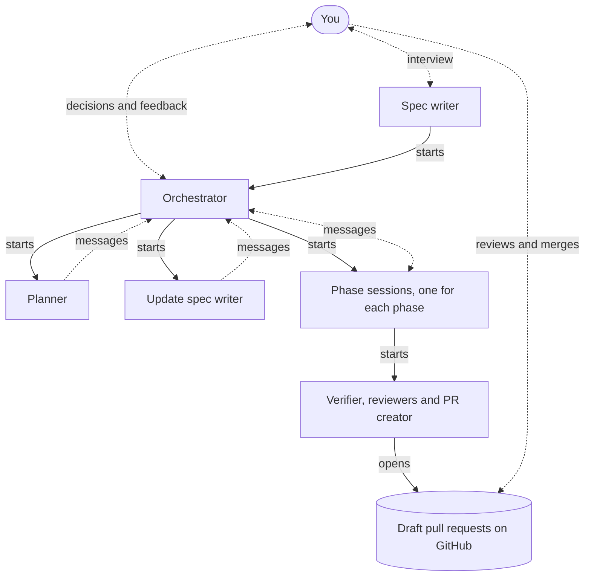
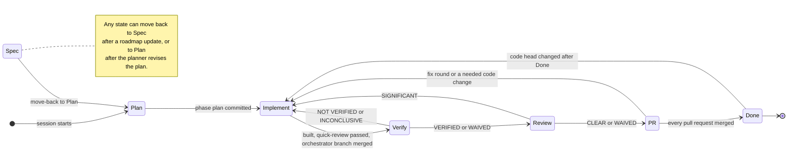
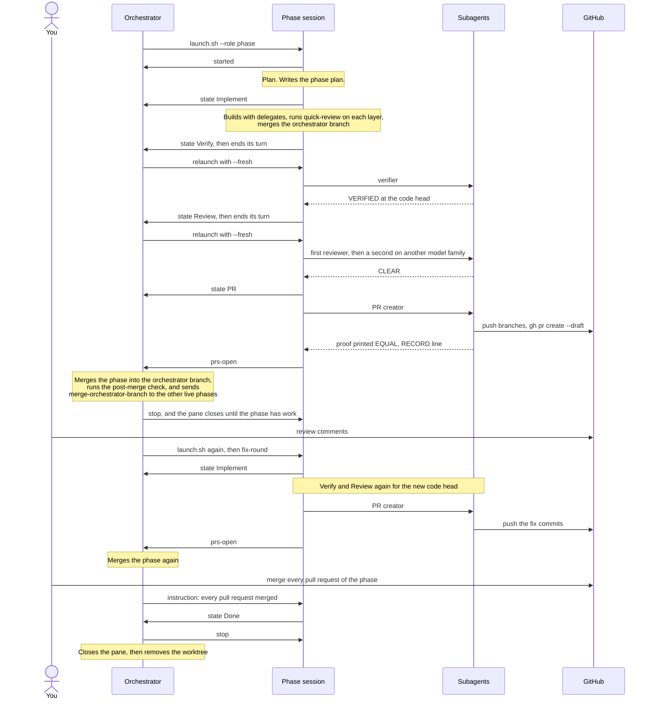
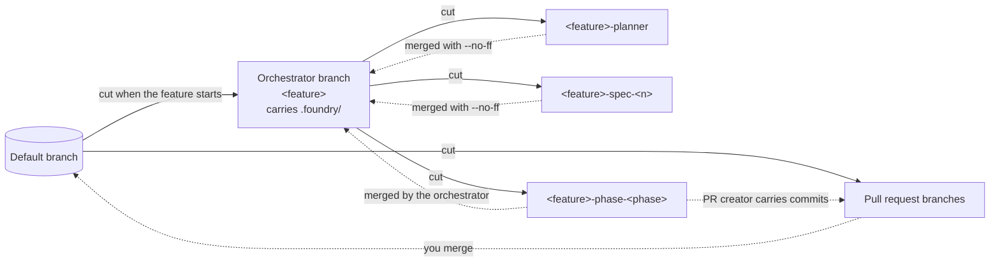

# s-stack guide

s-stack runs one large feature as a group of Claude Code sessions. Each session has one role, its own git worktree and its own tmux pane. The sessions plan the feature, build it in phases that run at the same time, check each phase with fresh agents, and open draft pull requests for you to review.

This guide explains how the parts fit together, then how to run a feature. The rules themselves live in the `sam-mode` skill and its handbooks. Each section below names the file that owns its rules, so you can read further.

| File | Owns |
| --- | --- |
| [`SKILL.md`](.apm/skills/sam-mode/SKILL.md) | The rules for every session: artefacts, states, branches, pull requests and decisions |
| [`references/status-and-messages.md`](.apm/skills/sam-mode/references/status-and-messages.md) | The status file, the code head, the merge rule, waivers and every message |
| [`handbooks/`](.apm/skills/sam-mode/handbooks/) | One handbook for each role |
| [`scripts/launch.sh`](.apm/skills/sam-mode/scripts/launch.sh) | Starting, closing and removing sessions, and placing their panes |
| [`assets/status-board.html`](.apm/skills/sam-mode/assets/status-board.html) | The status board page and its data schema |

## When to use it

Use s-stack for a large feature that splits into several phases, some of which can run at the same time.

Do not use it for a small patch or a minor bug fix. One Claude Code session in p-stack's `poteto-mode` handles those with far less overhead. s-stack builds on `poteto-mode` and replaces none of it. Every s-stack session reads `poteto-mode` for how to work, and its handbook adds only what is specific to s-stack.

## The roles

Four roles run as main sessions, each started by the launcher in its own pane. Three more run as subagents inside a phase session.

| Role | Kind | Does | Handbook |
| --- | --- | --- | --- |
| Spec writer | Main session | Interviews you and writes the feature roadmap. An update spec writer edits the approved roadmap later. | [`spec-writer.md`](.apm/skills/sam-mode/handbooks/spec-writer.md) |
| Orchestrator | Main session | Runs the feature. Starts sessions, merges finished phases, relays your decisions and feedback, and keeps the status board current. Never writes code. | [`orchestrator.md`](.apm/skills/sam-mode/handbooks/orchestrator.md) |
| Planner | Main session | Turns the roadmap into a feature plan of phases, each sized for one session | [`planner.md`](.apm/skills/sam-mode/handbooks/planner.md) |
| Phase session | Main session, one for each phase | Plans, builds and gates one phase, and alone changes its state | [`phase-session.md`](.apm/skills/sam-mode/handbooks/phase-session.md) |
| Verifier | Subagent of a phase session | Runs the phase's code and checks its behaviour | [`verifier.md`](.apm/skills/sam-mode/handbooks/verifier.md) |
| Reviewers | Subagents of a phase session | Try to break the change, on two model families | [`reviewer.md`](.apm/skills/sam-mode/handbooks/reviewer.md) |
| PR creator | Subagent of a phase session | Turns the verified phase into draft pull requests and keeps them current | [`pr-creator.md`](.apm/skills/sam-mode/handbooks/pr-creator.md) |

You talk to the spec writer and the orchestrator. Every other session sends its questions for you to the orchestrator. You can still type into any pane, and that session follows your instruction.

The diagram shows who starts whom, with solid arrows, and who talks to whom, with dotted arrows. Phase sessions may also message each other to settle an interface between their phases.



A message only wakes its receiver. It is never the record. A sender commits each fact to its own file first and then sends the message, so a lost message costs time and loses nothing. [`references/status-and-messages.md`](.apm/skills/sam-mode/references/status-and-messages.md#messages) lists every message kind.

## The phase lifecycle

Every phase moves through seven states: Spec, Plan, Implement, Verify, Review, PR and Done. A phase moves forward one state at a time and skips none. It can move back any number of states. Only the phase session changes its phase's state, by committing its status file and then sending the orchestrator a `state` message.

The phase session commits its first status file in Plan. A phase returns to Spec only after a roadmap update touches it, and it waits there until the planner has revised the plan.



The back edges come from these events.

| Event | Moves the phase back to | Owner |
| --- | --- | --- |
| The verifier returns NOT VERIFIED or INCONCLUSIVE | Implement | [`phase-session.md`](.apm/skills/sam-mode/handbooks/phase-session.md#verify) |
| The reviewers find a significant problem | Implement | [`phase-session.md`](.apm/skills/sam-mode/handbooks/phase-session.md#review) |
| You review a pull request, a check fails, or a conflict with the default branch reaches the phase | Implement | [`phase-session.md`](.apm/skills/sam-mode/handbooks/phase-session.md#fix-rounds) |
| Merging the orchestrator branch moves the code head while the phase is in Verify or later | Implement | [`phase-session.md`](.apm/skills/sam-mode/handbooks/phase-session.md#messages-from-the-orchestrator) |
| An instruction asks for a code change in Verify, Review, PR or Done | Implement | [`phase-session.md`](.apm/skills/sam-mode/handbooks/phase-session.md#instructions-from-the-developer) |
| A check on the orchestrator branch fails after the phase merged | Implement | [`orchestrator.md`](.apm/skills/sam-mode/handbooks/orchestrator.md#merging-a-phase) |
| A Done phase's branch gains commits that move its code head | Implement | [`orchestrator.md`](.apm/skills/sam-mode/handbooks/orchestrator.md#finishing-a-phase) |
| The planner revises the phase's plan entry | Plan | [`orchestrator.md`](.apm/skills/sam-mode/handbooks/orchestrator.md#starting-the-feature) |
| A roadmap update changes behaviour the phase builds | Spec, then Plan | [`orchestrator.md`](.apm/skills/sam-mode/handbooks/orchestrator.md#roadmap-updates) |

There is no blocked state. A phase that waits for an answer, a blocked merge or a `move-back` stays in its state and sets `waits_for` in its status file to one line saying what it waits for.

## One phase from start to finish

The sequence below follows one phase on the common path: no failed gate and one round of your review feedback. The message names are the ones [`references/status-and-messages.md`](.apm/skills/sam-mode/references/status-and-messages.md#messages) defines.



Two details in the sequence are easy to miss.

- **Fresh sessions at gate boundaries.** When a phase moves from Implement to Verify, or records a Verify or Review verdict, it ends its turn. The orchestrator relaunches it with `--fresh`, and the new conversation continues from the committed files. Each gate starts with a short context.
- **The orchestrator merges before you do.** Once a phase sends `prs-open` and its verdicts cover its current code head, the orchestrator merges the phase branch into the orchestrator branch and runs the checks in that merge's blast radius. Phases that start later build on that merged code. Only your merge of a pull request into the default branch counts as merged on the board.

## Where state lives

Every fact lives in a committed file or in live state that git, tmux or GitHub reports. A session that restarts reads the files again and continues.

### Files under `.foundry/`

Every file under `.foundry/` has one writer. Git tracks `.foundry/` on the orchestrator branch and on every branch cut from it, so a repository that uses s-stack must not ignore it. A pull request branch never contains it.

| Artefact | Path | Writer |
| --- | --- | --- |
| Feature roadmap | `.foundry/feature-roadmaps/<id>/` | Spec writer. The orchestrator writes only `run-decisions.md` in it. |
| Feature plan | `.foundry/plans/<id>/README.md` | Planner |
| Phase plan | `.foundry/plans/<id>/phases/<phase>.md` | That phase's session |
| Status file | `.foundry/plans/<id>/status/<phase>.md` | That phase's session |
| Evidence file | `.foundry/plans/<id>/status/<phase>-evidence.md` | That phase's session |
| Tracker | `.foundry/plans/<id>/status/orchestrator.md` | Orchestrator |

`<id>` is the roadmap's directory name, `<date-time>-<feature>`. `run-decisions.md` records the decisions you make during the run. Each row amends the roadmap until a roadmap update folds it in.

A status file starts with a YAML header that a program can read: the state, the code head, every verdict, every pull request, open decision requests and the decisions made for the phase. The orchestrator reads each status file through git, with `git show <phase branch>:<path>`, so no session reads outside its own worktree.

### Branches and worktrees



- The first spec writer and the orchestrator share the feature worktree, on the orchestrator branch. The planner, each update spec writer and each phase session get a worktree and branch of their own, which the launcher creates with workmux.
- The PR creator cuts pull request branches from the default branch, or from the branch of the pull request they depend on. They hold the phase's commits and never `.foundry/`.
- No session pushes the orchestrator branch, or a branch cut from it, to a public remote unless you say so. Only the PR creator pushes, and only pull request branches.
- s-stack never assumes the default branch is `main`. It resolves the name from the repository.

### Panes

The launcher places every pane in the feature's tmux window. The orchestrator holds the first column after the workmux sidebar. Spec writers stack in its column, and every other session opens to its right, as in this example. The launcher tags each pane it starts with the session's name, and never splits a pane that is not tagged, so your own panes stay where you put them.

```text
+---------+--------------------+--------------------+
| workmux | <feature>-         | <feature>-planner  |
| sidebar | orchestrator       +--------------------+
|         |                    | <feature>-phase-a  |
|         +--------------------+--------------------+
|         | <feature>-spec-1   | <feature>-phase-b  |
+---------+--------------------+--------------------+
```

When the window has no room for another pane, the launcher exits with code 4 and the orchestrator starts the session once a pane closes.

### The status board and the architecture page

The orchestrator publishes two private pages for each feature and records their addresses in the tracker.

- **The status board** shows how the work is going. The orchestrator publishes it once from [`assets/status-board.html`](.apm/skills/sam-mode/assets/status-board.html) and then updates only its database, in one batch each tick. Every value comes from a status file, workmux's status or a pull request's live state.
- **The architecture page** shows what is being built: a map of the system, its components, data model and main flows, each part marked as planned or built. A fresh subagent writes it and updates it after each phase merge that passes its check.

The board has six sections.

| Section | Shows |
| --- | --- |
| Needs you | Decision requests and permission prompts waiting on you |
| Ready for your review | Draft pull requests, ordered so that each comes after the pull requests it depends on |
| Pull requests | Every pull request with its state, checks, base and whether it needs an update |
| Phases | Each phase's place in the seven states, its session and a dependency map |
| Recent changes | The last 20 state changes |
| Heartbeat | When the orchestrator last ticked. The board marks itself stale after 40 minutes without a tick. |

## The gates

A phase reaches PR only after two gates, each run by fresh subagents that did not build the phase.

### The code head and the merge rule

A verdict covers one code head. The code head is the newest commit on the phase branch that changes a file outside `.foundry/`. A commit that only records status leaves it where it is, and so does a clean merge of the orchestrator branch, because the merged code already passed its own gates. Generated paths and lines that the feature plan names, such as lockfiles and `version:` lines, also leave it where it is.

The merge rule decides when a phase may move to PR. The newest `verify` verdict must be VERIFIED or WAIVED, the newest `review` verdict must be CLEAR or WAIVED, and both must name the current code head. [`references/status-and-messages.md`](.apm/skills/sam-mode/references/status-and-messages.md#status-files) gives the exact command that computes the code head.

### Verify

The verifier runs the phase's real code the way its user would and checks it against the roadmap and the plans. It may edit verification code only, never product code.

- It works out the blast radius, which is every check whose files the phase's changes since the last VERIFIED code head touch, and runs those checks from every phase's check file.
- It adds the phase's own checks to `checks/<phase>.md` in the feature's verification skill. A `## Rerun` section holds cheap, repeatable checks that later merges run again. An `## Evidence` section holds costly checks that only the phase's own verifier runs.
- It adds formal verification where the phase adds concurrency, retries, a state machine or a parser.
- It checks prose that an agent follows, such as a skill or a handbook, with a cold read by a fresh subagent against an answer written down before the run.

| Verdict | Means | Next state |
| --- | --- | --- |
| VERIFIED | Every check ran and none failed | Review |
| WAIVED | The change passes the waiver rule, and nothing ran | Review |
| NOT VERIFIED | At least one check failed | Implement |
| INCONCLUSIVE | No check failed, but at least one could not run | Implement |

The owner is [`verifier.md`](.apm/skills/sam-mode/handbooks/verifier.md).

### Review

Reviewers try to break the change through p-stack's `interrogate` skill. They see the change and the repository, and nothing under `.foundry/`. The code must explain itself, and a part that a reader cannot follow without the plan is itself a finding.

The phase session starts one reviewer first, which may waive. When it reviews, a second reviewer on another model family joins. A finding is significant only when a run shows that the change crashes, gives a wrong result, loses data, opens a security hole, breaks a documented contract or the repository's checks, or leads an agent to the wrong action. A preference between two working designs is not significant. One significant finding makes the verdict SIGNIFICANT and sends the phase back to Implement. Otherwise it is CLEAR.

The owner is [`reviewer.md`](.apm/skills/sam-mode/handbooks/reviewer.md).

### Waivers

A gate may return WAIVED instead of running when its brief allows a waiver and the change alters nothing that a user, a program or an agent reading the file would act on differently.

| Waivable | Never waivable |
| --- | --- |
| Generated files only | Any change to logic or control flow |
| Formatting, import order or a linter's auto-fix | A change to a public interface or contract |
| A complete rename of a local variable or private function | A dependency added or bumped by hand |
| Comments, docstrings, log wording | Authentication, permissions, secrets, input handling or the commands the code runs |
| A small, isolated change whose whole effect the agent can state from the diff | A test change that alters an expected result |
| | A change to a prompt, skill or handbook |

A waiver counts only when the gate's last verdict that was not a waiver passed. The next real Verify or Review covers everything since the last one that ran. The full rule is in [`references/status-and-messages.md`](.apm/skills/sam-mode/references/status-and-messages.md#status-files).

### Checks after a phase merges

When the orchestrator merges a phase into the orchestrator branch, a fresh subagent runs the checks in that merge's blast radius. If a check fails, the orchestrator branch freezes: no new phase starts and no other phase merges until the failing check passes on a new merge of the same phase. The phase moves back to Implement to fix it. When the last phase merges, a subagent runs the whole verification skill. When every phase is Done, it runs again unless a full run has passed since the last phase merge.

The orchestrator merges at most one phase each tick, so a failing check always points at one change. [`orchestrator.md`](.apm/skills/sam-mode/handbooks/orchestrator.md#merging-a-phase) owns the procedure.

### Pull requests

The PR creator turns the phase into pull requests that together hold exactly the verified diff, because you review the pull requests and not the phase branch.

- Every pull request is a draft. s-stack never marks one ready for review and never merges one. You do both.
- Each pull request is one atomic change within the repository's scope and size rules. In Foundry, section 11 of the `coding-style` package's software engineering rules caps a pull request at 2,500 hand-written changed lines against its base.
- A pull request with one open dependency joins that pull request's `gh stack` when nothing else is stacked on it. One with several open dependencies targets the default branch and carries their changes until they merge.
- A script proves that the pull requests equal the phase diff before anything is pushed. Nothing is pushed unless the proof prints `EQUAL`.
- The PR creator never force-pushes, and pushes only pull request branches.
- When the default branch moves or a dependency merges, the PR creator refreshes each branch with a merge commit, so every push is a fast-forward.

You may add commits to a pull request branch, use **Update branch** and leave comments. The phase takes your commits back into the phase branch and passes both gates again. Do not amend, squash or rebase a pull request branch, including with **Update with rebase**: every later round stops until you have said whether the rewritten branch holds edits of yours.

The owners are [`pr-creator.md`](.apm/skills/sam-mode/handbooks/pr-creator.md) and [`references/pr-commands.md`](.apm/skills/sam-mode/references/pr-commands.md).

## Running while you are away

s-stack defines no separate unattended mode and no rules for usage limits. Once you approve the roadmap, the orchestrator runs on its own and asks you only for real decisions. These rules keep it going.

- **The tick.** The orchestrator arms a recurring Claude Code scheduled task every 20 minutes, off the hour and half hour. Each tick reconciles every status file, session and pull request, merges the default branch, starts phases whose dependencies are met, merges at most one phase, puts new decisions to you, sends fix rounds and updates the board. A scheduled task fires only while the orchestrator runs and is idle, and expires after seven days, so the orchestrator creates it again at every start.
- **Short contexts.** At the end of every sixth tick, the orchestrator relaunches itself with a fresh conversation. Phase sessions start fresh at each gate boundary.
- **Stalled sessions.** The orchestrator judges a session by its commits and pull request activity. A session that still has work, waits for nothing, and has made no commit or pull request change for two ticks gets `stop`, then a fresh relaunch, then every message it left unanswered.
- **Restarts.** The launcher resumes a session's last conversation. Every session reads its committed files again before it continues, and the orchestrator resends unanswered messages.
- **Permission prompts.** The orchestrator sends you a push notification naming the pane and the action, and lists the prompt under **Needs you**. Only you approve it, in that pane.

Run every session of a feature in the same permission mode. Claude Code holds a message for approval when the receiver runs in a bypass mode and the sender does not.

## How to use it

### Requirements

- Claude Code 2.1.224 or later, with cross-session messaging.
- tmux and workmux.
- The GitHub CLI with `gh stack`, which the PR creator uses to link stacked pull requests.
- git 2.43 or later, for the PR creator's script.
- A repository that does not ignore `.foundry/`.

### Install

```bash
apm install Samuel-Harris/foundry/packages/s-stack#^0.1.0 --target cursor,claude,copilot
```

The install brings in s-stack's dependencies: `p-stack`, `deep-interview`, `review`, `pr`, `planning` and `coding-style`. Only Claude Code can run the workflow, because it needs cross-session messaging.

### Start a feature

1. Start Claude Code inside tmux, at the repository root.
2. Run `/sam-mode start <feature>`, where `<feature>` is a kebab-case name. The name must not contain `-phase-` or end with `-phase`, `-planner`, `-orchestrator`, `-spec` or `-spec-<n>`, and the launcher refuses one that does.
3. The launcher creates the feature worktree and its workmux window from the default branch, and starts the spec writer there.
4. Answer the spec writer's interview. It asks about every one-way door and every ambiguity, then writes the roadmap and tells you where its `README.md` is.
5. Read the roadmap and ask for changes. When you approve it explicitly, the spec writer starts the orchestrator and stops. You can close the spec writer's pane.

From there the orchestrator starts the planner, then each phase as its dependencies are met. You never start the other roles yourself. The launcher types each session's first prompt, in the form `/sam-mode <role> feature=<feature> phase=<phase> ...`.

### What you watch

- **The status board.** The orchestrator records its address in the tracker. Start with **Needs you** and **Ready for your review**.
- **The orchestrator's pane.** The orchestrator reports only when something needs you.
- **The draft pull requests.** Review them in the order the board gives. Comment, or add commits on top.

### What you decide

| You decide | Where |
| --- | --- |
| The roadmap, and when it is approved | The spec writer's pane |
| Every one-way door, and product or preference calls | The orchestrator relays each decision request with its options and a recommendation |
| A change to the roadmap | Ask the orchestrator. It starts an update spec writer in its column. |
| Permission prompts | The pane named in the notification |
| Histories the handbooks do not handle, such as a pull request closed without merging | The orchestrator sends a decision request and pauses the phases it touches |
| Marking pull requests ready and merging them | GitHub |
| Pushing the orchestrator branch to a public remote | Tell the orchestrator |

Merge mechanics, retries and fix rounds never reach you. When every phase is Done and the whole verification skill passes, the orchestrator updates the architecture page, closes every pane it started, removes the remaining worktrees and tells you the feature is complete.
